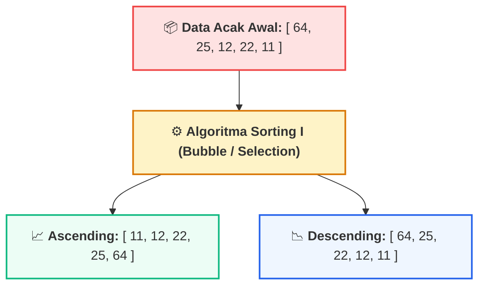
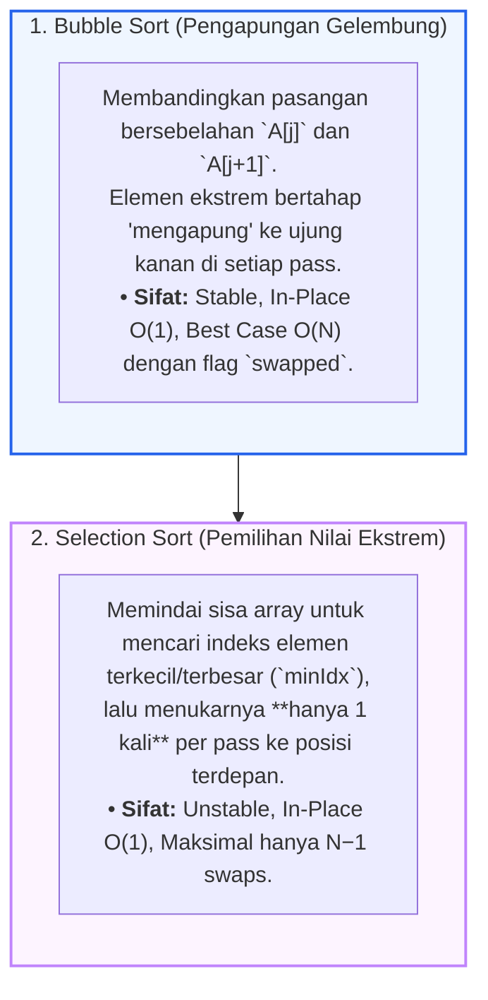

# 📘 Minggu 13: Algoritma Pengurutan Sederhana (Sorting I: Bubble & Selection Sort)

## 🎯 Capaian Pembelajaran (Sub-CPMK 6)
Setelah mempelajari modul ini, mahasiswa diharapkan mampu:
1. Memahami hakikat pengurutan data (*Sorting*), mekanisme pertukaran elemen (**Swap**), serta konsep **In-Place Memory** dan **Kestabilan (*Stability*)**.
2. Memahami cara kerja pass perulangan luar (*outer pass*) dan perulangan dalam (*inner pass*) pada **Bubble Sort (dengan optimasi Early Exit)** dan **Selection Sort**.
3. Membuktikan penurunan matematis deret aritmatika jumlah perbandingan `N(N−1) ÷ 2 ⟹ O(N²)`.
4. Menyusun **Trace Table (Tabel Penelusuran Pergeseran Data)** langkah demi langkah untuk pengurutan **Ascending** dan **Descending**.
5. Mengimplementasikan Bubble Sort dan Selection Sort menggunakan C++ dan Python 3.

---

## 1. Hakikat Pengurutan & Mekanisme Swap

**Pengurutan (*Sorting*)** adalah proses menyusun kembali sekumpulan elemen data acak ke dalam urutan terstruktur, baik **Menaik (*Ascending*: kecil → besar)** maupun **Menurun (*Descending*: besar → kecil)**:



### Operasi Inti: Pertukaran (*Swap*)
Pada kedua algoritma di modul ini, elemen berpindah posisi melalui operasi **swap** (membutuhkan 1 variabel sementara di C++, atau *tuple unpacking* di Python):

```cpp
// C++ Standar (atau gunakan std::swap(a, b))
int sementara = a;
a = b;
b = sementara;
```
```python
# Python Tuple Unpacking Swap (tanpa variabel temp eksplisit)
data[i], data[j] = data[j], data[i]
```

---

## 2. Bubble Sort vs Selection Sort



::: info 📐 Formula: Penurunan Matematis Deret Aritmatika O(N²)
> Total perbandingan maksimum pada Bubble Sort & Selection Sort:
>
> **`Total Komparasi = (N − 1) + (N − 2) + ... + 2 + 1`**
>
> **`Total = [ (N − 1) × N ] ÷ 2 = (N² − N) ÷ 2  ⟹  O(N²)`**
:::

---

## 3. Trace Table Dry Run (Ascending)

Data Awal: `[ 64, 25, 12, 22, 11 ]` (`N = 5`)

### A. Trace Table Bubble Sort
| Pass ke- | Pasangan Dibandingkan | Swap Terjadi? | Status Array Setelah Pass | Elemen Terkunci |
| :---: | :--- | :---: | :--- | :---: |
| **Pass 1** | (64,25) → (64,12) → (64,22) → (64,11) | 4× | `[ 25, 12, 22, 11, `**`64`**` ]` | **64** di indeks 4 |
| **Pass 2** | (25,12) → (25,22) → (25,11) | 3× | `[ 12, 22, 11, `**`25`**`, `**`64`**` ]` | **25** di indeks 3 |
| **Pass 3** | (12,22) → (22,11) | 1× | `[ 12, 11, `**`22`**`, `**`25`**`, `**`64`**` ]` | **22** di indeks 2 |
| **Pass 4** | (12,11) | 1× | `[ `**`11`**`, `**`12`**`, `**`22`**`, `**`25`**`, `**`64`**` ]` | **Terurut penuh** |

### B. Trace Table Selection Sort
| Pass ke- | Posisi Target `i` | Nilai Minimum Ditemukan (`minIdx`) | Operasi Swap | Status Array Setelah Pass |
| :---: | :---: | :---: | :---: | :--- |
| **Pass 1** | `i = 0` (`64`) | `11` di indeks `4` | `A[0] ↔ A[4]` | `[ `**`11`**`, 25, 12, 22, 64 ]` |
| **Pass 2** | `i = 1` (`25`) | `12` di indeks `2` | `A[1] ↔ A[2]` | `[ `**`11, 12`**`, 25, 22, 64 ]` |
| **Pass 3** | `i = 2` (`25`) | `22` di indeks `3` | `A[2] ↔ A[3]` | `[ `**`11, 12, 22`**`, 25, 64 ]` |
| **Pass 4** | `i = 3` (`25`) | `25` di indeks `3` | Tidak swap | `[ `**`11, 12, 22, 25, 64`**` ]` |

*Perhatikan:* Bubble Sort melakukan **9× swap**, sedangkan Selection Sort hanya melakukan **3× swap** pada dataset yang sama!

---

## 4. Implementasi Kode Hands-on Dual-Stack (C++ & Python 3)

Berikut implementasi **Bubble Sort** dan **Selection Sort** yang mendukung mode **Ascending** maupun **Descending**:

::: code-group
```cpp [C++]
#include <iostream>
#include <utility>

using namespace std;

void cetakArray(const int arr[], int n, const string& label) {
    cout << label << ": [ ";
    for (int i = 0; i < n; i++) cout << arr[i] << (i < n - 1 ? ", " : " ");
    cout << "]" << endl;
}

// 1. Bubble Sort dengan Optimasi Early-Exit Flag & Opsi Arah
void bubbleSort(int arr[], int n, bool ascending = true) {
    for (int i = 0; i < n - 1; i++) {
        bool adaPertukaran = false;
        for (int j = 0; j < n - i - 1; j++) {
            bool perluTukar = ascending ? (arr[j] > arr[j + 1]) : (arr[j] < arr[j + 1]);
            if (perluTukar) {
                swap(arr[j], arr[j + 1]);
                adaPertukaran = true;
            }
        }
        // Early exit: hentikan iterasi jika tidak ada swap sama sekali
        if (!adaPertukaran) break;
    }
}

// 2. Selection Sort dengan Minimalisasi Operasi Swap & Opsi Arah
void selectionSort(int arr[], int n, bool ascending = true) {
    for (int i = 0; i < n - 1; i++) {
        int targetIdx = i;
        for (int j = i + 1; j < n; j++) {
            bool lebihCocok = ascending ? (arr[j] < arr[targetIdx]) : (arr[j] > arr[targetIdx]);
            if (lebihCocok) {
                targetIdx = j;
            }
        }
        if (targetIdx != i) {
            swap(arr[i], arr[targetIdx]);
        }
    }
}

int main() {
    cout << "==================================================" << endl;
    cout << "   SORTING I: BUBBLE & SELECTION SORT (C++)       " << endl;
    cout << "==================================================" << endl;

    int raw1[] = {64, 25, 12, 22, 11};
    int raw2[] = {64, 25, 12, 22, 11};
    int n = 5;

    cetakArray(raw1, n, "Data Acak Awal          ");
    cout << "--------------------------------------------------" << endl;

    bubbleSort(raw1, n, true);
    cetakArray(raw1, n, "1. Bubble Sort (Asc)    ");

    selectionSort(raw2, n, false);
    cetakArray(raw2, n, "2. Selection Sort (Desc)");
    cout << "==================================================" << endl;

    return 0;
}
```

```python [Python 3]
def bubble_sort(arr: list, ascending: bool = True) -> list:
    """Bubble Sort dengan optimasi early-exit flag."""
    data = arr.copy()
    n = len(data)
    for i in range(n - 1):
        swapped = False
        for j in range(n - i - 1):
            perlu_tukar = data[j] > data[j + 1] if ascending else data[j] < data[j + 1]
            if perlu_tukar:
                data[j], data[j + 1] = data[j + 1], data[j]
                swapped = True
        if not swapped:
            break
    return data


def selection_sort(arr: list, ascending: bool = True) -> list:
    """Selection Sort: maksimal N - 1 kali swap."""
    data = arr.copy()
    n = len(data)
    for i in range(n - 1):
        target_idx = i
        for j in range(i + 1, n):
            lebih_cocok = data[j] < data[target_idx] if ascending else data[j] > data[target_idx]
            if lebih_cocok:
                target_idx = j
        if target_idx != i:
            data[i], data[target_idx] = data[target_idx], data[i]
    return data


def main() -> None:
    print("=" * 50)
    print("   SORTING I: BUBBLE & SELECTION SORT (PYTHON 3)  ")
    print("=" * 50)

    data_acak = [64, 25, 12, 22, 11]
    print(f"Data Acak Awal           : {data_acak}")
    print("-" * 50)
    print(f"1. Bubble Sort (Asc)     : {bubble_sort(data_acak, ascending=True)}")
    print(f"2. Selection Sort (Desc) : {selection_sort(data_acak, ascending=False)}")
    print("=" * 50)


if __name__ == "__main__":
    main()
```
:::

---

## 5. Rangkuman & Latihan Mandiri

::: tip 💡 Rangkuman Konsep Kunci
1. **Bubble Sort:** Sederhana dan bersifat *stable*; dengan flag `swapped`, kasus terbaik (*already sorted*) berjalan dalam `O(N)`.
2. **Selection Sort:** Mengurangi penulisan ke memori secara signifikan karena hanya melakukan maksimal `N − 1` pertukaran (*swap*), namun tidak *stable* dan selalu `O(N²)`.
3. **Lanjutan Minggu 14:** Insertion Sort, komparasi empiris ketiga metode sorting, serta pengantar kompleksitas Big-O dibahas pada **[Minggu 14: Sorting II & Pengantar Big-O](./sorting-lanjut-big-o.md)**.
:::

### 📝 Tugas Praktikum 9 (Mandiri)
1. **Trace Table Descending:** Susunlah *Trace Table* langkah demi langkah (setiap pass dan pergeseran elemen) untuk mengurutkan array `[ 18, 7, 42, 15, 29 ]` secara **Descending** menggunakan **Bubble Sort** dan **Selection Sort**.
2. **Penghitung Pertukaran (*Swap Counter*):** Modifikasi fungsi `bubbleSort` dan `selectionSort` agar mengembalikan jumlah perbandingan dan jumlah swap yang terjadi pada input `[ 5, 4, 3, 2, 1 ]`.
