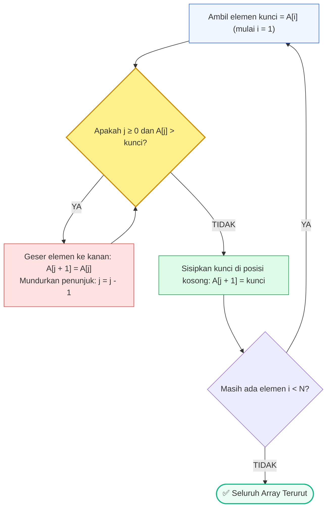

# 📘 Minggu 14: Algoritma Pengurutan Lanjut (Sorting II: Insertion Sort & Pengantar Big-O)

## 🎯 Capaian Pembelajaran (Sub-CPMK 6)
Setelah mempelajari modul ini, mahasiswa diharapkan mampu:
1. Menguasai mekanisme pergeseran (*shifting*) pada **Insertion Sort** dan memahami sifat **Adaptabilitas** serta **Kestabilan (*Stability*)**-nya.
2. Menyusun **Trace Table** langkah demi langkah untuk Insertion Sort pada data acak maupun data hampir terurut.
3. Membandingkan kinerja **Bubble Sort, Selection Sort, dan Insertion Sort** berdasarkan **jumlah operasi perbandingan dan pertukaran/pergeseran**.
4. Memahami pengantar sistematis **Notasi Big-O (Time Complexity & Space Complexity)** serta posisi algoritma `O(N²)` dibandingkan algoritma lanjut `O(N log N)`.

---

## 1. Insertion Sort: Analogi Menyusun Kartu Remi

**Insertion Sort** membagi array menjadi dua bagian konseptual: bagian **kiri yang sudah terurut** (dimulai dari 1 elemen `A[0]`) dan bagian **kanan yang belum terurut**. Setiap elemen baru (`kunci`) diambil satu per satu lalu digeser ke kiri hingga menempati posisi yang tepat:



### Trace Table Insertion Sort (Ascending)
Data Awal: `[ 25, 64, 12, 22, 11 ]`

| Iterasi `i` | Nilai `kunci` | Elemen yang Digeser ke Kanan | Posisi Sisip | Status Array Setelah Iterasi |
| :---: | :---: | :--- | :---: | :--- |
| **`i = 1`** | `64` | Tidak ada (`25 < 64`) | Indeks `1` | `[ `**`25, 64`**`, 12, 22, 11 ]` |
| **`i = 2`** | `12` | `64`, lalu `25` | Indeks `0` | `[ `**`12, 25, 64`**`, 22, 11 ]` |
| **`i = 3`** | `22` | `64`, lalu `25` | Indeks `1` | `[ `**`12, 22, 25, 64`**`, 11 ]` |
| **`i = 4`** | `11` | `64`, `25`, `22`, lalu `12` | Indeks `0` | `[ `**`11, 12, 22, 25, 64`**` ]` |

---

## 2. Pengantar Notasi Big-O: Time & Space Complexity

**Notasi Big-O** mengukur **laju pertumbuhan** kebutuhan waktu (*Time Complexity*) atau memori tambahan (*Space Complexity*) suatu algoritma ketika ukuran input `N` bertambah sangat besar:

| Kelas Kompleksitas | Nama Pertumbuhan | Estimasi Operasi (`N = 1.000`) | Contoh Algoritma di Mata Kuliah Ini |
| :---: | :--- | :---: | :--- |
| **`O(1)`** | Konstan | `1` | Akses indeks array `A[i]`, operasi aritmatika |
| **`O(log N)`** | Logaritmik | `~10` | **Binary Search** pada array terurut |
| **`O(N)`** | Linier | `1.000` | **Linear Search**, Traversal Min/Max, Best Case Bubble/Insertion Sort |
| **`O(N log N)`** | Linearitmik | `~10.000` | *Merge Sort*, *Quick Sort* (algoritma sorting skala besar) |
| **`O(N²)`** | Kuadratik | `1.000.000` | **Bubble, Selection, Insertion Sort** (Average & Worst Case), Nested Loop |

### Aturan Penyederhanaan Big-O:
1. **Abaikan konstanta pengali:** `3N²` disederhanakan menjadi `O(N²)`.
2. **Ambil suku berorde tertinggi:** `(N² − N) / 2` disederhanakan menjadi `O(N²)`.
3. **Space Complexity (*Auxiliary Space*):** Mengukur memori **tambahan** di luar array masukan. Ketiga sorting dasar (`Bubble`, `Selection`, `Insertion`) hanya memakai beberapa variabel bantu (`i, j, kunci, swapped`), sehingga memiliki **Space Complexity `O(1)` (*In-Place*)**.

---

## 3. Komparasi Kinerja 3 Metode Sorting

| Algoritma | Best Case | Average Case | Worst Case | Space Complexity | Kestabilan | Karakteristik Operasi |
| :--- | :---: | :---: | :---: | :---: | :---: | :--- |
| **Bubble Sort (Optimized)** | **`O(N)`** | `O(N²)` | `O(N²)` | **`O(1)`** | **Stable** | Banyak *swap* bersebelahan; berhenti dini jika sudah terurut |
| **Selection Sort** | `O(N²)` | `O(N²)` | `O(N²)` | **`O(1)`** | **Unstable** | Perbandingan selalu `N(N−1)/2`, namun *swap* maksimal hanya `N − 1` |
| **Insertion Sort** | **`O(N)`** | `O(N²)` | `O(N²)` | **`O(1)`** | **Stable** | Memakai *shifting* (bukan swap penuh); tercepat untuk data kecil / hampir terurut |

---

## 4. Implementasi Eksperimen Komparasi Dual-Stack (C++ & Python 3)

Program berikut menjalankan **Bubble Sort, Selection Sort, dan Insertion Sort** pada 3 skenario dataset (*Acak*, *Hampir Terurut*, dan *Terurut Terbalik*) sambil menghitung jumlah **perbandingan** serta **swap/pergeseran**:

::: code-group
```cpp [C++]
#include <iostream>
#include <vector>
#include <iomanip>
#include <utility>

using namespace std;

struct MetrikSort {
    string nama;
    long long perbandingan = 0;
    long long perpindahan = 0; // swap atau shift
};

MetrikSort ujiBubbleSort(vector<int> data) {
    MetrikSort m{"Bubble Sort (Opt)"};
    int n = data.size();
    for (int i = 0; i < n - 1; i++) {
        bool swapped = false;
        for (int j = 0; j < n - i - 1; j++) {
            m.perbandingan++;
            if (data[j] > data[j + 1]) {
                swap(data[j], data[j + 1]);
                m.perpindahan++;
                swapped = true;
            }
        }
        if (!swapped) break;
    }
    return m;
}

MetrikSort ujiSelectionSort(vector<int> data) {
    MetrikSort m{"Selection Sort   "};
    int n = data.size();
    for (int i = 0; i < n - 1; i++) {
        int minIdx = i;
        for (int j = i + 1; j < n; j++) {
            m.perbandingan++;
            if (data[j] < data[minIdx]) minIdx = j;
        }
        if (minIdx != i) {
            swap(data[i], data[minIdx]);
            m.perpindahan++;
        }
    }
    return m;
}

MetrikSort ujiInsertionSort(vector<int> data) {
    MetrikSort m{"Insertion Sort   "};
    int n = data.size();
    for (int i = 1; i < n; i++) {
        int kunci = data[i];
        int j = i - 1;
        while (j >= 0) {
            m.perbandingan++;
            if (data[j] > kunci) {
                data[j + 1] = data[j];
                m.perpindahan++;
                j--;
            } else {
                break;
            }
        }
        data[j + 1] = kunci;
    }
    return m;
}

void tampilkanKomparasi(const string& judul, const vector<int>& sampel) {
    cout << "\n--- Skenario: " << judul << " (N = " << sampel.size() << ") ---" << endl;
    vector<MetrikSort> hasil = {
        ujiBubbleSort(sampel),
        ujiSelectionSort(sampel),
        ujiInsertionSort(sampel)
    };
    cout << left << setw(20) << "Algoritma"
         << right << setw(15) << "Perbandingan"
         << setw(16) << "Swap / Geser" << endl;
    for (const auto& h : hasil) {
        cout << left << setw(20) << h.nama
             << right << setw(15) << h.perbandingan
             << setw(16) << h.perpindahan << endl;
    }
}

int main() {
    cout << "=====================================================" << endl;
    cout << "  BENCHMARK KOMPARASI 3 METODE SORTING (C++)         " << endl;
    cout << "=====================================================" << endl;

    tampilkanKomparasi("Data Acak", {64, 25, 12, 22, 11, 90, 34, 7});
    tampilkanKomparasi("Hampir Terurut", {11, 12, 22, 25, 34, 64, 90, 7});
    tampilkanKomparasi("Terurut Terbalik (Worst)", {90, 64, 34, 25, 22, 12, 11, 7});

    return 0;
}
```

```python [Python 3]
from typing import List, Tuple


def uji_bubble_sort(arr: List[int]) -> Tuple[str, int, int]:
    data = arr.copy()
    n = len(data)
    cmp_count = move_count = 0
    for i in range(n - 1):
        swapped = False
        for j in range(n - i - 1):
            cmp_count += 1
            if data[j] > data[j + 1]:
                data[j], data[j + 1] = data[j + 1], data[j]
                move_count += 1
                swapped = True
        if not swapped:
            break
    return ("Bubble Sort (Opt)", cmp_count, move_count)


def uji_selection_sort(arr: List[int]) -> Tuple[str, int, int]:
    data = arr.copy()
    n = len(data)
    cmp_count = move_count = 0
    for i in range(n - 1):
        min_idx = i
        for j in range(i + 1, n):
            cmp_count += 1
            if data[j] < data[min_idx]:
                min_idx = j
        if min_idx != i:
            data[i], data[min_idx] = data[min_idx], data[i]
            move_count += 1
    return ("Selection Sort   ", cmp_count, move_count)


def uji_insertion_sort(arr: List[int]) -> Tuple[str, int, int]:
    data = arr.copy()
    cmp_count = move_count = 0
    for i in range(1, len(data)):
        kunci = data[i]
        j = i - 1
        while j >= 0:
            cmp_count += 1
            if data[j] > kunci:
                data[j + 1] = data[j]
                move_count += 1
                j -= 1
            else:
                break
        data[j + 1] = kunci
    return ("Insertion Sort   ", cmp_count, move_count)


def main() -> None:
    print("=" * 54)
    print("  BENCHMARK KOMPARASI 3 METODE SORTING (PYTHON 3)    ")
    print("=" * 54)

    skenario = [
        ("Data Acak", [64, 25, 12, 22, 11, 90, 34, 7]),
        ("Hampir Terurut", [11, 12, 22, 25, 34, 64, 90, 7]),
        ("Terurut Terbalik (Worst)", [90, 64, 34, 25, 22, 12, 11, 7]),
    ]

    for judul, sampel in skenario:
        print(f"\n--- Skenario: {judul} (N = {len(sampel)}) ---")
        print(f"{'Algoritma':<20} {'Perbandingan':>14} {'Swap / Geser':>15}")
        for fn in (uji_bubble_sort, uji_selection_sort, uji_insertion_sort):
            nama, cmp_c, mov_c = fn(sampel)
            print(f"{nama:<20} {cmp_c:>14} {mov_c:>15}")


if __name__ == "__main__":
    main()
```
:::

---

## 5. Rangkuman & Latihan Mandiri

::: tip 💡 Rangkuman Konsep Kunci
1. **Insertion Sort:** Unggul di antara algoritma `O(N²)` untuk dataset kecil (`N < 20`) atau data yang hampir terurut karena langsung berhenti menyisir ke kiri saat elemen lebih kecil ditemukan (`Best Case O(N)`).
2. **Trade-Off Memori vs Waktu:** Ketiga algoritma `O(N²)` sangat hemat ruang (`Space Complexity O(1)`), sementara algoritma lebih cepat seperti *Merge Sort* (`O(N log N)`) memerlukan ruang tambahan `O(N)`.
3. **Kestabilan:** **Bubble Sort** dan **Insertion Sort** bersifat *stable*, sedangkan **Selection Sort** bersifat *unstable*.
:::

### 📝 Tugas Praktikum 10 (Laporan Analisis Komparasi)
1. **Eksperimen Ukuran Input (`N = 100` vs `N = 1.000`):** Jalankan benchmark ketiga algoritma di atas menggunakan angka acak berukuran `N = 100` dan `N = 1.000`. Catat kenaikan rasio jumlah perbandingan dan buktikan bahwa pertumbuhannya mendekati kuadratik (`10² = 100×` lipat).
2. **Kestabilan Multi-Kolom:** Buatlah array 5 mahasiswa (`Nama`, `IPK`), lalu urutkan berdasarkan `IPK` secara menurun (*Descending*) menggunakan **Insertion Sort**. Buktikan bahwa mahasiswa dengan `IPK` yang sama tetap mempertahankan urutan input awal.
