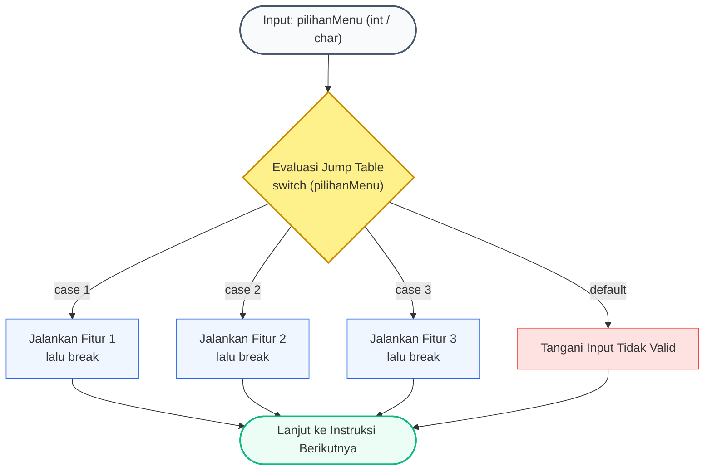
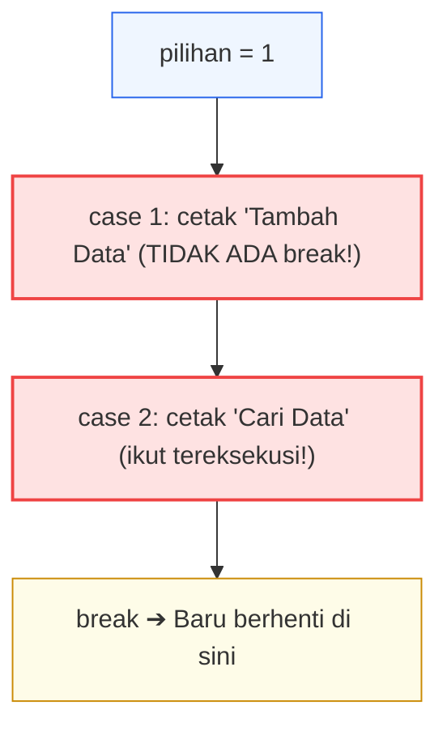

# 📘 Minggu 05: Percabangan Lanjut (`switch-case`) & Navigasi Menu CLI

## 🎯 Capaian Pembelajaran (Sub-CPMK 3)
Setelah mempelajari modul ini, mahasiswa diharapkan mampu:
1. Merancang struktur pemilihan diskrit menggunakan **`switch-case`** di C++ serta padanannya **`match-case`** (Structural Pattern Matching) di Python 3.10+.
2. Menganalisis mekanisme **Fall-Through Behavior**, fungsi wajib pernyataan **`break`**, dan penanganan kasus tak dikenal dengan **`default`**.
3. Membandingkan kinerja dan konteks penggunaan **`switch-case` (Jump Table `O(1)`)** versus **`if-else-if` (`O(n)`)**.
4. Membangun **sistem menu navigasi CLI interaktif** yang tangguh dan bersih untuk aplikasi konsol.

---

## 1. Struktur Pemilihan Diskrit (`switch-case` & `match-case`)

Ketika program perlu mencocokkan satu ekspresi diskrit (misalnya pilihan menu `1, 2, 3, 4` atau kode huruf `'A', 'B', 'C'`) terhadap banyak nilai konstanta, `switch-case` menawarkan struktur yang lebih deklaratif dan cepat daripada rantai `if-else-if` yang panjang:



### Komparasi Kinerja: `switch-case` vs `if-else-if`

| Dimensi Komparasi | `if-else-if` Bertingkat | `switch-case` Pemilihan |
| :--- | :--- | :--- |
| **Karakteristik Kondisi** | Ekspresi boolean arbitrer (`x > 10 && y < 5`, nilai `float`, rentang). | Nilai konstanta diskrit integral (`int`, `char`, `enum`) di C++; pola nilai di `match-case` Python 3.10+. |
| **Mekanisme Eksekusi Mesin** | *Linear Evaluation*: Memeriksa kondisi satu per satu dari atas ke bawah (`O(n)`). | **Jump Table / Binary Decision Tree (`O(1)`)**: CPU langsung melompat ke alamat memori label yang cocok. |
| **Kelebihan Utama** | Fleksibel untuk perbandingan rentang (`nilai >= 80`). | Sangat cepat dan rapi untuk menu CLI, parser token, dan *state machine*. |
| **Pernyataan `break`** | Tidak dibutuhkan. | **Wajib di C++** untuk mencegah eksekusi bocor ke `case` di bawahnya. |

---

## 2. Mekanisme *Fall-Through Behavior*

Di C++, setiap label `case` hanyalah penanda titik masuk (*entry point*). Tanpa kata kunci `break`, alur eksekusi akan **terus jatuh ke bawah (*fall-through*)** mengeksekusi isi `case` berikutnya tanpa memeriksa kondisi labelnya!



::: warning ⚠️ Fall-Through: Bug vs Disengaja
- **Sebagai Bug:** Lupa menulis `break` membuat beberapa fitur berjalan beruntun secara tidak diinginkan.
- **Sebagai Fitur Disengaja (Intentional Fall-Through):** Berguna saat beberapa nilai konstanta harus berbagi satu aksi yang sama (misal mengelompokkan hari kerja `'1'`–`'5'` atau huruf vokal `'a'`, `'i'`, `'u'`, `'e'`, `'o'`). Di C++17+, tuliskan atribut `[[fallthrough]];` secara eksplisit agar kompilator dan pembaca kode tahu hal tersebut disengaja.
:::

---

## 3. Desain Menu Navigasi CLI Interaktif

Aplikasi konsol standar industri menggabungkan struktur perulangan menu dengan pemilihan `switch-case` (atau `match-case`) serta validasi input defensif:
1. Tampilkan daftar opsi bernomor beserta deskripsi singkat dan opsi `0` untuk keluar.
2. Tangani kegagalan tipe input (misalnya pengguna mengetik huruf saat diminta angka) agar program tidak masuk ke *infinite loop*.
3. Pecah setiap aksi `case` ke dalam **fungsi terpisah** agar isi `switch-case` tetap ringkas dan mudah dipelihara (*Clean Code*).

---

## 4. Implementasi Kode Hands-on Dual-Stack (C++ & Python 3)

Berikut implementasi **Menu Navigasi Layanan Akademik CLI** yang memperagakan `switch-case` dengan *intentional fall-through* pada kategori hari operasional serta `match-case` di Python 3.10+:

::: code-group
```cpp [C++]
#include <iostream>
#include <limits>
#include <string>

using namespace std;

void tampilkanMenu() {
    cout << "\n==================================================" << endl;
    cout << "    MENU LAYANAN AKADEMIK INFORMATIKA UUI (CLI)   " << endl;
    cout << "==================================================" << endl;
    cout << "1. Cek Jadwal Layanan (Demo Intentional Fall-Through)" << endl;
    cout << "2. Hitung Konversi Nilai Huruf (Skala A >= 80)" << endl;
    cout << "3. Informasi Ruang Laboratorium" << endl;
    cout << "0. Keluar Program" << endl;
    cout << "--------------------------------------------------" << endl;
    cout << "Pilih menu [0-3]: ";
}

void cekJadwalLayanan() {
    int kodeHari;
    cout << "Masukkan kode hari (1=Senin .. 7=Minggu): ";
    if (!(cin >> kodeHari)) {
        cin.clear();
        cin.ignore(numeric_limits<streamsize>::max(), '\n');
        cout << "[ERROR] Kode hari harus berupa angka 1-7." << endl;
        return;
    }

    switch (kodeHari) {
        case 1:
        case 2:
        case 3:
        case 4:
            cout << "[BUKA] Layanan Akademik aktif pukul 08.00 - 16.00 WIB." << endl;
            break;
        case 5:
            cout << "[BUKA - JUMAT] Layanan aktif pukul 08.00 - 11.30 & 13.30 - 16.30 WIB." << endl;
            break;
        case 6:
        case 7:
            cout << "[TUTUP] Akhir pekan, layanan tatap muka libur." << endl;
            break;
        default:
            cout << "[PERINGATAN] Kode hari di luar rentang 1-7." << endl;
            break;
    }
}

void simulasiKonversiGrade() {
    double nilai;
    cout << "Masukkan nilai akhir (0-100): ";
    if (!(cin >> nilai) || nilai < 0.0 || nilai > 100.0) {
        cin.clear();
        cin.ignore(numeric_limits<streamsize>::max(), '\n');
        cout << "[ERROR] Nilai harus berada di rentang 0 - 100." << endl;
        return;
    }

    // Rentang kontinu tetap memakai if-else-if, bukan switch-case
    char grade = 'E';
    if (nilai >= 80.0) grade = 'A';
    else if (nilai >= 60.0) grade = 'B';
    else if (nilai >= 40.0) grade = 'C';
    else if (nilai >= 20.0) grade = 'D';

    cout << "Huruf Mutu Anda: " << grade << endl;
}

int main() {
    int pilihan = -1;

    do {
        tampilkanMenu();
        if (!(cin >> pilihan)) {
            cin.clear();
            cin.ignore(numeric_limits<streamsize>::max(), '\n');
            cout << "[ERROR] Masukkan angka menu yang valid!" << endl;
            continue;
        }

        switch (pilihan) {
            case 1:
                cekJadwalLayanan();
                break;
            case 2:
                simulasiKonversiGrade();
                break;
            case 3:
                cout << "[INFO] Lab Komputasi Dasar berada di Gedung FST Lantai 2." << endl;
                break;
            case 0:
                cout << "Terima kasih. Program ditutup." << endl;
                break;
            default:
                cout << "[PERINGATAN] Menu '" << pilihan << "' tidak tersedia." << endl;
                break;
        }
    } while (pilihan != 0);

    return 0;
}
```

```python [Python 3]
def tampilkan_menu() -> None:
    print("\n" + "=" * 50)
    print("    MENU LAYANAN AKADEMIK INFORMATIKA UUI (CLI)   ")
    print("=" * 50)
    print("1. Cek Jadwal Layanan (Demo Pattern Grouping)")
    print("2. Hitung Konversi Nilai Huruf (Skala A >= 80)")
    print("3. Informasi Ruang Laboratorium")
    print("0. Keluar Program")
    print("-" * 50)


def cek_jadwal_layanan() -> None:
    try:
        kode_hari = int(input("Masukkan kode hari (1=Senin .. 7=Minggu): "))
    except ValueError:
        print("[ERROR] Kode hari harus berupa angka 1-7.")
        return

    # Python 3.10+ match-case tidak memiliki implicit fall-through;
    # gunakan operator OR pattern '|' untuk mengelompokkan beberapa nilai.
    match kode_hari:
        case 1 | 2 | 3 | 4:
            print("[BUKA] Layanan Akademik aktif pukul 08.00 - 16.00 WIB.")
        case 5:
            print("[BUKA - JUMAT] Layanan aktif pukul 08.00 - 11.30 & 13.30 - 16.30 WIB.")
        case 6 | 7:
            print("[TUTUP] Akhir pekan, layanan tatap muka libur.")
        case _:
            print("[PERINGATAN] Kode hari di luar rentang 1-7.")


def simulasi_konversi_grade() -> None:
    try:
        nilai = float(input("Masukkan nilai akhir (0-100): "))
    except ValueError:
        print("[ERROR] Nilai harus berupa angka.")
        return

    if nilai < 0.0 or nilai > 100.0:
        print("[ERROR] Nilai harus berada di rentang 0 - 100.")
        return

    if nilai >= 80.0:
        grade = "A"
    elif nilai >= 60.0:
        grade = "B"
    elif nilai >= 40.0:
        grade = "C"
    elif nilai >= 20.0:
        grade = "D"
    else:
        grade = "E"

    print(f"Huruf Mutu Anda: {grade}")


def main() -> None:
    while True:
        tampilkan_menu()
        try:
            pilihan = int(input("Pilih menu [0-3]: "))
        except ValueError:
            print("[ERROR] Masukkan angka menu yang valid!")
            continue

        match pilihan:
            case 1:
                cek_jadwal_layanan()
            case 2:
                simulasi_konversi_grade()
            case 3:
                print("[INFO] Lab Komputasi Dasar berada di Gedung FST Lantai 2.")
            case 0:
                print("Terima kasih. Program ditutup.")
                break
            case _:
                print(f"[PERINGATAN] Menu '{pilihan}' tidak tersedia.")


if __name__ == "__main__":
    main()
```
:::

---

## 5. Rangkuman & Latihan Mandiri

::: tip 💡 Rangkuman Konsep Kunci
1. **`switch-case` untuk Nilai Diskrit:** Gunakan `switch-case` (atau `match-case` di Python 3.10+) untuk pencocokan nilai konstanta yang tetap; pertahankan `if-else-if` untuk perbandingan rentang atau kondisi boolean kompleks.
2. **Disiplin `break` & `default`:** Selalu tutup setiap blok `case` di C++ dengan `break` (kecuali pengelompokan nilai yang disengaja) dan sertakan `default` untuk menangani input tak terduga.
3. **CLI yang Tangguh:** Gabungkan loop menu dengan pembersihan buffer input (`cin.clear()` / `try-except ValueError`) agar menu navigasi tidak pernah crash.
:::

### 📝 Tugas Praktikum 5 (Mandiri)
1. **Menu Kalkulator Matematis CLI:** Buat aplikasi konsol interaktif dengan `switch-case` (C++) atau `match-case` (Python) yang memiliki menu: `(1)` Luas Persegi Panjang, `(2)` Luas Lingkaran, `(3)` Volume Tabung, dan `(0)` Keluar, lengkap dengan validasi nilai dimensi harus `> 0`.
2. **Konverter Kode Bulan:** Buat fungsi yang menerima angka bulan `1–12` dan mengelompokkannya menggunakan teknik *fall-through* / *OR-pattern* ke dalam jumlah hari bulan tersebut (31 hari, 30 hari, atau 28/29 hari untuk Februari).
