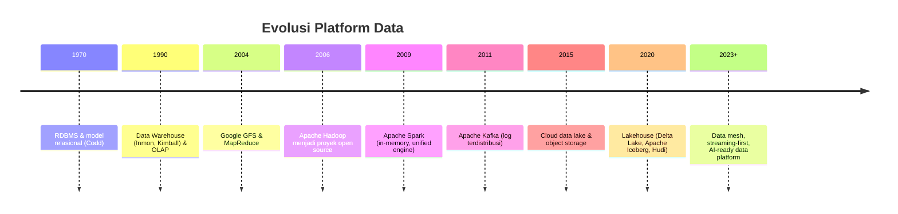
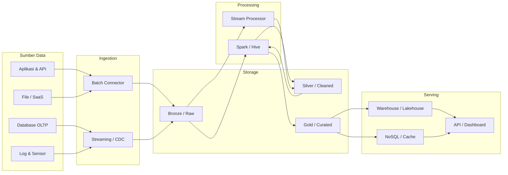
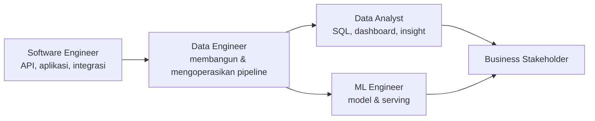

# Pertemuan 1: Fondasi & Lanskap Big Data

::: info 🎓 Bacaan Teori Wajib (Kelas RPL)
Baca **[Buku Teori Big Data — Pertemuan 1](/big-data/TEORI-RPL#p1)** sebelum praktik. Latihan teknis di modul ini adalah **pengayaan/verifikasi**; fokus utama adalah pemahaman konsep dan kemampuan menjelaskan trade-off.
:::

::: tip 🎙️ Slide Presentasi Interaktif
Buka **[slide presentasi Pertemuan 1](/presentasi/pertemuan-1-big-data)** — dilengkapi navigasi keyboard, timer, transkrip, dan narasi audio.
Untuk presentasi layar penuh, buka **[HTML interaktif](/Perkuliahan/presentasi/pertemuan-1-pengantar-big-data.html)** di tab baru.
:::

::: tip CAPAIAN PEMBELAJARAN (SUB-CPMK 1)
- **CPMK Terkait:** CPMK 1
- **CPL Terkait:** CPL01 (Pengetahuan), CPL03 (Problem Solving)
- **Indikator:** Mahasiswa mampu menjelaskan karakteristik 5V, menganalisis keterbatasan arsitektur relasional untuk beban data ekstrem, memetakan komponen arsitektur data modern, serta menghitung estimasi kapasitas penyimpanan dan memilih mode pemrosesan (batch/streaming) secara beralasan.
:::

---

## 1. Apa Itu Big Data?

**Big Data** bukan sekadar "data yang banyak". Big Data adalah kondisi ketika **volume, kecepatan, atau keragaman data melampaui kapasitas alat dan proses konvensional** untuk menangkap, menyimpan, mengelola, dan menganalisisnya dalam waktu yang wajar. Karena itu, Big Data lebih tepat dipahami sebagai **masalah arsitektur dan rekayasa**, bukan sekadar masalah kapasitas disk.

> **"Big data is data that exceeds the processing capacity of conventional database systems."**  
> — **Edd Dumbill**, *Planning for Big Data* (O'Reilly)

Definisi operasional untuk mata kuliah ini:

> Big Data adalah kumpulan teknik dan sistem terdistribusi untuk **menyerap, menyimpan, memproses, dan menyajikan data** yang volumenya besar, datang cepat, beragam format, dan/atau kualitasnya tidak seragam — dengan biaya dan waktu yang dapat dipertanggungjawabkan.

---

## 2. Karakteristik 5V (+2V)

| Karakteristik | Pertanyaan Kunci | Contoh | Implikasi Rekayasa |
| :--- | :--- | :--- | :--- |
| **Volume** | Seberapa besar data? | 50 TB log per bulan; 1 miliar transaksi/tahun | Butuh penyimpanan terdistribusi, kompresi, partisi, tiering |
| **Velocity** | Seberapa cepat data datang? | 100.000 event/detik; klik pengguna real-time | Butuh streaming, buffer, backpressure, consumer group |
| **Variety** | Seberapa beragam format/sumber? | JSON, CSV, Parquet, gambar, log, API, database | Butuh schema management, data lake, format terbuka |
| **Veracity** | Seberapa dapat dipercaya? | Data ganda, null, timestamp salah, bot | Butuh validasi, deduplikasi, data quality checks |
| **Value** | Apa nilai bisnisnya? | Rekomendasi, deteksi fraud, efisiensi operasional | Butuh metrik, tujuan analitik, evaluasi dampak |
| **Variability** | Apakah pola data berubah? | Lonjakan musim promo, skema berubah | Butuh desain yang lentur, versioning, monitoring |
| **Visualization** | Bagaimana dikomunikasikan? | Dashboard, laporan, API | Butuh lapisan serving dan visualisasi |

::: warning Miskonsepsi Umum
"Data kecil tapi cepat" (misalnya 5.000 transaksi/detik) bisa tetap menjadi masalah Big Data karena **velocity**-nya. Sebaliknya, arsip 100 TB yang jarang diakses mungkin cukup ditangani dengan object storage murah tanpa cluster komputasi besar. **Konteks penggunaan** menentukan arsitektur, bukan angka volume semata.
:::

---

## 3. Mengapa RDBMS Konvensional Tidak Selalu Cukup?

Relational Database Management System (RDBMS) tetap unggul untuk transaksi ACID, integritas referensial, dan query yang terstruktur. Namun, pada beban data ekstrem terdapat beberapa keterbatasan praktis:

| Aspek | RDBMS Konvensional | Kebutuhan Big Data |
| :--- | :--- | :--- |
| **Skala** | Umumnya *scale-up* (CPU/RAM/disk lebih besar) — mahal dan ada batas fisik | *Scale-out* horizontal dengan banyak node commodity |
| **Skema** | Skema ketat, perubahan butuh migrasi | Schema-on-read / evolusi skema untuk data beragam |
| **Beban tulis** | Optimal untuk OLTP; query analitik berat dapat mengganggu transaksi | Pemisahan OLTP dan OLAP; batch/streaming pipeline |
| **Format** | Didominasi data terstruktur | Teks, JSON, log, gambar, sensor, event stream |
| **Biaya** | Lisensi dan perangkat keras proprietary | Open source + object storage + komputasi elastis |
| **Toleransi kegagalan** | Failover bergantung konfigurasi, sering single point of failure | Replikasi dan recovery sebagai default |

> RDBMS tidak "mati". Arsitektur modern sering memakai RDBMS untuk **serving layer** (data yang sudah diolah) dan sistem terdistribusi untuk **pemrosesan skala besar**. Pilihan selalu trade-off.

---

## 4. Evolusi Arsitektur Data



### 4.1 Dari Data Warehouse ke Data Lake

| Generasi | Kekuatan | Kelemahan |
| :--- | :--- | :--- |
| **Data Warehouse** | Skema jelas, kualitas terjaga, query SQL cepat untuk BI | Mahal, kaku, sulit menampung data mentah/semi-terstruktur |
| **Data Lake** | Murah, fleksibel, menampung semua format | Rawan "data swamp": tanpa tata kelola, kualitas buruk, duplikasi |
| **Lakehouse** | Fleksibilitas lake + transaksi & tata kelola warehouse (ACID table format) | Kompleksitas operasional, butuh disiplin katalog & kompaksi |

### 4.2 Lapisan Arsitektur Data Modern



**Lapisan lintas-potong (cross-cutting):**

- **Orkestrasi:** penjadwalan, dependensi, retry, backfill (Airflow, Dagster).
- **Tata kelola:** katalog, lineage, ownership, klasifikasi data (DataHub, OpenMetadata).
- **Kualitas data:** validasi, profiling, alert (Great Expectations, dbt tests).
- **Keamanan:** autentikasi, otorisasi, enkripsi, masking, audit trail.
- **Observabilitas:** log, metrik, tracing, biaya per pipeline.
- **CI/CD:** version control, test otomatis, deployment pipeline.

---

## 5. Batch vs Streaming vs Micro-batch

| Aspek | Batch | Micro-batch | Streaming (event-by-event) |
| :--- | :--- | :--- | :--- |
| **Latensi** | Menit–jam | Detik–menit | Milidetik–detik |
| **Contoh alat** | Spark batch, Hive, MapReduce | Spark Structured Streaming (trigger) | Kafka Streams, Flink |
| **Kompleksitas** | Rendah | Sedang | Tinggi |
| **Cocok untuk** | Laporan harian, rekap, backfill | Dashboard near-real-time | Fraud detection, alerting, IoT |
| **Pola kegagalan** | Job gagal → rerun | Batch kecil gagal → retry | Butuh checkpoint, exactly-once |

**Aturan praktis:** mulailah dari batch. Tambahkan streaming hanya jika ada **kebutuhan latensi yang terukur** dan tim mampu mengoperasikannya.

---

## 6. Peran Profesional dalam Ekosistem Big Data (Kelas RPL)

Big Data bukan hanya milik data scientist. Di kelas RPL, peserta datang dengan latar belakang beragam — analis, staf IT, operasional, administrasi data, atau manajer — dan pengalaman itu menjadi bekal untuk memahami peran berikut:

| Peran | Tanggung Jawab Utama | Pengalaman yang Relevan |
| :--- | :--- | :--- |
| **Data Engineer** | Membangun & mengoperasikan pipeline | Integrasi sistem, SQL, otomasi laporan |
| **Data Analyst** | Menerjemahkan data menjadi insight | Laporan, dashboard, analisis bisnis |
| **Software Engineer** | API, aplikasi, integrasi layanan | Pengembangan aplikasi, testing |
| **ML Engineer** | Model & serving | Analitik, statistik, pemrograman |
| **Data Steward/Owner** | Kualitas, definisi, tata kelola | Kepemilikan proses bisnis |

### Peran dalam Tim Data



Di banyak organisasi, satu orang memegang beberapa peran sekaligus. Yang penting bukan jabatannya, tetapi kemampuan **membaca masalah, memilih pendekatan, dan menjelaskan trade-off**. Pengalaman kerja Anda di salah satu peran di atas adalah modal untuk memahami materi ini, bukan kekurangan.

> **Refleksi RPL:** peran mana yang paling dekat dengan pekerjaan Anda? Kompetensi apa yang sudah Anda miliki, dan kompetensi apa yang ingin Anda kuatkan melalui mata kuliah ini?

---

## 7. Studi Kasus Industri

| Domain | Sumber Data | Volume/Tempo | Nilai |
| :--- | :--- | :--- | :--- |
| **E-commerce** | Klik, keranjang, transaksi, stok | Jutaan event/hari | Rekomendasi, optimasi stok, deteksi fraud |
| **Fintech** | Transaksi, login, device | Ribuan/detik | Deteksi anomali, scoring kredit, anti-money laundering |
| **Telekomunikasi** | CDR, jaringan, sensor | Miliar record/bulan | Optimasi jaringan, churn prediction |
| **Smart City** | Sensor lalu lintas, CCTV, AQI | Kontinu | Manajemen lalu lintas, peringatan dini |
| **Kesehatan** | Rekam medis, klaim, IoT | Besar & sensitif | Analitik populasi, efisiensi layanan (wajib privasi) |
| **Log & Observability** | Application logs, traces | Sangat tinggi | Troubleshooting, keamanan, SLO |

---

## 8. Estimasi Kapasitas: *Back-of-the-Envelope*

Sebelum memilih teknologi, biasakan menghitung kebutuhan secara kasar. Contoh:

> **Skenario:** platform e-commerce mencatat **5 juta event/hari**, rata-rata **800 byte** per event (JSON), retensi 1 tahun, replikasi 3×, dan konversi ke Parquet memperkecil ukuran 4×.

```text
Data mentah per hari   = 5.000.000 × 800 B       = 4.000.000.000 B ≈ 4 GB
Data mentah per tahun  = 4 GB × 365               ≈ 1.460 GB ≈ 1,46 TB
Setelah Parquet (÷4)   = 1,46 TB ÷ 4              ≈ 0,37 TB
Dengan replikasi 3×    = 0,37 TB × 3              ≈ 1,1 TB
```

**Kesimpulan:** storage bukan bottleneck utama. Yang mahal adalah **komputasi**, **shuffle**, dan **operasional**. Karena itu, keputusan format (Parquet), partisi, dan frekuensi job jauh lebih penting daripada sekadar menambah disk.

### Faktor yang Sering Terlewat

- **Overhead metadata & small files:** 1 juta file 1 KB jauh lebih buruk daripada 100 file 10 MB.
- **Pertumbuhan data:** rancang untuk 2–3 tahun, bukan hanya bulan ini.
- **Biaya egress:** memindahkan data antar-cloud/region bisa mahal.
- **Retensi & kepatuhan:** data pribadi mungkin tidak boleh disimpan selamanya.
- **Puncak beban:** hitung *peak*, bukan rata-rata.

---

## 9. Praktik Terbimbing (Pengayaan): Menyiapkan Environment & Dataset Sintetis

### 9.1 Verifikasi Tools

```bash
python --version          # 3.11+
java -version             # JDK 17
docker --version
git --version
```

### 9.2 Instalasi Pustaka

```bash
python -m venv .venv
source .venv/bin/activate
pip install pyspark==3.5.* pandas pyarrow kafka-python pymongo pytest
```

### 9.3 Membuat Dataset Event Sintetis

Simpan sebagai `scripts/generate_events.py`:

```python
"""Menghasilkan dataset event e-commerce sintetis berformat JSON Lines."""
import json
import random
from datetime import datetime, timedelta
from pathlib import Path

random.seed(42)
OUT = Path("data/bronze/events")
OUT.mkdir(parents=True, exist_ok=True)

EVENT_TYPES = ["view", "add_to_cart", "checkout", "payment", "refund"]
CITIES = ["Banda Aceh", "Medan", "Jakarta", "Bandung", "Surabaya"]

start = datetime(2026, 9, 1)
with (OUT / "events_2026-09-01.jsonl").open("w", encoding="utf-8") as f:
    for i in range(200_000):
        ts = start + timedelta(seconds=random.randint(0, 86_399))
        event = {
            "event_id": f"evt-{i:08d}",
            "user_id": f"usr-{random.randint(1, 20_000):06d}",
            "event_type": random.choice(EVENT_TYPES),
            "product_id": f"prd-{random.randint(1, 2_000):05d}",
            "city": random.choice(CITIES),
            "amount": round(random.uniform(10_000, 2_000_000), 2),
            "event_ts": ts.isoformat(),
        }
        f.write(json.dumps(event) + "\n")

print("Selesai:", OUT / "events_2026-09-01.jsonl")
```

Jalankan:

```bash
python scripts/generate_events.py
wc -l data/bronze/events/events_2026-09-01.jsonl
du -h data/bronze/events/events_2026-09-01.jsonl
```

### 9.4 Eksplorasi Awal dengan Python

```python
import pandas as pd

df = pd.read_json("data/bronze/events/events_2026-09-01.jsonl", lines=True)
print(df.shape)
print(df["event_type"].value_counts())
print(df["amount"].describe())
print(df.isna().sum())
```

---

## 10. Tugas 1 — Analisis Kebutuhan & Estimasi Kapasitas (6%)

Pilih satu studi kasus (e-commerce, fintech, atau smart city), lalu susun dokumen 3–5 halaman yang memuat:

1. **Deskripsi masalah** dan nilai bisnis yang ingin dicapai.
2. **Profil data:** sumber, format, volume/hari, kecepatan, retensi, sensitivitas.
3. **Estimasi kapasitas:** raw, terkompresi, replikasi, pertumbuhan 2 tahun.
4. **Klasifikasi beban:** batch, micro-batch, atau streaming — beserta alasan terukur.
5. **Rancangan arsitektur awal** (diagram): sumber → ingestion → storage → processing → serving.
6. **Risiko utama:** kualitas data, privasi, biaya, operasional.

**Kriteria penilaian:** ketepatan perhitungan (40%), kualitas analisis trade-off (30%), kejelasan diagram & tulisan (20%), sitasi/referensi (10%).

---

## 11. Checklist Sebelum Lanjut ke Pertemuan 2

- [ ] Saya dapat menjelaskan 5V dengan contoh dan implikasi teknisnya.
- [ ] Saya dapat menjelaskan mengapa RDBMS tidak selalu cukup, **dan** kapan RDBMS tetap pilihan tepat.
- [ ] Saya dapat menggambarkan lapisan arsitektur data modern.
- [ ] Saya dapat menghitung estimasi kapasitas dan mengidentifikasi bottleneck biaya.
- [ ] Environment Python/Spark/Docker saya berjalan.
- [ ] Dataset sintetis berhasil dibuat dan dieksplorasi.

---

## 📚 Bacaan Lanjutan

- Kleppmann, M. (2017). *Designing Data-Intensive Applications*, Bab 1–2.
- Reis, J., & Housley, M. (2022). *Fundamentals of Data Engineering*, Bab 1–3.
- Dean, J., & Ghemawat, S. (2004). *MapReduce: Simplified Data Processing on Large Clusters*.
- Apache Hadoop Documentation — *HDFS Architecture*.
