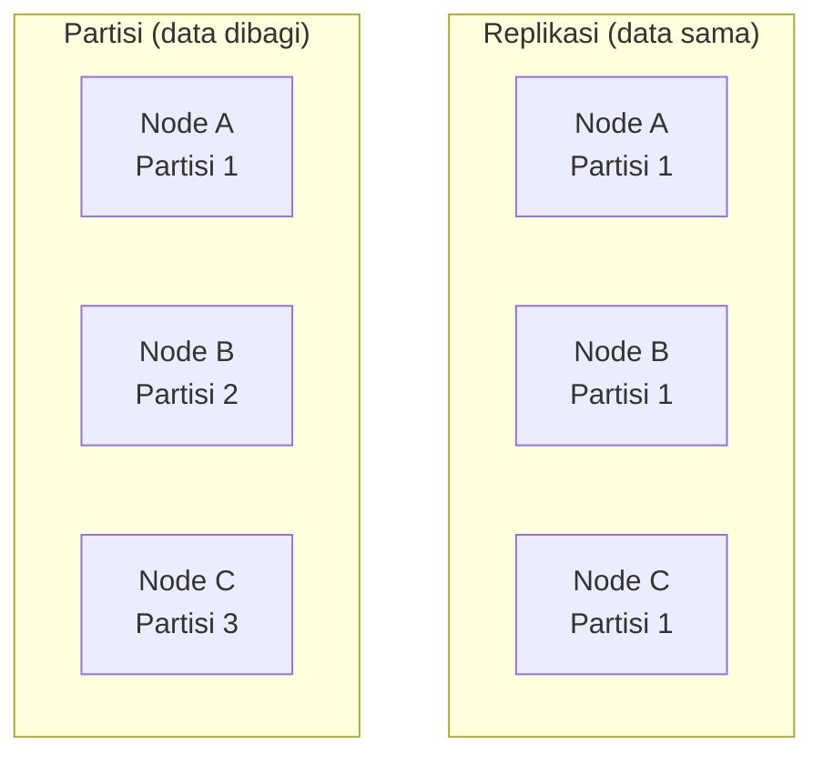
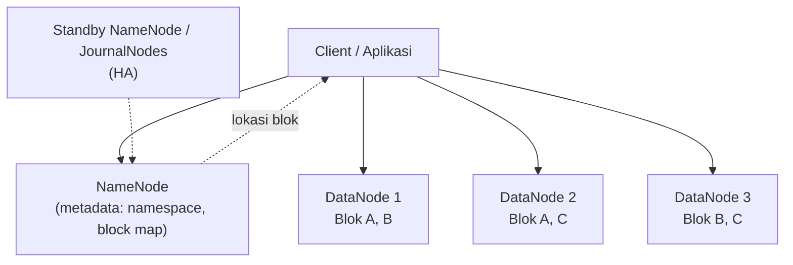
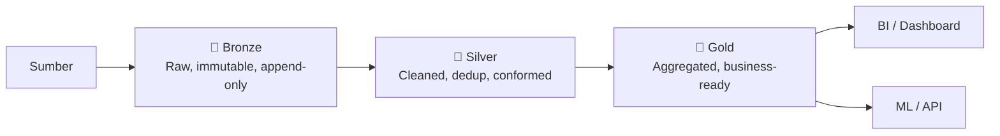

# Pertemuan 2: Arsitektur Terdistribusi & Penyimpanan Data

::: tip CAPAIAN PEMBELAJARAN (SUB-CPMK 2)
- **CPMK Terkait:** CPMK 2
- **CPL Terkait:** CPL01, CPL03, CPL04
- **Indikator:** Mahasiswa mampu menganalisis trade-off konsistensi/ketersediaan (CAP/PACELC), menjelaskan arsitektur HDFS dan object storage, memilih format file analitik, serta merancang layout partisi yang menghindari masalah *small files*.
:::

---

## 1. Fondasi Sistem Terdistribusi

Sistem terdistribusi adalah kumpulan komputer independen yang tampak bagi pengguna sebagai satu sistem. Big Data hampir selalu terdistribusi karena satu mesin memiliki batas CPU, RAM, disk, dan bandwidth.

### 1.1 Scale-Up vs Scale-Out

| Aspek | Scale-Up (vertikal) | Scale-Out (horizontal) |
| :--- | :--- | :--- |
| Cara | Tambah CPU/RAM/disk pada satu mesin | Tambah banyak mesin biasa |
| Batas | Batas fisik & biaya eksponensial | Hampir linear, tetapi koordinasi makin kompleks |
| Kegagalan | Satu mesin = satu titik kegagalan | Kegagalan node dianggap normal |
| Cocok untuk | Database transaksional kecil–menengah | Penyimpanan & pemrosesan data besar |

### 1.2 Dua Strategi Dasar: Replikasi & Partisi

- **Replikasi:** menyalin data ke beberapa node untuk **ketersediaan** dan **kecepatan baca**. Tantangannya: menjaga konsistensi antar salinan.
- **Partisi (sharding):** membagi data ke banyak node berdasarkan key untuk **skalabilitas tulis** dan **paralelisme**. Tantangannya: *hot partition* dan query lintas partisi.



Sistem nyata biasanya menggabungkan keduanya: data dipartisi, lalu setiap partisi direplikasi.

### 1.3 Model Konsistensi

| Model | Jaminan | Contoh Penggunaan |
| :--- | :--- | :--- |
| **Strong / linearizable** | Setiap pembacaan melihat tulisan terakhir | Saldo rekening, stok |
| **Read-your-writes** | Pengguna melihat tulisannya sendiri | Profil pengguna |
| **Causal** | Operasi yang berhubungan terlihat berurutan | Komentar & balasan |
| **Eventual** | Salinan akhirnya konvergen | Like counter, rekomendasi, cache |

---

## 2. Teorema CAP & PACELC

### 2.1 CAP

Pada saat terjadi **partisi jaringan (P)**, sistem hanya dapat menjamin salah satu dari:

- **Consistency (C):** semua node melihat data yang sama pada waktu yang sama.
- **Availability (A):** setiap permintaan mendapat respons (bukan error), meskipun mungkin basi.

Karena partisi jaringan tidak dapat dihindari, pilihan praktisnya adalah **CP** atau **AP** — bukan "CA" untuk sistem terdistribusi nyata.

| Sistem | Klasifikasi | Perilaku Saat Partisi |
| :--- | :---: | :--- |
| HBase, ZooKeeper | CP | Menolak operasi jika tidak dapat mencapai quorum |
| MongoDB (majority write concern) | CP | Menunggu mayoritas replika |
| Apache Cassandra | AP | Menerima tulisan, konflik diselesaikan via *last-write-wins* / quorum |
| Amazon DynamoDB | AP (dapat diatur) | Selalu menerima tulisan, konsistensi eventual |

### 2.2 PACELC

CAP hanya membahas saat partisi. **PACELC** menambahkan: **jika tidak ada partisi (E), pilih Latency (L) atau Consistency (C)**.

> Contoh: Cassandra dengan `QUORUM` lebih konsisten tetapi lebih lambat; dengan `ONE` lebih cepat tetapi mungkin basi.

::: tip Implikasi untuk Engineer
Jangan menanyakan "database mana yang paling bagus?". Tanyakan: **"Apa yang boleh terjadi jika data terlambat 2 detik?"** Jawaban itulah yang menentukan model konsistensi dan teknologi.
:::

---

## 3. HDFS: Hadoop Distributed File System

HDFS adalah sistem file terdistribusi yang dirancang untuk **throughput tinggi** pada file sangat besar, dengan asumsi kegagalan hardware adalah normal.

### 3.1 Arsitektur



| Komponen | Peran |
| :--- | :--- |
| **NameNode** | Menyimpan metadata (pohon direktori, pemetaan blok → DataNode). **Tidak** menyimpan data file. |
| **DataNode** | Menyimpan blok data dan melayani baca/tulis. Melapor via *heartbeat* dan *block report*. |
| **Secondary NameNode** | Melakukan *checkpoint* metadata; **bukan** standby NameNode. |
| **Standby NameNode + JournalNodes** | Konfigurasi HA: failover otomatis dengan Quorum Journal Manager. |

### 3.2 Karakteristik HDFS

| Properti | Nilai Default | Catatan |
| :--- | :--- | :--- |
| **Ukuran blok** | 128 MB (Hadoop 2/3) | Blok besar mengurangi overhead metadata |
| **Replikasi** | 3 | 2 replika dalam rack sama + 1 rack berbeda (rack awareness) |
| **Akses** | Write-once, append-only | Tidak cocok untuk update acak |
| **Throughput** | Tinggi untuk sequential scan | Latensi per operasi lebih tinggi dari SSD lokal |
| **Fault tolerance** | Replikasi blok | NameNode HA + replikasi metadata |

### 3.3 Alur Baca & Tulis

**Baca:**
1. Client meminta lokasi blok ke NameNode.
2. NameNode mengembalikan daftar DataNode (diurutkan berdasarkan kedekatan jaringan).
3. Client membaca blok langsung dari DataNode terdekat.
4. Jika DataNode gagal, client mencoba replika berikutnya.

**Tulis:**
1. Client meminta izin membuat file ke NameNode.
2. NameNode memilih DataNode untuk pipeline replikasi.
3. Client mengirim paket data ke DataNode pertama → diteruskan ke berikutnya.
4. Setelah semua replika meng-*ack*, blok dianggap selesai.
5. Client menutup file; NameNode mencatat metadata.

```bash
# Perintah HDFS yang wajib dikuasai
hdfs dfs -mkdir -p /data/bronze/events
hdfs dfs -put data/bronze/events/events_2026-09-01.jsonl /data/bronze/events/
hdfs dfs -ls -h /data/bronze/events
hdfs dfs -du -h /data/bronze/events
hdfs dfs -cat /data/bronze/events/events_2026-09-01.jsonl | head -n 3
hdfs fsck /data/bronze/events -files -blocks -locations
```

### 3.4 Kapan HDFS Tidak Tepat?

- **Banyak file kecil** (< 128 MB): metadata NameNode membengkak, biaya seek dominan.
- **Update acak / transaksi OLTP:** HDFS tidak mendukung modifikasi di tempat.
- **Latensi rendah per request:** HDFS dioptimalkan untuk throughput, bukan respons milidetik.
- **Data yang jarang diakses:** object storage biasanya lebih murah dan elastis.

---

## 4. Object Storage, Data Lake, Warehouse & Lakehouse

### 4.1 Object Storage

Object storage (Amazon S3, Google Cloud Storage, Azure Blob, MinIO) menyimpan data sebagai **objek** dalam **bucket** dengan identitas unik, diakses via HTTP API.

| Kelebihan | Keterbatasan |
| :--- | :--- |
| Elastis tanpa batas praktis, bayar sesuai pakai | Latensi lebih tinggi daripada disk lokal |
| Durabilitas sangat tinggi (replikasi/erasure coding internal) | Tidak mendukung update granular/rename murah |
| Pemisahan storage & compute | Biaya egress dan request perlu dihitung |
| Cocok untuk data lake & backup | Konsistensi/listing perlu dipahami per provider |

### 4.2 Perbandingan Arsitektur

| Aspek | Data Warehouse | Data Lake | Lakehouse |
| :--- | :--- | :--- | :--- |
| **Data** | Terstruktur, sudah dimodelkan | Semua format, mentah | Semua format + tabel transaksional |
| **Skema** | Schema-on-write | Schema-on-read | Schema-on-read + enforcement |
| **ACID** | Ya | Umumnya tidak | Ya (Delta/Iceberg/Hudi) |
| **Pengguna** | BI, analis SQL | Data scientist, engineer | Keduanya |
| **Risiko** | Kaku, mahal | Data swamp | Kompleksitas operasional |

### 4.3 Medallion Architecture



- **Bronze:** data mentah apa adanya + metadata ingest (waktu, sumber, versi). Berguna untuk audit dan reprocessing.
- **Silver:** dibersihkan, tipe data benar, duplikat dihapus, PII dimasking, aturan bisnis dasar diterapkan.
- **Gold:** tabel agregat/denormalisasi untuk kebutuhan spesifik (harian, per kategori, funnel).

---

## 5. Format File untuk Analitik

| Format | Tipe | Kompresi | Skema | Predicate Pushdown | Cocok Untuk |
| :--- | :--- | :---: | :--- | :---: | :--- |
| **CSV** | Baris | Terbatas | Tidak | Tidak | Pertukaran sederhana, data kecil |
| **JSON** | Baris | Ya | Fleksibel | Tidak | Event, API, semi-terstruktur |
| **Avro** | Baris | Ya (blok) | Ya + schema registry | Tidak | Streaming, write-heavy, evolusi skema |
| **Parquet** | Kolom | Ya (per kolom) | Ya | Ya (min/max stats) | Analitik, data lake, Spark |
| **ORC** | Kolom | Ya | Ya | Ya | Hive, tabel ACID |

### 5.1 Mengapa Columnar?

Query analitik biasanya hanya menyentuh beberapa kolom dari puluhan kolom. Format kolumnar:

1. **Column pruning** — hanya membaca kolom yang diminta.
2. **Kompresi lebih baik** — nilai sejenis berdekatan (dictionary, run-length).
3. **Predicate pushdown** — melewati row group yang tidak relevan berdasarkan statistik min/max.
4. **Vectorized execution** — pemrosesan batch per kolom lebih efisien di CPU.

```text
Baris (CSV):     [id, user, city, amount] [id, user, city, amount] ...
Kolom (Parquet): [id, id, id, ...] [user, user, ...] [city, ...] [amount, ...]
```

### 5.2 Schema Evolution

| Perubahan | Parquet | Avro | Catatan |
| :--- | :---: | :---: | :--- |
| Tambah kolom nullable | Ya | Ya | Aman jika default disediakan |
| Hapus kolom | Ya (baca selektif) | Ya | Pastikan consumer tidak bergantung |
| Ubah tipe (int → long) | Terbatas | Ya (promotion) | Hindari perubahan destruktif |
| Rename kolom | Tidak otomatis | Ya (alias) | Butuh mapping di katalog |

---

## 6. Strategi Partisi & Menghindari *Small Files*

Partisi adalah pembagian fisik data berdasarkan nilai kolom (umumnya tanggal), sehingga query dengan filter tanggal hanya membaca folder yang relevan (**partition pruning**).

### 6.1 Prinsip Perancangan

1. **Partisi berdasarkan pola query**, bukan sekadar tanggal ingest.
2. **Target ukuran file:** 128 MB–1 GB (Parquet terkompresi).
3. **Hindari kardinalitas partisi terlalu tinggi** (mis. `user_id` sebagai partisi → jutaan folder).
4. **Jangan partisi kolom yang sering di-update.**
5. **Kompaksi berkala** untuk data streaming yang menghasilkan banyak file kecil.

### 6.2 Contoh Perhitungan

> Volume 1 TB/hari. Partisi per tanggal dan `event_type` (10 nilai) → 100 GB per partisi. Dengan target file 512 MB → **200 file per partisi**, **2.000 file/hari**, **±730.000 file/tahun**.

Jumlah ini besar. Alternatif:

- Partisi hanya per tanggal → 1 TB/hari ÷ 512 MB ≈ **2.000 file/hari** (tetap besar, tetapi lebih terkendali).
- Gunakan tabel lakehouse (Iceberg/Delta) dengan **compaction** dan **hidden partitioning**.
- Simpan data panas per jam, data dingin digabung per hari/bulan.
- Gunakan **bucketing** hanya jika join key sering dipakai dan kardinalitasnya stabil.

### 6.3 Layout yang Direkomendasikan

```text
s3://lake/
├── bronze/events/dt=2026-09-01/hour=00/part-00000.parquet
├── silver/events/dt=2026-09-01/part-00000.parquet
└── gold/sales_daily/dt=2026-09-01/part-00000.parquet
```

Aturan penamaan: **lowercase, tanpa spasi, gunakan `=` untuk partisi Hive-style** agar kompatibel dengan Spark, Hive, dan Trino.

---

## 7. Praktikum: JSON → Parquet Berpartisi

### 7.1 Konversi dengan PySpark

```python
from pyspark.sql import SparkSession, functions as F

spark = (SparkSession.builder
         .appName("bronze-to-silver")
         .master("local[*]")
         .config("spark.sql.shuffle.partitions", "8")
         .getOrCreate())

events = spark.read.json("data/bronze/events")
events = (events
          .withColumn("event_ts", F.to_timestamp("event_ts"))
          .withColumn("event_date", F.to_date("event_ts"))
          .dropDuplicates(["event_id"])
          .filter(F.col("amount") >= 0))

(events.repartition("event_date")
       .write.mode("overwrite")
       .partitionBy("event_date")
       .parquet("data/silver/events_parquet"))

spark.stop()
```

### 7.2 Verifikasi Hasil

```python
import pyarrow.dataset as ds

dataset = ds.dataset(
    "data/silver/events_parquet",
    format="parquet",
    partitioning="hive",
)
print(dataset.schema)
print("Total baris:", dataset.count_rows())
print(dataset.to_table(columns=["event_type", "amount"]).slice(0, 5).to_pandas())
```

### 7.3 Bandingkan Ukuran

```bash
du -sh data/bronze/events
du -sh data/silver/events_parquet
find data/silver/events_parquet -name "*.parquet" | wc -l
```

Diskusikan: berapa rasio kompresi? Berapa jumlah file? Apakah jumlah file sudah wajar untuk ukuran data ini?

### 7.4 Opsional: Object Storage dengan MinIO

```bash
docker run -d --name minio \
  -p 9000:9000 -p 9001:9001 \
  -e MINIO_ROOT_USER=minioadmin \
  -e MINIO_ROOT_PASSWORD=minioadmin \
  -v "$PWD/data/minio:/data" \
  minio/minio server /data --console-address ":9001"
```

Buka `http://localhost:9001`, buat bucket `lake`, lalu unggah folder `silver/`. Untuk integrasi Spark–S3A, tambahkan paket `hadoop-aws` dan konfigurasi endpoint di `spark-defaults.conf`.

---

## 8. Tugas 2 — Rancangan Layout Penyimpanan (6%)

**Skenario:** aplikasi mencatat **1 TB data event per hari** (JSON, 1 KB/event), retensi 2 tahun. Query utama: funnel per hari, per kota, dan per tipe event; 90% query memfilter 1–7 hari terakhir.

Susun dokumen yang memuat:

1. **Pilihan format** (JSON/Parquet/Avro) dan alasan.
2. **Strategi partisi** (kolom, granularitas, jumlah file yang dihasilkan per hari).
3. **Perhitungan kapasitas** 2 tahun dengan kompresi dan replikasi.
4. **Rencana kompaksi** dan penanganan data panas/dingin.
5. **Risiko small files** serta mitigasinya.
6. **Diagram layout folder** lengkap.

**Penilaian:** ketepatan perhitungan (30%), kualitas keputusan trade-off (30%), mitigasi small files (20%), kejelasan dokumen & diagram (20%).

---

## 9. Checklist

- [ ] Saya dapat menjelaskan replikasi vs partisi dan kapan memakai masing-masing.
- [ ] Saya dapat memilih CP/AP berdasarkan kebutuhan bisnis, bukan preferensi.
- [ ] Saya dapat menjelaskan peran NameNode/DataNode dan alur baca/tulis HDFS.
- [ ] Saya dapat memilih format file berdasarkan pola akses.
- [ ] Saya dapat merancang partisi dan menghitung jumlah file.
- [ ] Saya berhasil mengonversi JSON ke Parquet berpartisi dan memverifikasinya.

---

## 📚 Bacaan Lanjutan

- Kleppmann, M. (2017). *Designing Data-Intensive Applications*, Bab 5–6.
- White, T. (2015). *Hadoop: The Definitive Guide*, Bab 3–4.
- Apache Hadoop — *HDFS Architecture Guide*.
- Apache Parquet — *File Format Specification*.
