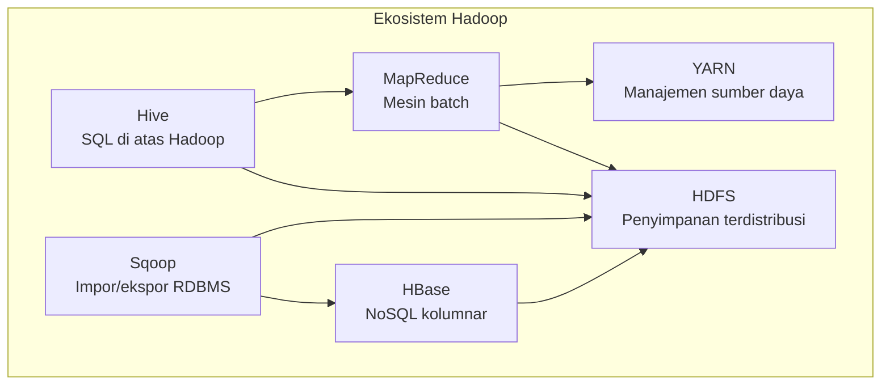
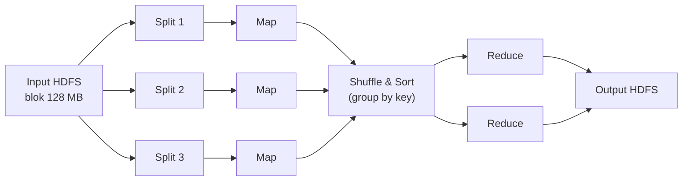
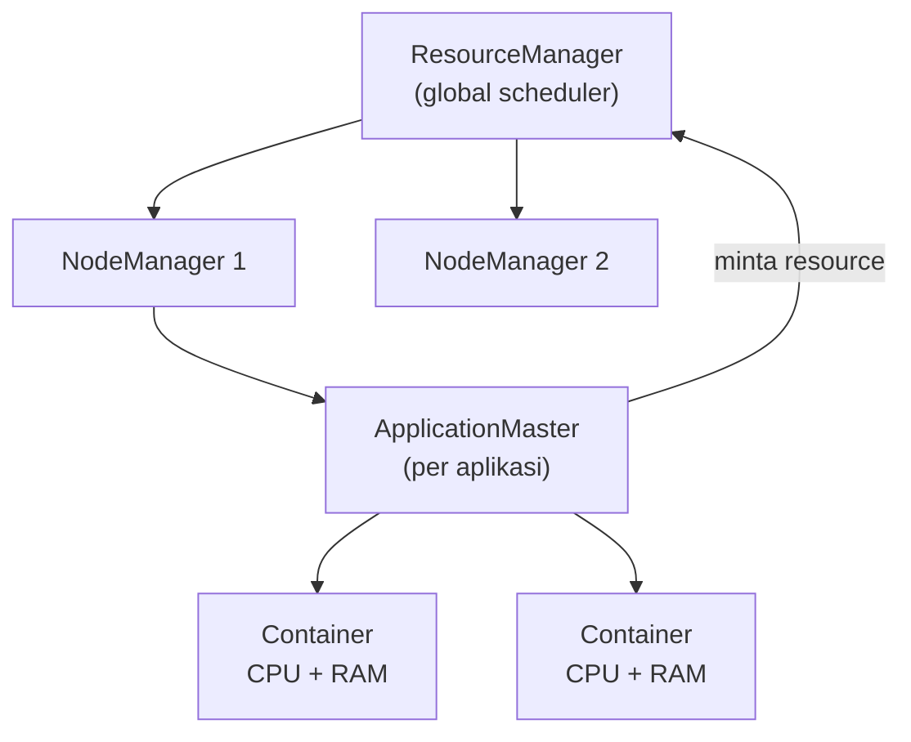
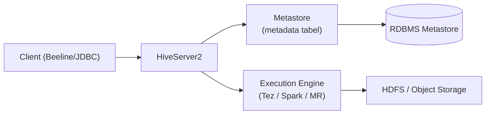

# Pertemuan 3: Hadoop — MapReduce, YARN & Hive

::: info 🎓 Bacaan Teori Wajib (Kelas RPL)
Baca **[Buku Teori Big Data — Pertemuan 3](/big-data/TEORI-RPL#p3)** sebelum praktik. Latihan teknis di modul ini adalah **pengayaan/verifikasi**; fokus utama adalah pemahaman konsep dan kemampuan menjelaskan trade-off.
:::

::: tip 🎙️ Slide Presentasi Interaktif
Buka **[slide presentasi Pertemuan 3](/presentasi/pertemuan-3-big-data)** — dilengkapi navigasi keyboard, timer, transkrip, dan narasi audio.
Untuk presentasi layar penuh, buka **[HTML interaktif](/Perkuliahan/presentasi/pertemuan-3-hadoop-mapreduce-hive.html)** di tab baru.
:::

::: tip CAPAIAN PEMBELAJARAN (SUB-CPMK 3)
- **CPMK Terkait:** CPMK 2
- **CPL Terkait:** CPL01, CPL03, CPL04
- **Indikator:** Mahasiswa mampu menjelaskan alur eksekusi job MapReduce, mengimplementasikan mapper–reducer, memilih combiner/partitioner yang tepat, menjelaskan manajemen sumber daya YARN, serta menulis query Hive yang memanfaatkan partisi dan format kolumnar.
:::

---

## 1. Ekosistem Hadoop

Hadoop bukan satu program, melainkan ekosistem komponen yang saling melengkapi:



| Komponen | Fungsi | Analogi |
| :--- | :--- | :--- |
| **HDFS** | Menyimpan file besar terdistribusi | Hard disk raksasa |
| **YARN** | Mengalokasikan CPU/RAM ke aplikasi | Manajer sumber daya / OS |
| **MapReduce** | Memproses data secara paralel | Tim pekerja pabrik |
| **Hive** | Menerjemahkan SQL ke job MapReduce/Tez/Spark | Penerjemah bahasa |
| **HBase** | Database NoSQL di atas HDFS | Tabel besar dengan akses baris |

> Pada praktik modern, MapReduce jarang ditulis langsung. Namun **model mentalnya** (split → map → shuffle → reduce) tetap menjadi dasar Spark, Flink, dan Hive. Memahaminya membuat Anda mampu mendiagnosis *shuffle* dan *skew*.

---

## 2. Filosofi MapReduce

MapReduce menyelesaikan masalah besar dengan **divide and conquer**:

1. **Pecah** input menjadi split independen.
2. **Map** setiap split secara paralel menjadi pasangan `(key, value)`.
3. **Shuffle & sort** mengelompokkan semua nilai berdasarkan key.
4. **Reduce** mengagregasi nilai untuk setiap key.
5. **Tulis** hasil ke HDFS.

Prinsip penting: **move compute to data**. Job dikirim ke node tempat data berada, bukan memindahkan data ke job.



---

## 3. Anatomi Job MapReduce

### 3.1 Fase Eksekusi

| Fase | Yang Terjadi | Bottleneck Umum |
| :--- | :--- | :--- |
| **Input** | File dipecah menjadi split (default = ukuran blok) | Terlalu banyak file kecil |
| **Map** | Fungsi map dijalankan per record | Komputasi mahal per record, parsing JSON |
| **Spill & Sort** | Buffer map penuh → ditulis ke disk lokal, diurutkan | Kekurangan memori, kompresi mahal |
| **Shuffle** | Reduce mengambil output map sesuai partisi | **Jaringan** dan **disk I/O** |
| **Merge** | Menggabungkan hasil map yang sudah terurut | Banyak segmen kecil |
| **Reduce** | Group by key, agregasi | **Data skew** (satu key terlalu besar) |
| **Output** | Ditulis ke HDFS (replikasi) | Banyak file output kecil |

> **Shuffle adalah biaya terbesar MapReduce.** Semua optimasi pada dasarnya mengurangi jumlah data yang melewati jaringan atau mengurangi ketidakseimbangan beban.

### 3.2 Combiner & Partitioner

- **Combiner** = "mini reducer" yang berjalan di sisi map sebelum shuffle. Mengurangi data yang dikirim. Syarat: operasi harus **komutatif dan asosiatif** (penjumlahan, maksimum), tidak boleh untuk rata-rata langsung.
- **Partitioner** menentukan key mana menuju reducer mana. Default: `hash(key) % numReducers`. Partitioner kustom berguna untuk menghindari penumpukan key tertentu.

```text
Tanpa combiner : map mengirim (kota, 1) sebanyak 1.000.000 record
Dengan combiner: map mengirim (kota, 1000) satu kali per kota
```

### 3.3 Join di MapReduce

| Strategi | Cara Kerja | Kapan Dipakai |
| :--- | :--- | :--- |
| **Reduce-side join** | Kedua dataset diberi tag, di-shuffle berdasarkan join key | Dataset besar–besar |
| **Map-side join** | Tabel kecil dibroadcast ke semua mapper | Satu tabel muat di memori |
| **Bucket map join (Hive)** | Kedua tabel di-bucket dengan key sama | Join sering, data terpartisi konsisten |

---

## 4. MapReduce dengan Hadoop Streaming (Python)

Hadoop Streaming memungkinkan mapper/reducer ditulis dalam bahasa apa pun yang membaca `stdin` dan menulis `stdout`.

### 4.1 Mapper

`mapper.py`:

```python
#!/usr/bin/env python3
"""Mapper word count: mengeluarkan (kata, 1)."""
import re
import sys

for line in sys.stdin:
    for word in re.findall(r"[a-zA-Z]+", line.lower()):
        print(f"{word}\t1")
```

### 4.2 Reducer

`reducer.py`:

```python
#!/usr/bin/env python3
"""Reducer word count: menjumlahkan nilai per kata."""
import sys

current_word = None
current_count = 0

for line in sys.stdin:
    line = line.strip()
    if not line:
        continue
    try:
        word, count = line.split("\t", 1)
        count = int(count)
    except ValueError:
        continue  # lewati baris rusak

    if word == current_word:
        current_count += count
    else:
        if current_word is not None:
            print(f"{current_word}\t{current_count}")
        current_word, current_count = word, count

if current_word is not None:
    print(f"{current_word}\t{current_count}")
```

### 4.3 Uji Lokal Tanpa Cluster

```bash
chmod +x mapper.py reducer.py
cat data/bronze/events/*.jsonl | ./mapper.py | sort | ./reducer.py | head -n 20
```

### 4.4 Jalankan di Hadoop

```bash
hdfs dfs -mkdir -p /data/input
hdfs dfs -put data/bronze/events/events_2026-09-01.jsonl /data/input/

hadoop jar "$HADOOP_HOME/share/hadoop/tools/lib/hadoop-streaming-3.3.6.jar" \
  -files mapper.py,reducer.py \
  -mapper "python3 mapper.py" \
  -reducer "python3 reducer.py" \
  -combiner "python3 reducer.py" \
  -input /data/input \
  -output /data/output/wordcount

hdfs dfs -cat /data/output/wordcount/part-* | head
```

> `-combiner` aman untuk penjumlahan karena komutatif dan asosiatif. Jangan gunakan combiner untuk operasi seperti median.

### 4.5 Melihat Counter & Diagnostik

```bash
yarn application -list
yarn logs -applicationId application_XXXXXXXX_XXXX
mapred job -history /data/output/wordcount
```

Perhatikan counter **Map input records**, **Map output records**, **Reduce shuffle bytes**, dan **Spilled Records**. Angka ini menunjukkan di mana biaya sebenarnya.

---

## 5. YARN: Manajemen Sumber Daya

YARN memisahkan **manajemen sumber daya** dari **model pemrograman**.



| Komponen | Tanggung Jawab |
| :--- | :--- |
| **ResourceManager** | Mengelola total resource cluster, menjadwalkan aplikasi |
| **NodeManager** | Agen per node: memantau container, melaporkan resource |
| **ApplicationMaster** | Mengelola siklus hidup satu aplikasi, meminta container |
| **Container** | Alokasi CPU + memori tempat task berjalan |

### Scheduler

| Scheduler | Karakteristik |
| :--- | :--- |
| **FIFO** | Job berurutan; sederhana, buruk untuk multi-user |
| **Capacity** | Beberapa queue dengan kapasitas terjamin; cocok enterprise |
| **Fair** | Resource dibagi adil antar job aktif; cocok cluster bersama |

**Pitfall umum:** container meminta RAM lebih besar dari `yarn.nodemanager.resource.memory-mb` → aplikasi menunggu selamanya (ACCEPTED, bukan RUNNING). Selalu cocokkan `spark.executor.memory` + overhead dengan kapasitas node.

---

## 6. Hive: SQL di Atas Hadoop

Hive menyediakan **skema tabel** dan **HiveQL** di atas file HDFS. Hive tidak menyimpan data dalam format proprietary; ia menyimpan **metadata** di Metastore dan membaca file di HDFS.

### 6.1 Arsitektur



### 6.2 Managed vs External Table

| Aspek | Managed (Internal) | External |
| :--- | :--- | :--- |
| Lokasi data | `warehouse.dir` milik Hive | Ditentukan `LOCATION` |
| `DROP TABLE` | Menghapus data juga | Hanya metadata; data tetap |
| Cocok untuk | Data sementara/hasil transformasi | Data lake bersama, data mentah |

> **Aturan praktis:** untuk data lake, gunakan **external table** agar `DROP` tidak menghapus data secara tidak sengaja.

### 6.3 DDL Contoh

```sql
CREATE DATABASE IF NOT EXISTS analytics;

CREATE EXTERNAL TABLE IF NOT EXISTS analytics.events (
  event_id   STRING,
  user_id    STRING,
  event_type STRING,
  product_id STRING,
  city       STRING,
  amount     DOUBLE,
  event_ts   TIMESTAMP
)
PARTITIONED BY (dt DATE)
STORED AS PARQUET
LOCATION '/data/silver/events';

-- Mendaftarkan partisi yang sudah ada di HDFS
MSCK REPAIR TABLE analytics.events;

-- Partisi manual (lebih cepat daripada MSCK untuk banyak partisi)
ALTER TABLE analytics.events
ADD IF NOT EXISTS PARTITION (dt = DATE '2026-09-01')
LOCATION '/data/silver/events/dt=2026-09-01';
```

### 6.4 Query Analitik

```sql
-- Jumlah event dan pengguna unik per tipe per hari
SELECT dt,
       event_type,
       COUNT(*)                 AS total_event,
       COUNT(DISTINCT user_id)  AS unique_users
FROM analytics.events
WHERE dt BETWEEN DATE '2026-09-01' AND DATE '2026-09-07'
GROUP BY dt, event_type
ORDER BY dt, total_event DESC;

-- Funnel harian
SELECT
  COUNT(DISTINCT CASE WHEN event_type = 'view'        THEN user_id END) AS viewers,
  COUNT(DISTINCT CASE WHEN event_type = 'add_to_cart' THEN user_id END) AS cart_users,
  COUNT(DISTINCT CASE WHEN event_type = 'checkout'    THEN user_id END) AS checkout_users,
  COUNT(DISTINCT CASE WHEN event_type = 'payment'     THEN user_id END) AS payers
FROM analytics.events
WHERE dt = DATE '2026-09-01';

-- Pendapatan per kota (hanya event pembayaran)
SELECT city,
       COUNT(*)               AS payments,
       ROUND(SUM(amount), 2)  AS revenue
FROM analytics.events
WHERE dt = DATE '2026-09-01'
  AND event_type = 'payment'
GROUP BY city
ORDER BY revenue DESC;
```

### 6.5 Partitioning & Bucketing

- **Partitioning** membagi data menjadi direktori (`dt=2026-09-01`). Query dengan filter partisi menghindari pemindaian penuh.
- **Bucketing** membagi data menjadi sejumlah file tetap berdasarkan hash kolom (`CLUSTERED BY (user_id) INTO 16 BUCKETS`). Berguna untuk join dan sampling.

```sql
CREATE TABLE analytics.events_bucketed (
  event_id STRING,
  user_id STRING,
  event_type STRING,
  amount DOUBLE
)
CLUSTERED BY (user_id) INTO 16 BUCKETS
STORED AS ORC;
```

### 6.6 Optimasi Hive

| Teknik | Efek |
| :--- | :--- |
| Filter pada kolom partisi | **Partition pruning** — menghindari scan penuh |
| `STORED AS PARQUET/ORC` | Kompresi + column pruning |
| `hive.vectorized.execution.enabled=true` | Eksekusi vektor, CPU lebih efisien |
| `hive.cbo.enable=true` | Optimasi join berbasis biaya |
| Hindari `SELECT *` | Mengurangi I/O kolom |
| `hive.optimize.skewjoin=true` | Menangani key yang timpang |
| Tez/Spark sebagai engine | Menggantikan MapReduce multi-stage |

---

## 7. Data Skew: Musuh Tersembunyi

**Data skew** terjadi ketika satu key memiliki jauh lebih banyak record daripada key lain. Contoh: 80% event berasal dari `city = 'Jakarta'`, sehingga satu reducer mengerjakan 80% data sementara reducer lain selesai cepat.

**Gejala:** job 99% macet di fase reduce, satu task berjalan jauh lebih lama.

**Mitigasi:**

1. **Salting:** tambahkan suffix acak pada key (`Jakarta-0` … `Jakarta-9`), agregasi dua tahap.
2. **Custom partitioner:** sebarkan key besar secara merata.
3. **Map-side join** untuk tabel kecil.
4. **Adaptive Query Execution (Spark)** atau skew join Hive.
5. **Pisahkan key outlier** dan proses terpisah.

```text
Tanpa salting : (Jakarta, 8.000.000) → 1 reducer
Dengan salting: (Jakarta-0, 800.000) ... (Jakarta-9, 800.000) → 10 reducer
```

---

## 8. Praktik Terbimbing (Pengayaan)

### 8.1 Word Count Lokal

Siapkan file teks, lalu:

```bash
cat data/bronze/events/events_2026-09-01.jsonl \
  | ./mapper.py \
  | sort \
  | ./reducer.py \
  | sort -k2,2nr \
  | head -n 15
```

### 8.2 Word Count di Cluster

```bash
hdfs dfs -rm -r -f /data/output/wordcount
hadoop jar "$HADOOP_HOME/share/hadoop/tools/lib/hadoop-streaming-3.3.6.jar" \
  -files mapper.py,reducer.py \
  -mapper "python3 mapper.py" \
  -reducer "python3 reducer.py" \
  -combiner "python3 reducer.py" \
  -input /data/input \
  -output /data/output/wordcount
```

### 8.3 Hive Analytics

Jalankan `beeline -u jdbc:hive2://localhost:10000` lalu eksekusi DDL dan query pada Bagian 6. Catat:

- Waktu eksekusi sebelum dan sesudah filter partisi.
- Jumlah baris yang dipindai (lihat **Hive execution plan** dengan `EXPLAIN`).
- Perbedaan ukuran Parquet vs JSON untuk data yang sama.

### 8.4 Analisis

Jawab dalam laporan singkat:

1. Berapa jumlah map dan reduce task? Mengapa?
2. Berapa byte yang melewati shuffle? Bagaimana combiner mengubahnya?
3. Apakah ada reducer yang jauh lebih lambat? Mengapa?
4. Query Hive mana yang paling mahal, dan bagaimana partition pruning membantu?

---

## 9. Tugas 3 — Analitik Log dengan Hadoop/Hive (6%)

Diberikan log web server dengan format:

```text
2026-09-01T10:23:45Z 203.0.113.10 GET /produk/123 200 5321
```

Kerjakan:

1. **MapReduce:** hitung 10 URL paling sering diakses dan distribusi status code.
2. **Hive:** buat external table berpartisi `dt`, lalu hitung:
   - jumlah request per jam,
   - error rate (`status >= 500`) per URL,
   - rata-rata ukuran respons per status.
3. **Analisis:** jelaskan bottleneck yang Anda temukan (shuffle, skew, small files) dan usulkan perbaikan.
4. **Reproducibility:** sertakan perintah dan README agar hasil dapat dijalankan ulang.

**Penilaian:** kebenaran hasil (40%), kualitas kode/DDL (20%), analisis performa (25%), dokumentasi (15%).

---

## 10. Checklist

- [ ] Saya dapat menggambar alur map → shuffle → reduce dan menjelaskan biayanya.
- [ ] Saya dapat menulis mapper/reducer yang menangani input rusak.
- [ ] Saya memahami kapan combiner aman digunakan.
- [ ] Saya dapat menjelaskan peran ResourceManager, NodeManager, dan ApplicationMaster.
- [ ] Saya dapat membuat external table Hive berpartisi dan menulis query agregasi.
- [ ] Saya dapat mendeteksi dan memitigasi data skew.

---

## 📚 Bacaan Lanjutan

- Dean, J., & Ghemawat, S. (2004). *MapReduce: Simplified Data Processing on Large Clusters*.
- White, T. (2015). *Hadoop: The Definitive Guide*, Bab 2, 6–8.
- Apache Hive Documentation — *Language Manual DDL & DML*.
- Apache Hadoop — *YARN Architecture*.
