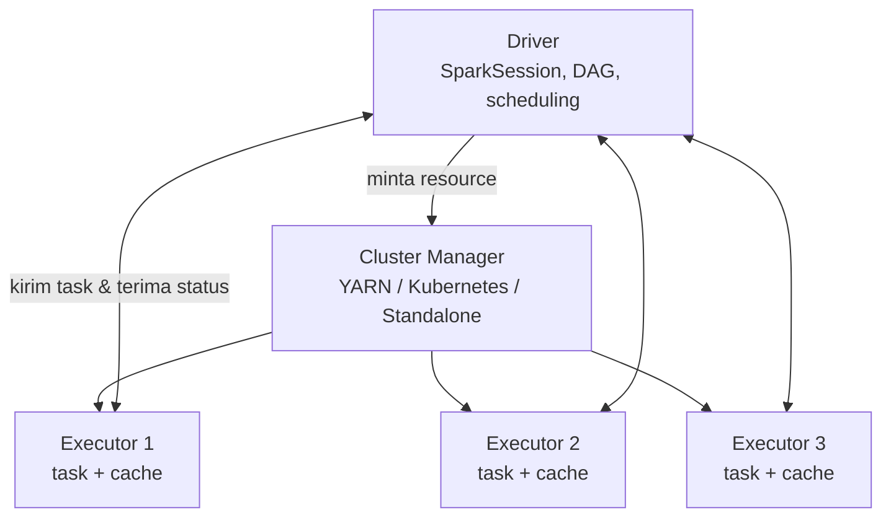
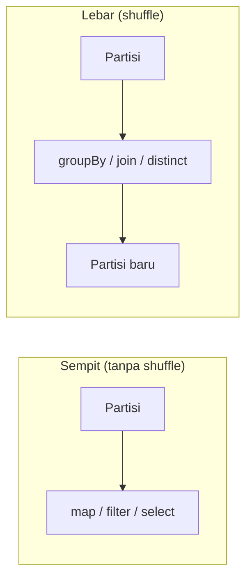

# Pertemuan 4: Apache Spark & Optimasi ETL

::: tip CAPAIAN PEMBELAJARAN (SUB-CPMK 4)
- **CPMK Terkait:** CPMK 2
- **CPL Terkait:** CPL01, CPL03, CPL04
- **Indikator:** Mahasiswa mampu menjelaskan arsitektur Spark dan alasan efisiensinya, membedakan transformasi sempit/lebar, membangun pipeline PySpark yang benar, serta melakukan tuning (partisi, broadcast join, AQE, caching) dengan bukti pengukuran.
:::

---

## 1. Mengapa Spark?

MapReduce menulis hasil antar-fase ke HDFS. Untuk analitik multi-tahap atau iteratif (machine learning), I/O disk antar-fase menjadi mahal. Spark memperkenalkan:

| Fitur | Dampak |
| :--- | :--- |
| **In-memory computation** | Data antar-transformasi dapat dipertahankan di memori |
| **DAG execution** | Menggabungkan beberapa operasi menjadi satu stage |
| **Lazy evaluation** | Optimasi global sebelum eksekusi |
| **Unified engine** | Batch, SQL, streaming, ML, graph dalam satu API |
| **API deklaratif** | DataFrame/SQL dengan optimizer (Catalyst) |
| **Fault tolerance** | Lineage RDD: partisi hilang dapat dihitung ulang |

> Spark bukan "Hadoop killer". Spark sering membaca/menulis di HDFS atau object storage, dan berjalan di atas YARN/Kubernetes. Keduanya saling melengkapi.

---

## 2. Arsitektur Spark



| Komponen | Peran |
| :--- | :--- |
| **Driver** | Menjalankan `main()`, membuat `SparkSession`, menyusun DAG, menjadwalkan task, mengumpulkan hasil |
| **Executor** | Proses JVM di worker: menjalankan task, menyimpan cache, melaporkan status |
| **Cluster Manager** | Mengalokasikan container/executor (YARN, Kubernetes, Standalone) |
| **Task** | Unit kerja terkecil, satu task per partisi per stage |
| **Job** | Satu aksi (mis. `count()`) memicu satu job |
| **Stage** | Sekumpulan task yang dipisahkan oleh shuffle |

### 2.1 Lazy Evaluation & DAG

Transformasi seperti `select`, `filter`, `join` **tidak langsung dieksekusi**. Spark membangun rencana logis. Eksekusi baru terjadi saat **aksi** dipanggil (`show`, `count`, `write`, `collect`).

```python
df = spark.read.parquet("...")          # lazy
clean = df.filter(...)                  # lazy
agg = clean.groupBy("city").count()     # lazy — masih membangun DAG
agg.show()                              # aksi → baru dieksekusi
```

Keuntungan: optimizer dapat menggabungkan filter, memilih join strategy, dan menghilangkan kolom yang tidak dipakai sebelum data dibaca.

### 2.2 Catalyst & Tungsten

**Catalyst** adalah optimizer berbasis aturan dan biaya:

1. **Analysis** — resolusi kolom, tipe, dan katalog.
2. **Logical optimization** — predicate pushdown, column pruning, constant folding, reorder join.
3. **Physical planning** — memilih join algorithm (broadcast hash, sort-merge, shuffled hash).
4. **Code generation** — menghasilkan bytecode Java yang efisien.

**Tungsten** menangani manajemen memori off-heap, format data biner, dan *whole-stage code generation* untuk mengurangi overhead JVM.

### 2.3 Adaptive Query Execution (AQE)

Sejak Spark 3.2, AQE aktif secara default. AQE mengoptimasi **saat runtime** berdasarkan statistik nyata:

- Menggabungkan partisi shuffle kecil (*coalesce partitions*).
- Mengubah sort-merge join menjadi broadcast join jika salah satu sisi ternyata kecil.
- Memecah partisi yang skew (*skew join handling*).

```python
.config("spark.sql.adaptive.enabled", "true")          # default true
.config("spark.sql.adaptive.coalescePartitions.enabled", "true")
.config("spark.sql.adaptive.skewJoin.enabled", "true")
```

---

## 3. RDD, DataFrame, dan Dataset

| Abstraksi | Tipe | Optimasi | Kapan Dipakai |
| :--- | :--- | :--- | :--- |
| **RDD** | Tidak terstruktur (`RDD[T]`) | Tidak ada optimizer; kontrol penuh | Data tidak terstruktur, operasi low-level |
| **DataFrame** | Tabel terstruktur (`Dataset[Row]`) | Catalyst + Tungsten | **Default untuk ETL/analitik** |
| **Dataset** | Terstruktur + type-safe (Scala/Java) | Catalyst + encoder | Kode JVM yang butuh type safety |

Di PySpark, gunakan **DataFrame** sebagai pilihan utama. RDD hanya jika Anda benar-benar membutuhkan kontrol partisi/record level.

### 3.1 Transformasi vs Aksi

| Transformasi (lazy) | Aksi (memicu eksekusi) |
| :--- | :--- |
| `select`, `filter`, `withColumn` | `show`, `count`, `collect` |
| `join`, `groupBy`, `orderBy` | `write`, `first`, `take` |
| `union`, `distinct`, `dropDuplicates` | `foreach`, `toPandas` |

### 3.2 Narrow vs Wide Transformation



- **Sempit:** setiap partisi output bergantung pada satu partisi input → cepat, tanpa jaringan.
- **Lebar:** data harus didistribusikan ulang berdasarkan key → **shuffle**, mahal.

> Saat memperlambat job, cari **wide transformation**. Di situlah waktu dan uang habis.

---

## 4. Pipeline ETL PySpark

### 4.1 Membuat Session

```python
from pyspark.sql import SparkSession, functions as F, Window

spark = (SparkSession.builder
         .appName("events-etl")
         .master("local[*]")                       # cluster: hapus master
         .config("spark.sql.shuffle.partitions", "8")
         .config("spark.sql.adaptive.enabled", "true")
         .config("spark.sql.adaptive.coalescePartitions.enabled", "true")
         .getOrCreate())
```

### 4.2 Bronze → Silver

```python
raw = spark.read.json("data/bronze/events")

silver = (raw
    .withColumn("event_ts", F.to_timestamp("event_ts"))
    .withColumn("dt", F.to_date("event_ts"))
    .withColumn("amount", F.col("amount").cast("double"))
    .withColumn("event_type", F.lower(F.trim("event_type")))
    .filter(F.col("event_id").isNotNull())
    .filter(F.col("event_ts").isNotNull())
    .filter(F.col("amount") >= 0)
    .dropDuplicates(["event_id"]))

(silver.write.mode("overwrite")
       .partitionBy("dt")
       .parquet("data/silver/events"))
```

**Aturan kualitas yang diterapkan:**

| Aturan | Implementasi |
| :--- | :--- |
| `event_id` wajib ada dan unik | `isNotNull()` + `dropDuplicates` |
| Timestamp valid | `to_timestamp` + `isNotNull` |
| Amount tidak negatif | `filter(amount >= 0)` |
| Tipe event konsisten | `lower(trim(...))` |

### 4.3 Silver → Gold dengan Join & Agregasi

```python
events = spark.read.parquet("data/silver/events")
products = spark.read.parquet("data/reference/products")   # tabel kecil

enriched = events.join(F.broadcast(products), "product_id", "left")

daily_city = (enriched
    .groupBy("dt", "city")
    .agg(
        F.count("*").alias("total_events"),
        F.countDistinct("user_id").alias("unique_users"),
        F.sum(F.when(F.col("event_type") == "payment", F.col("amount"))
               .otherwise(0)).alias("revenue"),
        F.sum(F.when(F.col("event_type") == "checkout", 1).otherwise(0))
         .alias("checkouts"),
    )
    .withColumn("conversion_rate",
                F.round(F.col("checkouts") / F.col("unique_users"), 4)))

(daily_city.write.mode("overwrite")
           .partitionBy("dt")
           .parquet("data/gold/daily_city"))
```

### 4.4 Spark SQL

```python
events.createOrReplaceTempView("events")

spark.sql("""
    SELECT dt,
           event_type,
           COUNT(*)                AS total,
           COUNT(DISTINCT user_id) AS users
    FROM events
    WHERE dt >= DATE '2026-09-01'
    GROUP BY dt, event_type
    ORDER BY dt, total DESC
""").show(20, truncate=False)
```

### 4.5 Window Function

```python
w = Window.partitionBy("user_id").orderBy("event_ts")

funnel = (events
    .withColumn("prev_event", F.lag("event_type").over(w))
    .withColumn("prev_ts", F.lag("event_ts").over(w))
    .withColumn("seconds_since_prev",
                F.unix_timestamp("event_ts") - F.unix_timestamp("prev_ts")))
```

Berguna untuk analisis sesi, funnel, retensi, dan deteksi anomali tanpa menulis loop.

---

## 5. Tuning Performa

### 5.1 Partisi

| Operasi | Efek | Kapan |
| :--- | :--- | :--- |
| `repartition(n)` | Shuffle penuh, partisi seimbang | Menambah paralelisme |
| `repartition(n, col)` | Shuffle berdasarkan kolom | Partisi by key sebelum join/tulis |
| `coalesce(n)` | Menggabungkan partisi tanpa shuffle penuh | Mengurangi file sebelum write |
| `repartitionByRange` | Range partition | Data terurut, join range |

**Aturan ukuran partisi:** target **100–200 MB** per partisi di memori. Partisi terlalu kecil → overhead task; terlalu besar → spill dan OOM.

```python
# Contoh: 8 partisi untuk data lokal kecil
small = df.coalesce(8)
```

### 5.2 Shuffle

- `spark.sql.shuffle.partitions` default **200**. Untuk data kecil, 200 task hampir seluruhnya idle.
- Aktifkan AQE agar partisi digabung otomatis.
- Kurangi data sebelum shuffle: filter dan pilih kolom lebih awal.
- Hindari `distinct()` pada kolom ber-kardinalitas tinggi jika tidak perlu.

### 5.3 Broadcast Join

Jika satu tabel kecil (default < 10 MB), broadcast ke semua executor agar tidak ada shuffle tabel besar:

```python
from pyspark.sql.functions import broadcast

result = big_df.join(broadcast(small_df), "product_id", "left")
```

Konfigurasi:

```python
.config("spark.sql.autoBroadcastJoinThreshold", "50m")
```

::: warning
Broadcast tabel terlalu besar dapat menyebabkan **driver OOM** dan memperlambat semua executor. Ukur dulu ukuran tabel, jangan asal menaikkan threshold.
:::

### 5.4 Caching

```python
events = spark.read.parquet("...").cache()
events.count()          # memicu materialisasi cache
...
events.unpersist()      # lepaskan setelah selesai
```

Cache hanya DataFrame yang **dipakai berulang** dan muat di memori. Cache semua data justru menyebabkan eviction dan memperlambat.

### 5.5 UDF vs Built-in

```python
# ❌ Lambat: Python UDF serialisasi per baris
from pyspark.sql.functions import udf
from pyspark.sql.types import StringType
upper = udf(lambda s: s.upper() if s else None, StringType())

# ✅ Cepat: fungsi bawaan Catalyst
df.withColumn("city_upper", F.upper("city"))
```

Jika terpaksa memakai Python, gunakan **pandas UDF** berbasis Arrow agar pemrosesan berbasis batch.

### 5.6 Data Skew

Gejala: beberapa task berjalan sangat lama, stage tertahan di 99%.

```python
# Cek distribusi key
df.groupBy("product_id").count().orderBy(F.desc("count")).show(10)
```

Mitigasi:

1. **AQE skew join** (otomatis).
2. **Salting** key besar.
3. **Broadcast** tabel kecil.
4. Pisahkan key outlier dan proses terpisah.

### 5.7 Small Files

```python
# Sebelum menulis, kurangi jumlah partisi
df.coalesce(8).write.mode("overwrite").parquet("...")

# Atau batasi record per file
df.write.option("maxRecordsPerFile", 500_000).parquet("...")
```

Target file output: **128 MB–1 GB**. File 1 KB yang berjumlah jutaan akan memperlambat listing dan metadata.

### 5.8 Ringkasan Checklist Tuning

| Gejala | Penyebab Umum | Tindakan |
| :--- | :--- | :--- |
| Job lambat di satu task | Skew | Salting, AQE skew join, broadcast |
| Banyak task kecil | Partisi berlebih | `coalesce`, turunkan shuffle partitions |
| OOM executor | Partisi terlalu besar / cache berlebihan | Naikkan partisi, kurangi cache, cek broadcast |
| Shuffle besar | Join/groupBy sebelum filter | Filter & pilih kolom lebih awal |
| Output banyak file kecil | Partisi tulis berlebih | `coalesce`, `maxRecordsPerFile`, kompaksi |

---

## 6. Menguji Job Spark

Uji logika transformasi sebagai **fungsi murni** yang menerima dan mengembalikan DataFrame.

`jobs/transforms.py`:

```python
from pyspark.sql import DataFrame, functions as F

def clean_events(df: DataFrame) -> DataFrame:
    return (df
        .withColumn("event_ts", F.to_timestamp("event_ts"))
        .withColumn("dt", F.to_date("event_ts"))
        .filter(F.col("event_id").isNotNull())
        .filter(F.col("amount") >= 0)
        .dropDuplicates(["event_id"]))
```

`tests/test_transforms.py`:

```python
import pytest
from pyspark.sql import SparkSession
from jobs.transforms import clean_events

@pytest.fixture(scope="session")
def spark():
    return (SparkSession.builder
            .master("local[2]")
            .appName("test")
            .config("spark.sql.shuffle.partitions", "2")
            .getOrCreate())

def test_clean_events_removes_negative_and_duplicates(spark):
    data = [
        ("e1", "view",  10.0, "2026-09-01T10:00:00"),
        ("e1", "view",  10.0, "2026-09-01T10:00:00"),  # duplikat
        ("e2", "refund", -5.0, "2026-09-01T11:00:00"), # negatif
    ]
    df = spark.createDataFrame(data, ["event_id", "event_type", "amount", "event_ts"])
    result = clean_events(df).collect()
    assert len(result) == 1
    assert result[0]["event_id"] == "e1"
```

Jalankan:

```bash
pytest -q
```

Di CI (GitHub Actions), gunakan Spark lokal dan Java 17:

```yaml
- uses: actions/setup-java@v4
  with: { distribution: temurin, java-version: '17' }
- run: pip install pyspark==3.5.* pytest
- run: pytest -q
```

---

## 7. Praktikum: Pipeline Bronze → Silver → Gold

1. Gunakan dataset dari Pertemuan 1.
2. Bangun `jobs/etl.py` dengan tiga fungsi: `clean_events`, `build_daily_city`, `write_gold`.
3. Tambahkan minimal **4 aturan kualitas data**.
4. Tulis **3 unit test** untuk fungsi transformasi.
5. Ukur waktu eksekusi sebelum dan sesudah:
   - `spark.sql.shuffle.partitions=200` vs `8`,
   - join biasa vs `broadcast`,
   - tanpa vs dengan `coalesce` sebelum write.
6. Catat jumlah file output dan ukurannya.

**Format laporan:** tabel percobaan (konfigurasi, waktu, jumlah task, ukuran output) + analisis mengapa terjadi perbedaan.

---

## 8. Tugas 4 — Pipeline ETL PySpark (6%)

Bangun pipeline yang:

1. Membaca data mentah JSON (minimal 200.000 baris).
2. Membersihkan dan memvalidasi (minimal 4 aturan, dengan pencatatan baris ditolak).
3. Melakukan join dengan tabel referensi kecil menggunakan broadcast.
4. Menghasilkan tabel gold agregat harian per kota.
5. Menulis output Parquet berpartisi dengan jumlah file wajar.
6. Menyertakan unit test dan README berisi cara menjalankan.
7. Menyertakan **eksperimen tuning** minimal 2 variasi dengan bukti metrik.

**Penilaian:** kebenaran pipeline (40%), kualitas kode & test (25%), tuning berbasis bukti (20%), dokumentasi (15%).

---

## 9. Checklist

- [ ] Saya dapat menjelaskan peran driver, executor, job, stage, dan task.
- [ ] Saya dapat membedakan transformasi sempit dan lebar.
- [ ] Saya dapat menjelaskan mengapa lazy evaluation menguntungkan.
- [ ] Saya dapat membangun pipeline PySpark yang bersih dan teruji.
- [ ] Saya dapat memilih `repartition` vs `coalesce` dengan alasan.
- [ ] Saya dapat melakukan broadcast join dan mengukur dampaknya.
- [ ] Saya dapat mengidentifikasi skew dan small files.

---

## 📚 Bacaan Lanjutan

- Chambers, B., & Zaharia, M. (2018). *Spark: The Definitive Guide*, Bab 1–5, 8–10.
- Apache Spark Documentation — *SQL Performance Tuning Guide*.
- Armbrust, M., et al. (2015). *Spark SQL: Relational Data Processing in Spark*. SIGMOD.
- Zaharia, M., et al. (2016). *Apache Spark: A Unified Engine for Big Data Processing*. CACM.
