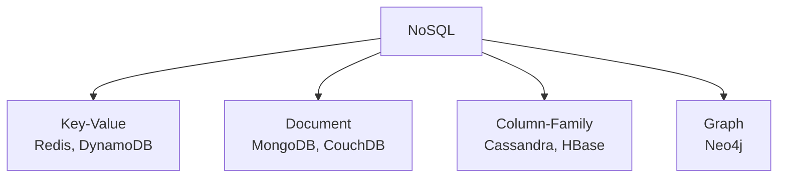
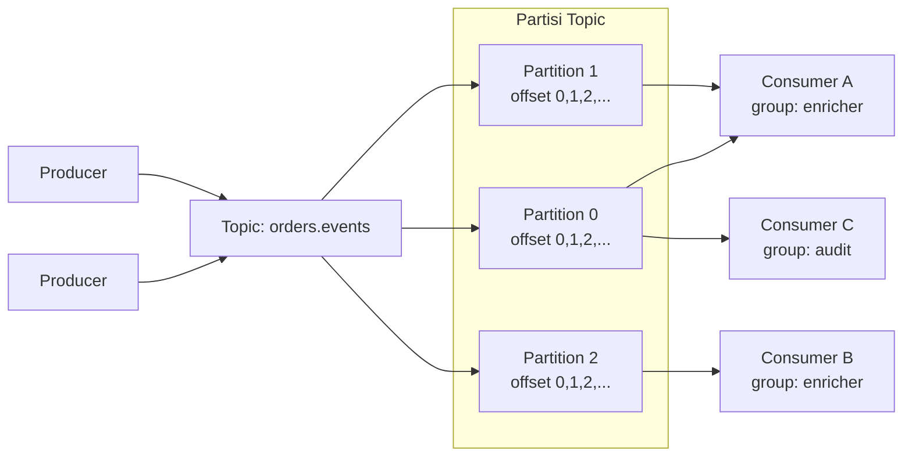

# Pertemuan 5: NoSQL, Kafka & Event Streaming

::: tip CAPAIAN PEMBELAJARAN (SUB-CPMK 5)
- **CPMK Terkait:** CPMK 3
- **CPL Terkait:** CPL03, CPL04
- **Indikator:** Mahasiswa mampu memilih jenis NoSQL berdasarkan pola akses, merancang model data dokumen dan kolumnar, serta membangun alur event streaming Kafka yang idempoten dan tahan kegagalan.
:::

---

## 1. Mengapa NoSQL?

Relational database mengutamakan integritas dan fleksibilitas query melalui normalisasi. Namun, pada sistem terdistribusi berskala besar, normalisasi dan join lintas node menjadi mahal. NoSQL muncul untuk mengoptimalkan **pola akses tertentu** dengan mengorbankan sebagian fleksibilitas.

| Kebutuhan | Solusi Relasional | Solusi NoSQL |
| :--- | :--- | :--- |
| Skala tulis sangat tinggi | Sharding manual, kompleks | Partisi bawaan |
| Skema cepat berubah | Migrasi tabel | Skema fleksibel / schema-on-read |
| Data hierarkis | Banyak join | Dokumen bersarang |
| Relasi kompleks | Join | Graph traversal |
| Latensi rendah per key | Index B-Tree | Key-value in-memory |

::: warning
NoSQL **bukan** pengganti otomatis RDBMS. Jika data Anda sangat relasional, transaksi multi-tabel penting, dan skala masih wajar, RDBMS sering menjadi pilihan paling sederhana dan benar.
:::

---

## 2. Taksonomi NoSQL



| Jenis | Model Data | Contoh | Cocok Untuk |
| :--- | :--- | :--- | :--- |
| **Key-Value** | `key → value` opaque | Redis, DynamoDB | Cache, session, counter, leaderboard |
| **Document** | JSON/BSON bersarang | MongoDB | Katalog produk, profil, konten |
| **Column-Family** | Baris dengan kolom dinamis, partisi | Cassandra, HBase | Time-series, event log, IoT skala besar |
| **Graph** | Node + edge + properti | Neo4j | Jejaring sosial, rekomendasi, fraud ring |

### ACID vs BASE

| ACID (RDBMS) | BASE (banyak NoSQL) |
| :--- | :--- |
| **Atomicity** — semua atau tidak sama sekali | **Basically Available** — selalu merespons |
| **Consistency** — aturan integritas selalu benar | **Soft state** — state dapat berubah tanpa input |
| **Isolation** — transaksi tidak saling mengganggu | **Eventual consistency** — konvergen pada akhirnya |
| **Durability** — data tersimpan permanen | |

Banyak NoSQL modern mendukung transaksi multi-dokumen (MongoDB 4.0+) dan quorum tuning (Cassandra). Batas ACID vs BASE makin kabur; pahami **jaminan aktual** produk yang dipakai.

---

## 3. MongoDB: Basis Data Dokumen

### 3.1 Model Data

```json
{
  "_id": "ord-20260901-0001",
  "customer_id": "cust-001",
  "status": "paid",
  "created_at": "2026-09-01T10:23:45Z",
  "items": [
    { "product_id": "prd-123", "name": "Keyboard", "price": 350000, "qty": 1 },
    { "product_id": "prd-456", "name": "Mouse",    "price": 150000, "qty": 2 }
  ],
  "shipping": { "city": "Banda Aceh", "cost": 20000 },
  "total": 670000
}
```

### 3.2 Embed vs Reference

| Strategi | Kapan | Konsekuensi |
| :--- | :--- | :--- |
| **Embed** (nested) | Data selalu dibaca bersama, ukuran terbatas, jarang berubah | Dokumen besar, duplikasi, update tersebar |
| **Reference** (ID) | Data mandiri, sering berubah, relasi banyak-ke-banyak | Butuh `$lookup`/query tambahan |

**Aturan praktis:** rancang berdasarkan **query**, bukan berdasarkan normalisasi. Jika 90% halaman pesanan menampilkan item, embed item di dokumen pesanan.

### 3.3 Operasi Dasar dengan PyMongo

```python
from datetime import datetime, timezone
from pymongo import MongoClient, ASCENDING

client = MongoClient("mongodb://localhost:27017")
db = client.shop
orders = db.orders

# Index sesuai pola query: pesanan terbaru per pelanggan
orders.create_index([("customer_id", ASCENDING), ("created_at", -1)])

orders.insert_one({
    "_id": "ord-20260901-0001",
    "customer_id": "cust-001",
    "status": "paid",
    "created_at": datetime.now(timezone.utc),
    "items": [{"product_id": "prd-123", "price": 350000, "qty": 1}],
    "total": 350000,
})

# Query
latest = list(orders.find({"customer_id": "cust-001"})
                    .sort("created_at", -1)
                    .limit(5))

# Update atomik
orders.update_one(
    {"_id": "ord-20260901-0001"},
    {"$set": {"status": "shipped"}, "$push": {"history": {"status": "shipped"}}},
)
```

### 3.4 Aggregation Pipeline

```python
pipeline = [
    {"$match": {"status": "paid"}},
    {"$unwind": "$items"},
    {"$group": {
        "_id": "$items.product_id",
        "revenue": {"$sum": {"$multiply": ["$items.price", "$items.qty"]}},
        "units": {"$sum": "$items.qty"},
    }},
    {"$sort": {"revenue": -1}},
    {"$limit": 5},
]
for row in orders.aggregate(pipeline):
    print(row)
```

Pipeline bekerja seperti rantai transformasi: `$match` (filter) → `$unwind` (pecah array) → `$group` (agregasi) → `$sort` → `$limit`.

---

## 4. Cassandra: Pemodelan *Query-First*

Cassandra adalah database terdistribusi **peer-to-peer** tanpa master, dirancang untuk ketersediaan tinggi dan throughput tulis besar.

### 4.1 Konsep Kunci

| Konsep | Peran |
| :--- | :--- |
| **Partition key** | Menentukan node tempat data disimpan (distribusi) |
| **Clustering column** | Menentukan urutan data di dalam partisi |
| **Replication factor (RF)** | Jumlah salinan per partisi |
| **Consistency level** | Berapa replika harus merespons (`ONE`, `QUORUM`, `ALL`) |

### 4.2 Desain Berdasarkan Query

> **Aturan emas:** satu tabel untuk satu query. Duplikasi data adalah hal normal; join tidak tersedia.

Query yang diinginkan:

```sql
-- Ambil 50 event terbaru untuk satu pengguna
SELECT * FROM events_by_user WHERE user_id = ? LIMIT 50;
```

Tabel:

```sql
CREATE TABLE events_by_user (
  user_id    text,
  event_date date,
  event_ts   timestamp,
  event_type text,
  payload    text,
  PRIMARY KEY ((user_id), event_date, event_ts)
) WITH CLUSTERING ORDER BY (event_date DESC, event_ts DESC);
```

- `user_id` = **partition key** → semua event pengguna berada di partisi yang sama.
- `(event_date, event_ts)` = **clustering** → data terurut menurun, query terbaru cepat.
- Query berdasarkan `event_type` memerlukan tabel lain, misalnya `events_by_type`.

::: danger Hindari `ALLOW FILTERING`
`SELECT * FROM events_by_user WHERE event_type = 'payment' ALLOW FILTERING;` memindai banyak partisi dan tidak scalable. Jika perlu query itu, buat tabel/indeks baru yang sesuai.
:::

### 4.3 Risiko Hot Partition

Partisi berdasarkan `user_id` aman jika pengguna tersebar. Partisi berdasarkan `event_date` saja akan menumpuk semua data hari itu di sedikit node. Pilih **partition key dengan kardinalitas tinggi dan distribusi merata**.

---

## 5. Apache Kafka: Log Event Terdistribusi

Kafka bukan sekadar message queue. Kafka adalah **log append-only terdistribusi** yang dapat dibaca banyak konsumen secara independen, diputar ulang, dan disimpan sesuai retensi.

### 5.1 Konsep



| Istilah | Arti |
| :--- | :--- |
| **Topic** | Kategori stream, seperti "tabel" pada database |
| **Partition** | Unit paralelisme dan urutan; ordering hanya di dalam partisi |
| **Offset** | Posisi record dalam partisi, dikelola per consumer group |
| **Producer** | Penulis record ke topic |
| **Consumer group** | Sekelompok konsumen yang berbagi beban; satu partisi hanya untuk satu konsumen per group |
| **Broker** | Server Kafka yang menyimpan partisi |
| **Retention** | Lama data disimpan (waktu/ukuran), bukan dihapus setelah dibaca |
| **Compaction** | Menyimpan nilai terakhir per key, cocok untuk state |

### 5.2 Ordering & Paralelisme

- Urutan **hanya dijamin per partisi**.
- Jumlah konsumen aktif dalam satu group tidak melebihi jumlah partisi; kelebihannya idle.
- Gunakan **key** yang stabil (mis. `order_id`) agar event terkait masuk partisi yang sama.

```python
producer.send("orders.events", key=order_id, value=event)
```

### 5.3 Delivery Semantics

| Mode | Cara | Risiko |
| :--- | :--- | :--- |
| **At most once** | Commit offset sebelum proses | Kehilangan data jika crash |
| **At least once** | Commit offset setelah proses | Duplikasi jika crash setelah proses sebelum commit |
| **Exactly once** | Transaksi/idempoten end-to-end | Paling kompleks, butuh dukungan sink |

Untuk sebagian besar sistem, **at-least-once + pemrosesan idempoten** adalah pilihan paling pragmatis.

```python
producer = KafkaProducer(
    bootstrap_servers="localhost:9092",
    acks="all",                    # semua replika mengonfirmasi
    enable_idempotence=True,       # cegah duplikasi akibat retry
    retries=5,
    key_serializer=lambda k: k.encode(),
    value_serializer=lambda v: json.dumps(v).encode(),
)
```

### 5.4 Consumer Group & Commit Manual

```python
from kafka import KafkaConsumer
import json

consumer = KafkaConsumer(
    "orders.events",
    bootstrap_servers="localhost:9092",
    group_id="order-enricher",
    auto_offset_reset="earliest",
    enable_auto_commit=False,              # commit manual
    value_deserializer=lambda b: json.loads(b.decode()),
)

for msg in consumer:
    process(msg.value)                     # harus idempoten
    consumer.commit()                      # commit setelah sukses
```

Jika `process` gagal, offset tidak di-commit dan pesan akan diproses ulang. Karena itu, `process` harus aman terhadap duplikasi:

```python
def process(event):
    orders.update_one(
        {"_id": event["order_id"]},
        {"$setOnInsert": event},           # insert jika belum ada
        upsert=True,
    )
```

---

## 6. Pola Integrasi Event-Driven

### 6.1 Dual-Write Problem

Menulis ke database **dan** mengirim event secara terpisah dapat menghasilkan inkonsistensi: database sukses tetapi event gagal, atau sebaliknya.

### 6.2 Outbox Pattern

```mermaid
sequenceDiagram
    participant App
    participant DB
    participant CDC as CDC Connector
    participant Kafka
    App->>DB: BEGIN; INSERT order; INSERT outbox; COMMIT
    DB-->>CDC: log perubahan (WAL/binlog)
    CDC->>Kafka: publish event
    Kafka->>Consumer: proses
```

Aplikasi menulis event ke **tabel outbox** dalam transaksi yang sama dengan data bisnis. Debezium membaca log database (CDC) dan mempublikasikannya ke Kafka. Tidak ada dual-write.

### 6.3 Schema Registry & Kompatibilitas

| Mode | Arti |
| :--- | :--- |
| **Backward** | Consumer baru dapat membaca data lama |
| **Forward** | Consumer lama dapat membaca data baru |
| **Full** | Keduanya |

Gunakan Avro/Protobuf + Schema Registry agar perubahan skema terdeteksi sebelum merusak konsumen.

### 6.4 Backpressure & Lag

- Pantau **consumer lag** (`kafka-consumer-groups.sh --describe`).
- Tambah konsumen **sampai batas jumlah partisi**.
- Jika konsumen kewalahan, pause/resume atau perbesar batch.
- Gunakan **dead letter queue (DLQ)** untuk pesan yang gagal permanen agar tidak memblokir stream.

---

## 7. Praktikum

### 7.1 Menjalankan Kafka (KRaft, satu node)

`docker-compose.yml`:

```yaml
services:
  kafka:
    image: apache/kafka:3.7.0
    container_name: kafka
    ports:
      - "9092:9092"
    environment:
      CLUSTER_ID: "MkU3OEVBNTcwNTJENDM2Qk"
      KAFKA_NODE_ID: 1
      KAFKA_PROCESS_ROLES: broker,controller
      KAFKA_LISTENERS: PLAINTEXT://:9092,CONTROLLER://:9093
      KAFKA_ADVERTISED_LISTENERS: PLAINTEXT://localhost:9092
      KAFKA_CONTROLLER_LISTENER_NAMES: CONTROLLER
      KAFKA_LISTENER_SECURITY_PROTOCOL_MAP: CONTROLLER:PLAINTEXT,PLAINTEXT:PLAINTEXT
      KAFKA_CONTROLLER_QUORUM_VOTERS: 1@localhost:9093
      KAFKA_OFFSETS_TOPIC_REPLICATION_FACTOR: 1
      KAFKA_TRANSACTION_STATE_LOG_REPLICATION_FACTOR: 1
      KAFKA_TRANSACTION_STATE_LOG_MIN_ISR: 1
```

```bash
docker compose up -d
docker exec -it kafka /opt/kafka/bin/kafka-topics.sh \
  --create --topic orders.events \
  --partitions 3 --replication-factor 1 \
  --bootstrap-server localhost:9092
```

### 7.2 Producer

```python
import json, random, time
from datetime import datetime, timezone
from kafka import KafkaProducer

producer = KafkaProducer(
    bootstrap_servers="localhost:9092",
    acks="all",
    enable_idempotence=True,
    key_serializer=lambda k: k.encode(),
    value_serializer=lambda v: json.dumps(v).encode(),
)

for i in range(100):
    order_id = f"ord-{i:05d}"
    event = {
        "order_id": order_id,
        "customer_id": f"cust-{random.randint(1, 50):03d}",
        "amount": random.randint(10_000, 1_000_000),
        "status": random.choice(["created", "paid", "cancelled"]),
        "event_ts": datetime.now(timezone.utc).isoformat(),
    }
    producer.send("orders.events", key=order_id, value=event).get(timeout=10)
    time.sleep(0.01)

producer.flush()
print("100 event terkirim")
```

### 7.3 Consumer

```python
import json
from kafka import KafkaConsumer

consumer = KafkaConsumer(
    "orders.events",
    bootstrap_servers="localhost:9092",
    group_id="order-enricher",
    auto_offset_reset="earliest",
    enable_auto_commit=False,
    value_deserializer=lambda b: json.loads(b.decode()),
)

for msg in consumer:
    print(msg.partition, msg.offset, msg.value)
    consumer.commit()
```

### 7.4 Cek Lag & Partisi

```bash
docker exec -it kafka /opt/kafka/bin/kafka-consumer-groups.sh \
  --bootstrap-server localhost:9092 \
  --describe --group order-enricher
```

### 7.5 MongoDB

```bash
docker run -d --name mongo -p 27017:27017 mongo:7
```

Uji operasi PyMongo pada Bagian 3, lalu bandingkan query dengan dan tanpa index menggunakan `explain("executionStats")`.

---

## 8. Tugas 5 — Streaming Idempoten + NoSQL (6%)

Bangun sistem kecil:

1. **Producer** mengirim event pesanan (minimal 1.000 event, 3 partisi, key = `order_id`).
2. **Consumer** memvalidasi event, lalu menulis ke MongoDB secara **idempoten** (`upsert` / cek idempotency key).
3. Simulasikan **duplikasi** (kirim event yang sama 2×) dan buktikan hasil akhir tetap benar.
4. Tangani pesan rusak dengan **dead letter queue** (topic `orders.dlq`).
5. Catat metrik: jumlah diproses, duplikat terdeteksi, gagal, lag akhir.
6. Dokumentasikan model data NoSQL dan alasan pemilihan key/partisi.

**Penilaian:** fungsionalitas (35%), idempotensi & penanganan error (30%), kualitas kode (20%), dokumentasi & analisis (15%).

---

## 9. Checklist

- [ ] Saya dapat memilih jenis NoSQL berdasarkan pola akses.
- [ ] Saya dapat merancang dokumen MongoDB (embed vs reference) dengan alasan.
- [ ] Saya dapat merancang tabel Cassandra dari query, bukan dari entitas.
- [ ] Saya dapat menjelaskan topic, partition, offset, dan consumer group.
- [ ] Saya dapat membedakan at-most-once, at-least-once, dan exactly-once.
- [ ] Saya dapat membuat consumer idempoten dan memantau lag.

---

## 📚 Bacaan Lanjutan

- Kleppmann, M. (2017). *Designing Data-Intensive Applications*, Bab 11–12.
- Narkhede, N., Shapira, G., & Palino, T. (2021). *Kafka: The Definitive Guide* (2nd ed.).
- MongoDB Documentation — *Data Modeling & Aggregation Pipeline*.
- Apache Cassandra Documentation — *Data Modeling*.
