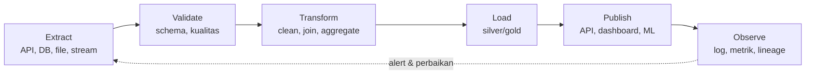

# Pertemuan 6: Pipeline, Orkestrasi & Kualitas Data

::: info 🎓 Bacaan Teori Wajib (Kelas RPL)
Baca **[Buku Teori Big Data — Pertemuan 6](/big-data/TEORI-RPL#p6)** sebelum praktik. Latihan teknis di modul ini adalah **pengayaan/verifikasi**; fokus utama adalah pemahaman konsep dan kemampuan menjelaskan trade-off.
:::

::: tip 🎙️ Slide Presentasi Interaktif
Buka **[slide presentasi Pertemuan 6](/presentasi/pertemuan-6-big-data)** — dilengkapi navigasi keyboard, timer, transkrip, dan narasi audio.
Untuk presentasi layar penuh, buka **[HTML interaktif](/Perkuliahan/presentasi/pertemuan-6-pipeline-airflow.html)** di tab baru.
:::

::: tip CAPAIAN PEMBELAJARAN (SUB-CPMK 6)
- **CPMK Terkait:** CPMK 4
- **CPL Terkait:** CPL04, CPL08
- **Indikator:** Mahasiswa mampu merancang pipeline idempoten, mengotomasi dependensi dengan Airflow, menerapkan uji kualitas data, serta menyiapkan observabilitas dan CI/CD untuk pipeline data.
:::

---

## 1. Pipeline Data sebagai Produk

Pipeline data bukan skrip sekali pakai. Ia adalah **produk perangkat lunak** yang memiliki pemilik, kontrak, versi, test, dan SLA.

| Aspek | Skrip ad-hoc | Pipeline production-grade |
| :--- | :--- | :--- |
| Penjadwalan | Dijalankan manual | Terjadwal, ada dependensi |
| Kegagalan | Diperbaiki manual | Retry, alert, runbook |
| Data salah | Diketahui pengguna | Diblokir oleh quality gate |
| Perubahan | Edit langsung | Version control + review + CI |
| Biaya | Tidak terukur | Dipantau per pipeline |

### 1.1 ETL vs ELT

| Aspek | ETL | ELT |
| :--- | :--- | :--- |
| Urutan | Transform sebelum load | Load mentah, transform di warehouse/lake |
| Cocok untuk | Data sensitif, transformasi kompleks di luar DB | Cloud warehouse/lakehouse dengan komputasi elastis |
| Contoh | Sqoop → transform → warehouse | Fivetran/Airbyte → dbt → warehouse |

### 1.2 Anatomi Pipeline



---

## 2. Prinsip Pipeline yang Andal

### 2.1 Idempotensi

Menjalankan pipeline **dua kali** untuk tanggal yang sama harus menghasilkan data yang sama, bukan duplikasi.

| Strategi | Cara |
| :--- | :--- |
| **Partition overwrite** | Tulis ulang seluruh partisi tanggal (`mode("overwrite")`) |
| **MERGE/UPSERT** | Update berdasarkan primary key |
| **Dedup by event_id** | Simpan hanya versi terbaru |
| **Write-audit-publish (WAP)** | Tulis ke staging → audit → tukar ke tabel produksi |

```python
# Idempoten: partisi tanggal ditimpa, bukan ditambahkan
(df.write
   .mode("overwrite")
   .partitionBy("dt")
   .parquet("s3://lake/silver/events"))
```

::: warning
`mode("append")` tanpa deduplikasi adalah penyebab paling umum data ganda. Pastikan setiap pipeline memiliki **kunci unik** dan strategi penulisan yang jelas.
:::

### 2.2 Retry, Timeout, dan Backfill

- **Retry** untuk kegagalan sementara (jaringan, API rate limit). Gunakan *exponential backoff*.
- **Timeout** agar task tidak menggantung selamanya.
- **Backfill** untuk memproses ulang tanggal historis setelah bug diperbaiki.
- **Logical date** (`ds`) harus menjadi parameter, bukan `datetime.now()`, agar backfill menghasilkan data yang benar.

```python
# ❌ Salah: selalu memproses hari ini
today = datetime.now().date()

# ✅ Benar: tanggal logis dari scheduler
def run(ds: str):
    process(date.fromisoformat(ds))
```

### 2.3 Late-Arriving Data

Data bisa datang terlambat (mis. event pukul 23:59 baru tiba pukul 01:00). Strategi:

- Proses ulang jendela waktu (mis. 3 hari terakhir) setiap run.
- Gunakan watermark pada streaming.
- Tandai data sebagai *provisional* sampai jendela tutup.

---

## 3. Apache Airflow

Airflow mengorkestrasi **task**, bukan memproses data itu sendiri. Ia menjawab: *apa yang harus jalan, kapan, dalam urutan apa, dan apa yang terjadi jika gagal?*

### 3.1 Konsep

| Konsep | Arti |
| :--- | :--- |
| **DAG** | Graf asiklik berarah: kumpulan task + dependensi |
| **Operator** | Template task (Python, Bash, Spark, SQL, HTTP) |
| **Task** | Instance operator dalam DAG |
| **Scheduler** | Memicu DAG sesuai jadwal dan dependensi |
| **Executor** | Menjalankan task (Local, Celery, Kubernetes) |
| **XCom** | Pertukaran metadata kecil antar task (**bukan** data besar) |
| **Catchup** | Menjalankan otomatis jadwal yang terlewat |
| **Backfill** | Menjalankan ulang rentang tanggal tertentu |

### 3.2 DAG Contoh: Orders Daily

```python
from datetime import datetime, timedelta

from airflow.decorators import dag, task
from airflow.exceptions import AirflowFailException
from airflow.operators.bash import BashOperator


@dag(
    dag_id="orders_daily",
    schedule="0 2 * * *",              # setiap hari 02:00
    start_date=datetime(2026, 9, 1),
    catchup=False,
    max_active_runs=1,
    default_args={
        "retries": 2,
        "retry_delay": timedelta(minutes=5),
        "execution_timeout": timedelta(hours=1),
    },
    tags=["big-data", "orders"],
)
def orders_daily():

    extract = BashOperator(
        task_id="extract_to_bronze",
        bash_command="python /opt/airflow/jobs/extract.py --date {{ ds }}",
    )

    transform = BashOperator(
        task_id="spark_bronze_to_gold",
        bash_command=(
            "spark-submit --master local[*] "
            "/opt/airflow/jobs/transform.py --date {{ ds }}"
        ),
    )

    @task
    def quality_gate(ds: str):
        import json
        from pathlib import Path

        report_path = Path(f"/opt/airflow/data/quality/{ds}.json")
        report = json.loads(report_path.read_text())
        if report["failed_checks"]:
            raise AirflowFailException(
                f"Kualitas data gagal: {report['failed_checks']}"
            )

    publish = BashOperator(
        task_id="publish_gold",
        bash_command="python /opt/airflow/jobs/publish.py --date {{ ds }}",
    )

    extract >> transform >> quality_gate() >> publish


orders_daily()
```

**Yang membuat DAG ini layak produksi:**

- `catchup=False` untuk menghindari ledakan run saat pertama kali di-deploy (kecuali memang butuh backfill).
- `max_active_runs=1` mencegah dua run menulis partisi yang sama bersamaan.
- Retry + timeout eksplisit.
- Quality gate **memblokir** publish jika data buruk.
- Tanggal logis `{{ ds }}` dipakai konsisten.

### 3.3 XCom: Batasan Penting

XCom menyimpan metadata kecil (ID, path, status) di database Airflow. **Jangan** mengoper DataFrame besar via XCom — simpan di object storage dan oper path-nya.

```python
@task
def extract(ds: str) -> str:
    path = f"s3://lake/bronze/orders/dt={ds}/"
    ...
    return path            # hanya string path

@task
def transform(path: str) -> str:
    ...
```

### 3.4 Pola DAG yang Baik

| Pola | Alasan |
| :--- | :--- |
| Satu DAG = satu pipeline bisnis | Mudah dipantau dan dimiliki |
| Task kecil dan spesifik | Retry tidak mengulang seluruh proses |
| Idempoten | Aman untuk retry/backfill |
| Parameter tanggal logis | Backfill konsisten |
| Alert pada kegagalan | Deteksi cepat |
| Tidak ada business logic di DAG | DAG hanya orkestrasi; logika di modul teruji |

---

## 4. Kualitas Data

### 4.1 Dimensi Kualitas

| Dimensi | Pertanyaan | Contoh Uji |
| :--- | :--- | :--- |
| **Completeness** | Apakah semua data ada? | `null_rate < 1%` |
| **Uniqueness** | Apakah ada duplikat? | `count(*) = count(distinct event_id)` |
| **Validity** | Apakah nilai sesuai domain? | `status IN ('paid','pending')` |
| **Consistency** | Apakah antar-tabel cocok? | total order = sum item |
| **Timeliness** | Apakah data cukup baru? | `max(ingested_at) > now() - 2h` |
| **Accuracy** | Apakah mencerminkan kenyataan? | rekonsiliasi dengan sumber |
| **Volume** | Apakah jumlah wajar? | `row_count` dalam ±30% baseline |

### 4.2 Uji Kualitas dengan PySpark

```python
from pyspark.sql import DataFrame, functions as F

def quality_report(df: DataFrame) -> dict:
    total = df.count()
    checks = {
        "row_count_positive": total > 0,
        "event_id_not_null": df.filter(F.col("event_id").isNull()).count() == 0,
        "event_id_unique": total == df.select("event_id").distinct().count(),
        "amount_non_negative": df.filter(F.col("amount") < 0).count() == 0,
        "valid_event_type": df.filter(
            ~F.col("event_type").isin("view", "add_to_cart", "checkout", "payment", "refund")
        ).count() == 0,
    }
    return {
        "total_rows": total,
        "failed_checks": [name for name, ok in checks.items() if not ok],
    }
```

### 4.3 Uji Kualitas dengan SQL

```sql
-- Gagal jika ada duplikat
SELECT event_id, COUNT(*) AS n
FROM silver.events
WHERE dt = DATE '2026-09-01'
GROUP BY event_id
HAVING COUNT(*) > 1;

-- Gagal jika tingkat null terlalu tinggi
SELECT
  COUNT(*) AS total,
  SUM(CASE WHEN user_id IS NULL THEN 1 ELSE 0 END) AS null_users,
  ROUND(100.0 * SUM(CASE WHEN user_id IS NULL THEN 1 ELSE 0 END) / COUNT(*), 2) AS null_pct
FROM silver.events
WHERE dt = DATE '2026-09-01';
```

### 4.4 Quality Gate

Quality gate adalah **keputusan otomatis**: jika data gagal uji kritis, pipeline berhenti dan **tidak** mempublikasikan data buruk ke gold. Bedakan:

- **Critical** → hentikan pipeline.
- **Warning** → lanjutkan, tetapi kirim alert.

---

## 5. Observabilitas Pipeline

| Sinyal | Contoh Metrik | Ambang/Alert |
| :--- | :--- | :--- |
| **Freshness** | Waktu sejak data terakhir masuk | > 2 jam → alert |
| **Volume** | Jumlah baris per run | ±30% dari rata-rata 7 hari |
| **Schema drift** | Kolom baru/hilang/tipe berubah | Perubahan tak terduga → alert |
| **Error rate** | Persentase record ditolak | > 1% → alert |
| **Duration** | Waktu eksekusi | > 2× baseline |
| **Cost** | DBU/GB dipindai per run | > budget harian |
| **Lineage** | Asal-usul tabel gold | Audit & debugging |

```python
import logging
import json

logging.basicConfig(level=logging.INFO, format="%(asctime)s %(levelname)s %(message)s")
log = logging.getLogger("orders_pipeline")

log.info(json.dumps({
    "event": "pipeline_complete",
    "dag": "orders_daily",
    "ds": ds,
    "rows_in": rows_in,
    "rows_out": rows_out,
    "rejected": rejected,
    "duration_sec": duration,
}))
```

Log terstruktur (JSON) memudahkan pencarian dan agregasi di sistem observabilitas.

---

## 6. CI/CD untuk Pipeline Data

### 6.1 Struktur Repositori yang Disarankan

```text
data-platform/
├── dags/
│   └── orders_daily.py
├── jobs/
│   ├── extract.py
│   ├── transform.py
│   └── publish.py
├── tests/
│   ├── test_transforms.py
│   └── test_quality.py
├── sql/
│   └── gold_orders.sql
├── docker-compose.yml
├── requirements.txt
├── Makefile
└── README.md
```

### 6.2 GitHub Actions

```yaml
name: data-pipeline-ci

on: [push, pull_request]

jobs:
  test:
    runs-on: ubuntu-latest
    steps:
      - uses: actions/checkout@v4
      - uses: actions/setup-python@v5
        with:
          python-version: "3.11"
      - uses: actions/setup-java@v4
        with:
          distribution: temurin
          java-version: "17"
      - run: pip install -r requirements.txt
      - run: ruff check .
      - run: pytest -q
```

### 6.3 Prinsip Deploy

1. **Review** perubahan DAG seperti kode biasa.
2. **Uji** transformasi dengan data sampel di CI.
3. **Deploy ke staging** dan jalankan untuk satu tanggal.
4. **Validasi output** sebelum produksi.
5. **Rilis** dengan versioning; simpan changelog.
6. **Rollback** dengan mengembalikan versi sebelumnya.

### 6.4 Manajemen Rahasia

- Jangan pernah commit kredensial.
- Gunakan environment variable/secret manager (Vault, AWS Secrets Manager, GitHub Secrets).
- Terapkan **least privilege**: pipeline hanya butuh akses ke bucket/tabel tertentu.
- Rotasi kredensial secara berkala.

---

## 7. Praktik Terbimbing (Pengayaan): Airflow Lokal

### 7.1 Menjalankan Airflow dengan Docker Compose

```bash
curl -LfO 'https://airflow.apache.org/docs/apache-airflow/2.9.3/docker-compose.yaml'
mkdir -p ./dags ./logs ./plugins ./config
echo -e "AIRFLOW_UID=50000" > .env

docker compose up airflow-init
docker compose up -d
```

Buka `http://localhost:8080` (user: `airflow`, password: `airflow`).

### 7.2 Menambahkan DAG

1. Salin `orders_daily.py` ke folder `dags/`.
2. Salin `extract.py`, `transform.py`, dan `publish.py` ke folder `jobs/` (mount ke container).
3. Tunggu scheduler memuat DAG (±30 detik).
4. Aktifkan DAG, lalu **Trigger DAG** secara manual.
5. Periksa **Graph View**, **Logs**, dan status setiap task.

### 7.3 Simulasi Kegagalan

1. Ubah `quality_gate` agar selalu gagal.
2. Trigger ulang; pastikan `publish_gold` **tidak** berjalan.
3. Perbaiki, lalu trigger lagi; pastikan pipeline selesai.
4. Diskusikan: mengapa `retry` tidak menyelesaikan masalah kualitas data?

### 7.4 Alternatif Tanpa Airflow

Jika resource terbatas, buat `Makefile`:

```makefile
run:
	python jobs/extract.py --date $(DATE)
	python jobs/transform.py --date $(DATE)
	python jobs/quality.py --date $(DATE)
	python jobs/publish.py --date $(DATE)
```

```bash
make run DATE=2026-09-01
```

Struktur dan prinsip idempotensi tetap sama; Airflow hanya menambahkan penjadwalan, retry, dan visibilitas.

---

## 8. Milestone Proyek 1 (Bukan Tugas Baru)

Pada pertemuan ini, setiap kelompok menyerahkan **Milestone 1**:

1. **Diagram arsitektur** pipeline (sumber → bronze → silver → gold → serving).
2. **DAG Airflow** (atau Makefile) yang menjalankan minimal 3 tahap.
3. **Minimal 5 uji kualitas** dengan quality gate.
4. **README** berisi cara menjalankan, dependency, dan asumsi.
5. **Bukti eksekusi**: screenshot/log sukses dan satu simulasi kegagalan.

**Review:** 10 menit per kelompok, fokus pada idempotensi, penanganan error, dan kejelasan pembagian tugas.

---

## 9. Checklist

- [ ] Saya dapat menjelaskan perbedaan ETL dan ELT serta kapan memilihnya.
- [ ] Saya dapat merancang pipeline idempoten dengan tanggal logis.
- [ ] Saya dapat membuat DAG Airflow dengan retry, timeout, dan quality gate.
- [ ] Saya dapat menulis uji kualitas untuk minimal 5 dimensi.
- [ ] Saya dapat merancang observabilitas (freshness, volume, error rate).
- [ ] Saya dapat menyiapkan CI untuk test pipeline.

---

## 📚 Bacaan Lanjutan

- Reis, J., & Housley, M. (2022). *Fundamentals of Data Engineering*, Bab 8–10.
- Apache Airflow Documentation — *Best Practices*.
- dbt Labs — *Data Tests & Documentation*.
- Kleppmann, M. (2017). *Designing Data-Intensive Applications*, Bab 10.
