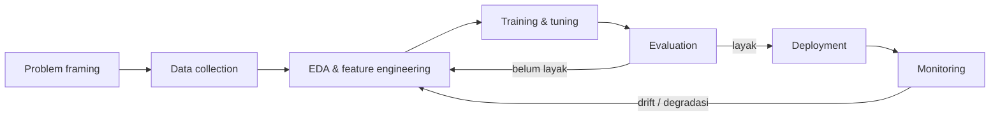

# Pertemuan 7: Analitik & Machine Learning Terdistribusi

::: tip 🎙️ Slide Presentasi Interaktif
Buka **[slide presentasi Pertemuan 7](/presentasi/pertemuan-7-big-data)** — dilengkapi navigasi keyboard, timer, transkrip, dan narasi audio.
Untuk presentasi layar penuh, buka **[HTML interaktif](/Perkuliahan/presentasi/pertemuan-7-ml-terdistribusi.html)** di tab baru.
:::

::: tip CAPAIAN PEMBELAJARAN (SUB-CPMK 7)
- **CPMK Terkait:** CPMK 4
- **CPL Terkait:** CPL04, CPL05
- **Indikator:** Mahasiswa mampu membangun pipeline machine learning dengan Spark MLlib, memilih metrik evaluasi yang tepat, menghasilkan batch scoring, serta menilai kesiapan model untuk produksi (versioning, monitoring, drift).
:::

---

## 1. Dari Analitik ke Machine Learning

| Tingkat | Pertanyaan | Contoh | Keluaran |
| :--- | :--- | :--- | :--- |
| **Descriptive** | Apa yang terjadi? | Penjualan harian | Dashboard, laporan |
| **Diagnostic** | Mengapa terjadi? | Analisis funnel, kohort | Root cause |
| **Predictive** | Apa yang akan terjadi? | Churn, fraud, demand | Skor prediksi |
| **Prescriptive** | Apa yang sebaiknya dilakukan? | Optimasi harga, rekomendasi | Rekomendasi aksi |

Big Data menyediakan **bahan bakar** (data dalam jumlah besar) dan **infrastruktur** (komputasi terdistribusi) untuk machine learning. Namun, data besar tidak otomatis menghasilkan model baik: **kualitas label, relevansi fitur, dan validasi** tetap menentukan.

::: warning Kapan Tidak Perlu Terdistribusi?
Jika dataset Anda 500 MB dan model scikit-learn selesai dalam 2 menit, **tidak perlu** Spark ML. Gunakan Spark untuk **preprocessing data besar**, lalu latih model pada sampel/agregat. Distribusi menambah kompleksitas operasional yang harus dibayar.
:::

---

## 2. Siklus Hidup ML



| Tahap | Pertanyaan Kunci | Artefak |
| :--- | :--- | :--- |
| Problem framing | Keputusan apa yang dibantu? | Definisi label, metrik sukses |
| Data | Apakah data representatif dan bebas leakage? | Dataset versi, data dictionary |
| Features | Apakah fitur tersedia saat prediksi? | Feature pipeline |
| Training | Algoritma & hyperparameter apa? | Model + parameter |
| Evaluation | Apakah lebih baik dari baseline? | Metrik, confusion matrix |
| Deployment | Batch atau online? | API/batch job, model version |
| Monitoring | Apakah performa menurun? | Dashboard drift & metrik |

---

## 3. Spark MLlib: Konsep

MLlib menyediakan API berbasis DataFrame dengan pola **Transformer** dan **Estimator**:

| Istilah | Arti | Contoh |
| :--- | :--- | :--- |
| **Transformer** | `transform(df)` → df baru | `StringIndexer`, `VectorAssembler` |
| **Estimator** | `fit(df)` → Transformer (model) | `LogisticRegression`, `ALS` |
| **Pipeline** | Rangkaian stage | Preprocessing + model |
| **Evaluator** | Menghitung metrik | `BinaryClassificationEvaluator` |

Semua tahap dibungkus dalam `Pipeline` agar preprocessing yang sama diterapkan saat training dan scoring — mencegah **training-serving skew**.

---

## 4. Feature Engineering Skala Besar

### 4.1 Tantangan

| Tantangan | Risiko | Solusi |
| :--- | :--- | :--- |
| Data leakage | Model terlihat bagus, gagal di produksi | Hanya fitur yang tersedia sebelum label |
| Kardinalitas tinggi | Dimensi meledak | Hashing, target encoding, top-K |
| Missing values | Bias / error | Imputer + indikator missing |
| Skala fitur berbeda | Konvergensi lambat | StandardScaler/MinMaxScaler |
| Class imbalance | Prediksi condong ke mayoritas | Bobot kelas, resampling, metrik tepat |
| Data masa depan | Evaluasi tidak valid | Split berdasarkan waktu |

### 4.2 Transformasi Umum

```python
from pyspark.ml.feature import (
    StringIndexer, OneHotEncoder, VectorAssembler,
    StandardScaler, Imputer,
)

cat_cols = ["city", "channel", "plan_type"]
num_cols = ["tenure_months", "monthly_charge", "support_tickets"]

indexer = StringIndexer(
    inputCols=cat_cols,
    outputCols=[f"{c}_idx" for c in cat_cols],
    handleInvalid="keep",
)
encoder = OneHotEncoder(
    inputCols=[f"{c}_idx" for c in cat_cols],
    outputCols=[f"{c}_ohe" for c in cat_cols],
)
imputer = Imputer(
    inputCols=num_cols,
    outputCols=[f"{c}_imp" for c in num_cols],
    strategy="median",
)
assembler = VectorAssembler(
    inputCols=[f"{c}_ohe" for c in cat_cols] + [f"{c}_imp" for c in num_cols],
    outputCol="features_raw",
)
scaler = StandardScaler(
    inputCol="features_raw",
    outputCol="features",
    withMean=True,
    withStd=True,
)
```

> **Penting:** `StringIndexer` menyimpan mapping kategori. Simpan seluruh `PipelineModel`, bukan hanya model algoritma, agar kategori baru saat scoring ditangani konsisten (`handleInvalid="keep"`).

---

## 5. Contoh: Prediksi Churn

### 5.1 Menyiapkan Data

```python
from pyspark.sql import SparkSession, functions as F

spark = (SparkSession.builder
         .appName("churn-ml")
         .master("local[*]")
         .config("spark.sql.shuffle.partitions", "8")
         .getOrCreate())

df = spark.read.parquet("data/gold/customer_features")
df = df.withColumn("label", F.col("churn").cast("int")).drop("churn")

train, test = df.randomSplit([0.8, 0.2], seed=42)

print("Train:", train.count(), "Test:", test.count())
print("Distribusi label:")
df.groupBy("label").count().show()
```

### 5.2 Pipeline Training

```python
from pyspark.ml import Pipeline
from pyspark.ml.classification import LogisticRegression
from pyspark.ml.evaluation import BinaryClassificationEvaluator

lr = LogisticRegression(
    featuresCol="features",
    labelCol="label",
    maxIter=50,
    regParam=0.01,
)

pipeline = Pipeline(stages=[
    indexer, encoder, imputer, assembler, scaler, lr,
])

model = pipeline.fit(train)
predictions = model.transform(test)

evaluator = BinaryClassificationEvaluator(
    labelCol="label",
    metricName="areaUnderROC",
)
print("ROC-AUC:", round(evaluator.evaluate(predictions), 4))
```

### 5.3 Confusion Matrix & Metrik

```python
predictions.groupBy("label", "prediction").count().show()

tp = predictions.filter((F.col("label") == 1) & (F.col("prediction") == 1)).count()
tn = predictions.filter((F.col("label") == 0) & (F.col("prediction") == 0)).count()
fp = predictions.filter((F.col("label") == 0) & (F.col("prediction") == 1)).count()
fn = predictions.filter((F.col("label") == 1) & (F.col("prediction") == 0)).count()

precision = tp / (tp + fp) if (tp + fp) else 0
recall    = tp / (tp + fn) if (tp + fn) else 0
f1        = 2 * precision * recall / (precision + recall) if (precision + recall) else 0

print(f"TP={tp} TN={tn} FP={fp} FN={fn}")
print(f"Precision={precision:.3f} Recall={recall:.3f} F1={f1:.3f}")
```

### 5.4 Cross-Validation

```python
from pyspark.ml.tuning import CrossValidator, ParamGridBuilder

param_grid = (ParamGridBuilder()
              .addGrid(lr.regParam, [0.001, 0.01, 0.1])
              .addGrid(lr.elasticNetParam, [0.0, 0.5])
              .build())

cv = CrossValidator(
    estimator=pipeline,
    estimatorParamMaps=param_grid,
    evaluator=evaluator,
    numFolds=3,
    parallelism=2,
    seed=42,
)

cv_model = cv.fit(train)
best = cv_model.bestModel
print("ROC-AUC CV:", round(cv_model.avgMetrics[0], 4))
print("RegParam terbaik:", best.stages[-1].getRegParam())
```

### 5.5 Menyimpan & Memuat Model

```python
cv_model.bestModel.write().overwrite().save("models/churn_pipeline")

from pyspark.ml import PipelineModel
loaded = PipelineModel.load("models/churn_pipeline")
scored = loaded.transform(test)
```

Simpan juga **metadata**: versi data, tanggal training, hyperparameter, metrik, dan commit Git.

---

## 6. Sistem Rekomendasi dengan ALS

Alternating Least Squares (ALS) memfaktorkan matriks user–item menjadi vektor latent.

```python
from pyspark.ml.recommendation import ALS

ratings = spark.read.parquet("data/gold/ratings")

train_r, test_r = ratings.randomSplit([0.8, 0.2], seed=42)

als = ALS(
    userCol="user_id",
    itemCol="product_id",
    ratingCol="rating",
    rank=20,
    maxIter=10,
    regParam=0.1,
    nonnegative=True,
    coldStartStrategy="drop",     # hindari NaN saat evaluasi
)

als_model = als.fit(train_r)
predictions = als_model.transform(test_r)

from pyspark.ml.evaluation import RegressionEvaluator
rmse = RegressionEvaluator(
    metricName="rmse", labelCol="rating", predictionCol="prediction"
).evaluate(predictions)
print("RMSE:", round(rmse, 4))

# Top-10 rekomendasi per pengguna
recs = als_model.recommendForAllUsers(10)
recs.show(5, truncate=False)
```

| Parameter | Efek |
| :--- | :--- |
| `rank` | Jumlah faktor latent; terlalu kecil underfit, terlalu besar overfit |
| `regParam` | Regularisasi; menaikkan mengurangi overfit |
| `maxIter` | Jumlah iterasi ALS |
| `coldStartStrategy="drop"` | Mengabaikan user/item baru saat evaluasi |

---

## 7. Metrik Evaluasi

### 7.1 Klasifikasi

| Metrik | Rumus | Fokus |
| :--- | :--- | :--- |
| **Accuracy** | (TP+TN) / Total | Menyesatkan pada class imbalance |
| **Precision** | TP / (TP+FP) | Ketepatan prediksi positif |
| **Recall** | TP / (TP+FN) | Kemampuan menemukan positif |
| **F1-Score** | 2·P·R / (P+R) | Keseimbangan precision–recall |
| **ROC-AUC** | Luas di bawah kurva ROC | Kemampuan ranking keseluruhan |
| **PR-AUC** | Luas kurva precision–recall | Lebih baik untuk kelas minoritas |

> **Contoh:** dataset fraud 1% positif. Model yang selalu menebak "bukan fraud" mendapat accuracy 99%, tetapi **recall = 0** dan tidak berguna. Gunakan recall, PR-AUC, dan biaya bisnis.

### 7.2 Regresi

| Metrik | Arti | Sensitif terhadap outlier? |
| :--- | :--- | :---: |
| **MAE** | Rata-rata error absolut | Tidak |
| **RMSE** | Akar rata-rata kuadrat error | Ya |
| **R²** | Proporsi varians yang dijelaskan | Ya |

### 7.3 Memilih Metrik

1. Tentukan **biaya** false positive vs false negative.
2. Pilih metrik yang mencerminkan biaya tersebut.
3. Tetapkan **baseline** (model sederhana/heuristik).
4. Laporkan lebih dari satu metrik + interval kepercayaan.

---

## 8. Deployment & MLOps

### 8.1 Pola Serving

| Pola | Cara | Latensi | Cocok Untuk |
| :--- | :--- | :--- | :--- |
| **Batch scoring** | Jadwal harian, tulis skor ke tabel | Jam | Churn, risk score, segmentasi |
| **Online API** | Layanan REST memuat model | Milidetik–detik | Fraud, rekomendasi real-time |
| **Streaming scoring** | Kafka + model di stream processor | Detik | Deteksi anomali event |

Spark sangat baik untuk **batch scoring** dan preprocessing. Untuk online inference, ekspor model (MLflow, ONNX, MLeap) atau panggil model server khusus; jangan menjalankan Spark job per request.

### 8.2 Batch Scoring

```python
model = PipelineModel.load("models/churn_pipeline")
today = spark.read.parquet("data/gold/customer_features_today")

scored = (model.transform(today)
          .select("customer_id", "probability", "prediction", "scored_at"))

(scored.write.mode("overwrite")
       .partitionBy("scored_at")
       .parquet("data/serving/churn_scores"))
```

### 8.3 Model Registry & Versioning

| Artefak | Isi |
| :--- | :--- |
| **Model version** | Hash/versi, tanggal, pemilik |
| **Data version** | Snapshot/commit dataset training |
| **Kode** | Commit Git pipeline |
| **Parameter** | Hyperparameter & seed |
| **Metrik** | Evaluasi pada test set |
| **Kartu model** | Tujuan, batasan, bias, penggunaan yang dilarang |

Alat: MLflow Model Registry, DVC, Git LFS.

### 8.4 Monitoring

| Jenis Drift | Definisi | Deteksi |
| :--- | :--- | :--- |
| **Data drift** | Distribusi fitur berubah | PSI, KS-test, perbandingan histogram |
| **Concept drift** | Hubungan fitur–label berubah | Penurunan metrik aktual |
| **Prediction drift** | Distribusi skor berubah | Rata-rata/kuantil skor |
| **Data quality** | Nilai hilang/aneh meningkat | Uji kualitas |

```python
# Contoh sederhana: bandingkan rata-rata fitur training vs produksi
train_mean = train.select(F.mean("monthly_charge")).first()[0]
prod_mean = today.select(F.mean("monthly_charge")).first()[0]
print("Perubahan:", round((prod_mean - train_mean) / train_mean * 100, 2), "%")
```

Tetapkan ambang alert, jadwalkan retraining, dan simpan **model cadangan** untuk rollback.

---

## 9. ML Terdistribusi: Realitas

| Pendekatan | Kapan | Catatan |
| :--- | :--- | :--- |
| **Spark MLlib** | Data tabular besar, preprocessing terdistribusi | Model terbatas dibanding library deep learning |
| **Data-parallel training** | Deep learning, banyak GPU | Sinkronisasi gradien; butuh bandwidth tinggi |
| **Model-parallel** | Model terlalu besar untuk satu GPU | Kompleks; pipeline parallelism |
| **Parameter server** | Model besar, worker banyak | Trade-off konsistensi & kecepatan |
| **Federated learning** | Data tersebar & privat | Privasi, non-IID |

Pola umum: **Spark untuk ETL & feature engineering → export ke Parquet → latih deep learning dengan PyTorch/Ray → deploy model**.

---

## 10. Praktikum: Churn Pipeline End-to-End

1. Siapkan dataset fitur pelanggan (minimal 50.000 baris, gabungkan data dari Pertemuan 4).
2. Definisikan label churn secara eksplisit dan jelaskan **cutoff waktu** untuk menghindari leakage.
3. Bangun pipeline: imputer → indexer → encoder → assembler → scaler → LogisticRegression.
4. Latih baseline (mayoritas kelas) dan model; bandingkan metrik.
5. Lakukan cross-validation minimal 3-fold untuk 2 hyperparameter.
6. Simpan `PipelineModel` + metadata ke folder `models/`.
7. Lakukan batch scoring pada data "hari ini" dan tulis ke `serving/`.
8. Buat **model card** 1 halaman: tujuan, data, metrik, batasan, risiko bias.

---

## 11. Milestone Proyek 2

Serahkan:

1. **Pipeline ML** yang terintegrasi dengan pipeline data Pertemuan 6.
2. **Perbandingan baseline vs model** (tabel metrik).
3. **Model card** dan versi artefak.
4. **Rencana deployment**: batch/online, jadwal, cara rollback.
5. **Rencana monitoring**: metrik drift dan ambang alert.

**Review:** fokus pada validitas evaluasi (leakage, split waktu) dan kejelasan penggunaan model.

---

## 12. Checklist

- [ ] Saya dapat menjelaskan perbedaan Transformer dan Estimator.
- [ ] Saya dapat membangun pipeline MLlib lengkap dan menyimpannya.
- [ ] Saya dapat memilih metrik yang tepat untuk class imbalance.
- [ ] Saya dapat menjelaskan risiko data leakage dan cara mencegahnya.
- [ ] Saya dapat memilih batch vs online serving dengan alasan.
- [ ] Saya dapat merancang monitoring drift dan rollback model.

---

## 📚 Bacaan Lanjutan

- Chambers, B., & Zaharia, M. (2018). *Spark: The Definitive Guide*, Bab 24–25.
- Leskovec, J., Rajaraman, A., & Ullman, J. (2020). *Mining of Massive Datasets*, Bab 9.
- Google (2022). *MLOps: Continuous delivery and automation pipelines in machine learning*.
- Sculley, D., et al. (2015). *Hidden Technical Debt in Machine Learning Systems*. NeurIPS.
