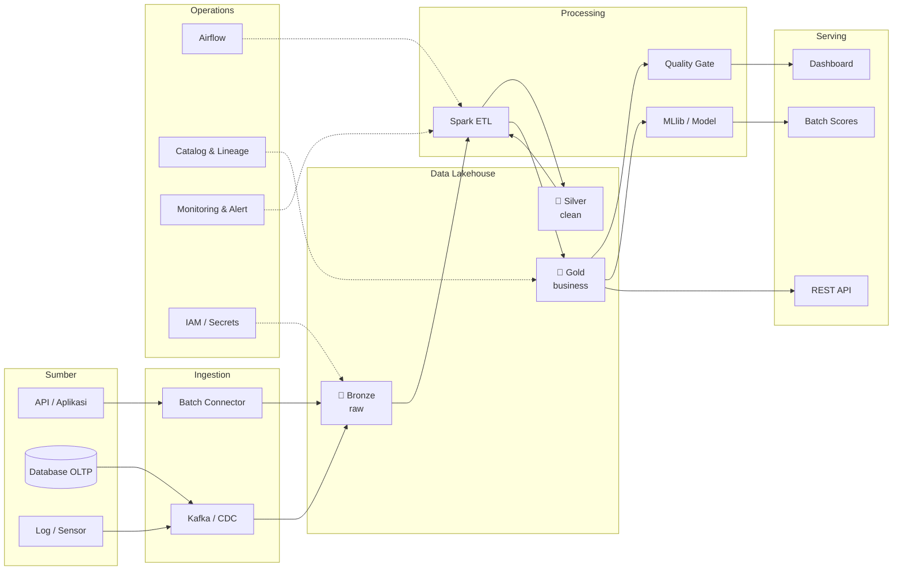

# Pertemuan 8: Proyek Akhir, Tata Kelola, Keamanan & Optimasi Biaya

::: tip 🎙️ Slide Presentasi Interaktif
Buka **[slide presentasi Pertemuan 8](/presentasi/pertemuan-8-big-data)** — dilengkapi navigasi keyboard, timer, transkrip, dan narasi audio.
Untuk presentasi layar penuh, buka **[HTML interaktif](/Perkuliahan/presentasi/pertemuan-8-capstone-tata-kelola.html)** di tab baru.
:::

::: tip CAPAIAN PEMBELAJARAN (SUB-CPMK 8)
- **CPMK Terkait:** CPMK 5
- **CPL Terkait:** CPL04, CPL08
- **Indikator:** Mahasiswa mampu menyajikan sistem big data end-to-end yang berjalan, mendokumentasikan tata kelola dan lineage, menerapkan keamanan serta privasi data (UU PDP), dan menghitung optimasi biaya secara kuantitatif.
:::

---

## 1. Capstone: Dari Data Mentah ke Layanan

Proyek akhir mengintegrasikan seluruh kompetensi Pertemuan 1–7 menjadi **satu sistem yang dapat dijalankan ulang**.



---

## 2. Pilihan Studi Kasus

Pilih **satu** kasus yang realistis dan datanya dapat Anda peroleh/bangkitkan:

| Kasus | Pertanyaan Bisnis | Komponen Wajib |
| :--- | :--- | :--- |
| **Funnel e-commerce** | Di tahap mana pengguna berhenti? | Event stream, funnel, segmentasi |
| **Deteksi fraud** | Transaksi mana yang mencurigakan? | Aturan + model, near-real-time |
| **Log analytics** | Bagaimana kesehatan layanan? | Batch + dashboard error rate |
| **IoT / smart city** | Bagaimana pola sensor & anomali? | Time-series, agregasi jendela |
| **Rekomendasi produk** | Apa yang relevan untuk pengguna? | ALS, batch scoring |
| **Churn prediction** | Pelanggan mana berisiko berhenti? | Feature pipeline, model, scoring |

**Batasan ruang lingkup:** minimal **satu sumber batch** dan **satu sumber streaming** (boleh simulasi), satu pipeline terjadiwal, satu tabel gold, satu antarmuka serving (dashboard/API), dan satu model ML **atau** analitik lanjutan.

---

## 3. Deliverables

| # | Artefak | Isi Minimum |
| :---: | :--- | :--- |
| 1 | **Repositori Git** | Kode, DAG, test, README, `.env.example` |
| 2 | **Diagram arsitektur** | Sumber → ingestion → storage → processing → serving + cross-cutting |
| 3 | **Data dictionary** | Tabel, kolom, tipe, deskripsi, klasifikasi (PII/non-PII) |
| 4 | **Pipeline** | Batch + streaming, idempoten, dapat dijalankan ulang |
| 5 | **Uji kualitas** | ≥ 5 checks + quality gate |
| 6 | **Serving** | Dashboard/API/batch scores yang berfungsi |
| 7 | **Model** (jika ada) | Model card + metrik + versi |
| 8 | **Governance pack** | Ownership, lineage, retensi, akses, PII handling |
| 9 | **Laporan** | 8–12 halaman, termasuk analisis biaya & risiko |
| 10 | **Demo** | 10 menit + tanya jawab 5 menit |

### Struktur Repositori

```text
project/
├── README.md
├── docs/
│   ├── architecture.md
│   ├── data-dictionary.md
│   ├── governance.md
│   └── cost-analysis.md
├── dags/
├── jobs/
├── tests/
├── sql/
├── docker-compose.yml
├── requirements.txt
├── Makefile
└── .env.example
```

### Prinsip "One Command"

Dosen harus dapat menjalankan proyek dari kondisi bersih:

```bash
git clone <repo>
cd project
cp .env.example .env
docker compose up -d
make seed
make run DATE=2026-09-01
make test
```

Jika ada langkah manual yang tidak terhindarkan, tulis di README dan tunjukkan saat demo.

---

## 4. Tata Kelola Data

### 4.1 Komponen Tata Kelola

| Komponen | Pertanyaan | Artefak |
| :--- | :--- | :--- |
| **Katalog** | Data apa yang kita punya? | Data catalog (DataHub, OpenMetadata) |
| **Lineage** | Dari mana data ini berasal? | Graf table/column-level lineage |
| **Ownership** | Siapa penanggung jawab? | Data owner & steward per domain |
| **Kontrak data** | Apa jaminan skema & SLA? | Data contract berversi |
| **Klasifikasi** | Seberapa sensitif? | Public / Internal / Confidential / Restricted |
| **Retensi** | Berapa lama disimpan? | Kebijakan retensi & penghapusan |
| **Akses** | Siapa boleh melihat? | RBAC/ABAC, row/column-level security |

### 4.2 Data Contract

Kontrak data adalah kesepakatan eksplisit antara produsen dan konsumen:

```yaml
# contracts/orders.events.v1.yaml
name: orders.events
version: 1.0.0
owner: team-checkout
description: Event pesanan dari layanan checkout
sla:
  freshness: 5m
  availability: 99.5%
schema:
  order_id:    { type: string, required: true, unique: true }
  customer_id: { type: string, required: true, pii: true }
  amount:      { type: decimal, required: true, min: 0 }
  status:      { type: enum, values: [created, paid, cancelled] }
  event_ts:    { type: timestamp, required: true }
compatibility: backward
```

Kontrak mencegah perubahan skema yang merusak konsumen secara diam-diam.

### 4.3 Data Mesh (Pengantar)

| Prinsip | Arti |
| :--- | :--- |
| **Domain ownership** | Tim bisnis memiliki data produknya |
| **Data as a product** | Data diperlakukan seperti API: terdokumentasi, punya SLA |
| **Self-serve platform** | Platform menyediakan alat standar |
| **Federated governance** | Aturan global, eksekusi terdesentralisasi |

Data mesh bukan alat, melainkan **model organisasi**. Jangan adopsi jika masalah utama Anda masih teknis (pipeline rapuh, kualitas buruk).

---

## 5. Keamanan Data

### 5.1 CIA Triad

| Aspek | Pertanyaan | Kontrol |
| :--- | :--- | :--- |
| **Confidentiality** | Siapa yang boleh melihat? | Enkripsi, IAM, masking |
| **Integrity** | Apakah data utuh? | Checksum, audit log, immutable store |
| **Availability** | Apakah layanan tersedia? | Replikasi, backup, disaster recovery |

### 5.2 Kontrol Wajib

| Area | Kontrol |
| :--- | :--- |
| **Autentikasi** | SSO, MFA, akun layanan terpisah |
| **Otorisasi** | Least privilege, RBAC/ABAC, row/column-level |
| **Enkripsi** | TLS 1.2+ in transit; AES-256 at rest; KMS |
| **Jaringan** | Private subnet, security group, tanpa bucket publik |
| **Rahasia** | Secret manager/Vault; **tidak ada** kredensial di Git |
| **Audit** | Log akses & query, retensi sesuai kebijakan |
| **Supply chain** | Scan dependency & image container |
| **Backup** | Uji restore, bukan hanya membuat backup |

```bash
# ❌ Jangan pernah
export AWS_SECRET_ACCESS_KEY="AKIA..."

# ✅ Gunakan secret manager / environment
export AWS_PROFILE="data-dev"
```

### 5.3 Ancaman Umum

| Ancaman | Contoh | Mitigasi |
| :--- | :--- | :--- |
| **Bucket terbuka** | Data pelanggan dapat diakses publik | Block public access, audit konfigurasi |
| **Credential bocor** | Token di repo publik | Secret scanning, rotasi, pre-commit hook |
| **Privilege escalation** | Service account terlalu luas | Least privilege, review berkala |
| **SQL injection** | Input tidak divalidasi | Parameterized query, validasi |
| **Data exfiltration** | Unduhan massal | DLP, alert anomali akses |
| **Ransomware** | Backup terenkripsi | Immutable backup, offline copy |

---

## 6. Privasi & UU PDP

### 6.1 UU No. 27 Tahun 2022 tentang Pelindungan Data Pribadi

| Konsep | Penjelasan |
| :--- | :--- |
| **Data Pribadi** | Data tentang individu yang teridentifikasi/dapat diidentifikasi |
| **Data Pribadi Spesifik** | Data kesehatan, biometrik, genetika, catatan kriminal, anak, keuangan pribadi |
| **Pengendali Data** | Pihak yang menentukan tujuan & cara pemrosesan |
| **Prosesor Data** | Pihak yang memproses atas nama pengendali |
| **Hak Subjek Data** | Informasi, akses, koreksi, penghapusan, penarikan consent, portabilitas |
| **Notifikasi Kebocoran** | Maksimal **3×24 jam** kepada subjek data & otoritas |
| **Prinsip** | Tujuan terbatas, minimisasi, akurasi, retensi terbatas, keamanan |

### 6.2 Praktik di Pipeline

| Praktik | Implementasi |
| :--- | :--- |
| **Data minimization** | Jangan mengumpulkan kolom yang tidak dipakai |
| **Purpose limitation** | Dokumentasikan tujuan; larang penggunaan sekunder tanpa dasar |
| **Consent management** | Catat consent & versi kebijakan |
| **Pseudonymization** | Ganti identifier dengan token; mapping disimpan terpisah |
| **Masking** | Tampilkan `****1234`, hash email untuk analitik |
| **Retention** | Hapus otomatis setelah masa retensi |
| **Right to erasure** | Prosedur penghapusan yang menjangkau semua turunan data |
| **Access control** | Hanya peran tertentu dapat melihat PII |

### 6.3 Anonimisasi vs Pseudonimisasi

| Teknik | Dapat dikembalikan? | Catatan |
| :--- | :---: | :--- |
| **Pseudonimisasi** | Ya, dengan mapping | Masih data pribadi menurut UU PDP |
| **Hashing + salt** | Sulit (jika salt aman) | Rentan brute-force pada ruang nilai kecil |
| **Tokenization** | Ya, via vault | Cocok untuk nomor kartu |
| **k-Anonymity** | Tidak | Pastikan setiap kombinasi quasi-identifier muncul ≥ k kali |
| **Differential privacy** | Tidak | Tambahkan noise terkalibrasi; akurasi trade-off |

::: danger Quasi-Identifier
Menghapus nama dan NIK tidak cukup. Kombinasi **tanggal lahir + kode pos + jenis kelamin** dapat mengidentifikasi individu. Selalu uji risiko re-identifikasi.
:::

---

## 7. Optimasi Biaya

### 7.1 Sumber Biaya

| Komponen | Pemicu Biaya | Strategi |
| :--- | :--- | :--- |
| **Storage** | GB/bulan, kelas penyimpanan | Kompresi, format kolumnar, lifecycle tiering |
| **Compute** | Jam cluster/DBU | Autoscaling, spot, matikan cluster idle |
| **Shuffle/Scan** | Data dipindai | Partition pruning, filter awal, column pruning |
| **Egress** | Data keluar region/cloud | Lokalisasi data, cache, kompresi |
| **Orkestrasi** | Task/run | Kurangi task kecil, jadwal efisien |
| **Lisensi** | Per pengguna/node | Evaluasi open source & kebutuhan nyata |

### 7.2 Contoh Perhitungan

> **Asumsi ilustratif:** 100 TB data, object storage $0.023/GB/bulan, cluster 10 worker × 8 jam/hari × 30 hari × $0.50/jam, egress 5 TB/bulan × $0.09/GB.

```text
Storage : 100 × 1.024 × 1.024 GB × $0.023 ≈ $2.416/bulan
Compute : 10 × 8 × 30 × $0.50            = $1.200/bulan
Egress  : 5.000 GB × $0.09              = $450/bulan
------------------------------------------------------
Total kasar                                ≈ $4.066/bulan
```

**Peluang penghematan:**

| Tindakan | Estimasi Dampak |
| :--- | :--- |
| Parquet + kompresi (5×) | Storage turun hingga 80% |
| Matikan cluster saat idle (12 jam/hari) | Compute turun ±50% |
| Partition pruning | Scan turun 60–90% |
| Lifecycle ke cold storage setelah 90 hari | Storage dingin turun 50–70% |
| Spot instance untuk batch | Compute turun 50–70% (dengan risiko retry) |
| Hapus tabel/dataset tak terpakai | Penghematan langsung |

> Angka di atas hanya ilustrasi. Selalu gunakan **harga aktual provider** dan ukur biaya per pipeline, bukan hanya total tagihan.

### 7.3 Metrik Biaya yang Berguna

- **Cost per 1.000 event** yang diproses.
- **Cost per query/dashboard refresh**.
- **Storage cost per tabel**.
- **Idle time** cluster.
- **Bytes scanned vs bytes returned** (efisiensi query).

---

## 8. Anti-Pattern yang Harus Dihindari

| Anti-pattern | Mengapa Buruk | Perbaikan |
| :--- | :--- | :--- |
| **Data swamp** | Tidak ada katalog, data tak ditemukan | Katalog, ownership, klasifikasi |
| **Dual write** | Data tidak konsisten | Outbox/CDC |
| **Cron + skrip manual** | Tidak ada retry/visibilitas | Orkestrasi (Airflow) |
| **Tidak idempoten** | Duplikasi saat retry/backfill | Partition overwrite/upsert |
| **`SELECT *`** | I/O boros | Pilih kolom |
| **Small files** | Metadata & listing lambat | Kompaksi, `coalesce` |
| **Cluster selalu hidup** | Biaya tinggi | Autoscaling, shutdown |
| **Tanpa test** | Bug data lolos ke produksi | Unit + quality test |
| **Hardcoded secret** | Risiko kebocoran | Secret manager |
| **Streaming untuk semua hal** | Kompleksitas tanpa kebutuhan | Batch dulu, ukur latency |
| **Tanpa owner** | Tidak ada yang memperbaiki | Data owner & SLA |
| **Menambah node untuk semua masalah** | Biaya naik, akar masalah tetap | Profiling & tuning |

---

## 9. Rubrik Proyek Akhir (100)

| Aspek | Bobot | Level Sangat Baik (90–100) | Level Cukup (70–79) | Level Kurang (< 60) |
| :--- | :---: | :--- | :--- | :--- |
| **Problem framing & requirements** | 15 | Masalah nyata, ruang lingkup jelas, metrik sukses terukur | Masalah jelas, metrik kabur | Tidak jelas / terlalu luas |
| **Arsitektur** | 15 | Diagram lengkap, trade-off dijelaskan, komponen tepat | Diagram ada, alasan minim | Tidak konsisten |
| **Ingestion & storage** | 15 | Batch + stream, format/partisi tepat, idempoten | Salah satu komponen lemah | Tidak berjalan |
| **Processing & pipeline** | 20 | End-to-end, tuning terbukti, error handling | Berjalan, optimasi minim | Sering gagal |
| **Kualitas & pengujian** | 10 | ≥5 checks, test otomatis, quality gate | Sedikit test | Tanpa test |
| **Governance, security & privacy** | 10 | PII dimasking, akses minimum, lineage, retensi | Sebagian diterapkan | Diabaikan |
| **Demo & dokumentasi** | 10 | One command, runbook, demo lancar | README dasar | Tidak dapat dijalankan |
| **Kolaborasi & pertahanan individu** | 5 | Semua anggota memahami keputusan | Sebagian | Tidak dapat menjelaskan |

### Pertanyaan Pertahanan

1. Mengapa memilih batch/streaming untuk kasus Anda?
2. Apa yang terjadi jika pipeline dijalankan dua kali untuk tanggal yang sama?
3. Bagaimana Anda menangani data yang terlambat?
4. Di mana data pribadi disimpan, dan bagaimana dilindungi?
5. Berapa biaya memproses 1.000 event, dan bagaimana Anda mengukurnya?
6. Bagaimana Anda mendeteksi penurunan kualitas data?
7. Apa yang akan berubah jika volume naik 10×?
8. Bagian mana yang paling rapuh, dan apa rencana mitigasinya?

---

## 10. Demo & Laporan

### 10.1 Struktur Demo (10 Menit)

| Menit | Konten |
| :---: | :--- |
| 0–2 | Masalah, pengguna, dan metrik sukses |
| 2–4 | Arsitektur & keputusan teknologi |
| 4–8 | Demo live: ingest → pipeline → gold → serving |
| 8–9 | Simulasi kegagalan/quality gate + pemulihan |
| 9–10 | Biaya, keamanan, dan pelajaran |

### 10.2 Struktur Laporan (8–12 Halaman)

1. Ringkasan eksekutif
2. Problem & requirements
3. Arsitektur & alasan pemilihan teknologi
4. Data dictionary & klasifikasi data
5. Pipeline & kualitas data
6. Model/analitik (jika ada)
7. Tata kelola, keamanan, privasi
8. Analisis biaya
9. Pengujian & hasil
10. Kendala, pelajaran, dan pengembangan lanjutan
11. Referensi & lampiran

---

## 11. Checklist Akhir

- [ ] Proyek dapat dijalankan dari kondisi bersih dengan satu perintah.
- [ ] Pipeline idempoten dan aman dijalankan ulang.
- [ ] Minimal 5 uji kualitas + quality gate berfungsi.
- [ ] Data PII diidentifikasi, dimasking, dan aksesnya dibatasi.
- [ ] Lineage dan ownership terdokumentasi.
- [ ] Ada estimasi biaya dan minimal 2 strategi penghematan.
- [ ] Demo mencakup simulasi kegagalan dan pemulihan.
- [ ] Semua anggota dapat menjelaskan keputusan teknis.

---

## 12. Penutup: Prinsip yang Dibawa Setelah Mata Kuliah

1. **Mulai dari masalah, bukan teknologi.** Pilih alat setelah memahami beban dan SLA.
2. **Sederhana itu fitur.** Batch yang andal lebih baik daripada streaming yang rapuh.
3. **Data yang salah lebih berbahaya daripada data yang tidak ada.** Bangun quality gate.
4. **Kegagalan adalah normal.** Rancang retry, idempotensi, dan observabilitas sejak awal.
5. **Biaya adalah requirement non-fungsional.** Ukur, bukan menebak.
6. **Privasi bukan beban kepatuhan.** Lindungi pengguna karena itu hal yang benar.
7. **Dokumentasi adalah bagian dari sistem.** Pipeline yang tidak dipahami akan ditinggalkan.

---

## 📚 Bacaan Lanjutan

- Kleppmann, M. (2017). *Designing Data-Intensive Applications*, Bab 12.
- Reis, J., & Housley, M. (2022). *Fundamentals of Data Engineering*, Bab 11.
- Dehghani, Z. (2022). *Data Mesh*.
- Undang-Undang Republik Indonesia Nomor 27 Tahun 2022 tentang Pelindungan Data Pribadi.
- NIST Privacy Framework & NIST Cybersecurity Framework.
- Dokumentasi resmi cloud provider — *Well-Architected Framework: Cost Optimization & Security*.
