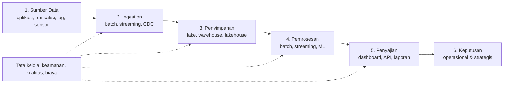

# 📘 Buku Teori Big Data untuk Kelas RPL

**Mata Kuliah:** Big Data (`IFR229`) · 3 SKS · Semester VI  
**Kelas:** RPL (Rekognisi Pembelajaran Lampau)  
**Dosen:** Mahendar Dwi Payana, S.ST., M.T.

---

## Mengapa Buku Teori Ini Ada?

Kelas RPL mengakui **pengalaman kerja, pelatihan nonformal/informal, dan pendidikan formal sebelumnya** sebagai SKS. Peserta RPL biasanya sudah pernah menghadapi data nyata: laporan yang terlambat, angka yang berbeda antarunit, atau sistem yang melambat saat data bertambah.

Buku ini disusun **theory-first** dan sengaja mudah dipahami:

- **Tanpa kode terlebih dahulu** — fokus pada *mengapa* dan *trade-off*.
- **Analogi sehari-hari** — membantu memahami istilah teknis.
- **Studi kasus tempat kerja** — menghubungkan teori dengan pengalaman Anda.
- **Pertanyaan refleksi** — menguji pemahaman, bukan hafalan.

> **Cara membaca:** baca satu bab sebelum pertemuan, tandai bagian yang cocok dengan pengalaman Anda, lalu gunakan modul pertemuan untuk melihat contoh teknis. Praktik laboratorium adalah **verifikasi**, bukan satu-satunya bukti kompetensi.

---

## Peta Besar Big Data

Big Data bukan hanya soal "data banyak". Ia adalah **rantai keputusan**: data dikumpulkan, disimpan, diolah, disajikan, lalu dipakai. Setiap mata rantai punya biaya dan risiko.

---

## Pertemuan 1 — Fondasi: Data, Informasi, dan Keputusan {#p1}

### Pertanyaan Pemandu

- Kapan data bisa disebut "big data"?
- Mengapa database operasional tidak selalu cocok untuk analisis?
- Apa nilai bisnis yang ingin dicapai?

### Analogi: Air dan Reservoir

- **Database operasional (OLTP)** seperti air yang mengalir di pipa rumah: harus cepat, bersih, dan tersedia saat dibutuhkan.
- **Data warehouse/analitik (OLAP)** seperti reservoir: menampung air dalam jumlah besar untuk melihat pola pasokan, musim kering, dan kebutuhan masa depan.
- **Big Data** muncul ketika pipa dan reservoir tidak lagi cukup: air datang dari banyak sumber, dengan debit yang tidak stabil, dan kualitasnya bervariasi.

### Konsep Inti

| Konsep | Penjelasan Sederhana | Implikasi |
| :--- | :--- | :--- |
| **Volume** | Jumlah data besar | Butuh penyimpanan terdistribusi & kompresi |
| **Velocity** | Data datang cepat | Butuh buffer, streaming, backpressure |
| **Variety** | Format beragam | Butuh skema fleksibel & standarisasi |
| **Veracity** | Kualitas belum tentu baik | Butuh validasi & pembersihan |
| **Value** | Nilai bisnis | Butuh tujuan & metrik yang jelas |

**OLTP vs OLAP**:

- OLTP menjawab: *"Apa yang baru terjadi?"* — fokus pada transaksi, satu baris, cepat.
- OLAP menjawab: *"Apa pola yang terjadi?"* — fokus pada agregasi, banyak baris, tren.

Keduanya tidak saling menggantikan. Sistem yang baik biasanya **memisahkan** keduanya agar beban analitik tidak mengganggu operasional.

### Kesalahpahaman Umum

1. **"Big data = data banyak."** Tidak selalu. Data 5.000 transaksi/detik bisa menjadi masalah big data karena kecepatannya, meski volumenya tidak besar.
2. **"Semua data harus disimpan."** Menyimpan tanpa tujuan hanya menambah biaya dan risiko.
3. **"Teknologi baru selalu lebih baik."** RDBMS tetap tepat untuk banyak kasus; pilih berdasarkan masalah.

### Studi Kasus Kerja

Sebuah unit layanan pelanggan memiliki data tiket dari tiga sistem berbeda: aplikasi chat, email, dan telepon. Setiap sistem punya definisi "selesai" sendiri. Manajer ingin tahu **waktu penyelesaian rata-rata per kanal per bulan**.

Pertanyaan: apakah masalahnya volume, kecepatan, atau **definisi**? Dalam banyak kasus, masalah utamanya adalah **integrasi dan definisi**, bukan teknologi big data.

### Refleksi

1. Data apa yang paling sering diminta atasan Anda? Apakah jawabannya tersedia tepat waktu?
2. Sistem mana di tempat kerja Anda yang paling terbebani saat laporan bulanan dibuat?
3. Menurut Anda, apakah masalahnya volume, kecepatan, keragaman, atau kualitas?

### Istilah Kunci

`OLTP` · `OLAP` · `5V` · `data warehouse` · `data lake` · `Business Intelligence`

---

## Pertemuan 2 — Arsitektur Terdistribusi & Penyimpanan {#p2}

### Pertanyaan Pemandu

- Mengapa satu komputer tidak cukup?
- Apa yang terjadi jika satu node mati?
- Bagaimana data disimpan agar aman dan cepat diakses?

### Analogi: Gudang dan Kurir

Bayangkan data sebagai barang di gudang besar:

- **Replikasi** = menyimpan salinan barang di beberapa gudang, agar jika satu gudang terbakar, barang tetap ada.
- **Partisi** = membagi barang berdasarkan kategori ke gudang berbeda, agar tidak menumpuk di satu tempat.
- **CAP** = saat jalan antar-gudang terputus, Anda harus memilih: tetap melayani pesanan (availability) atau memastikan stok di semua gudang sama (consistency).

### Konsep Inti

| Konsep | Arti | Trade-off |
| :--- | :--- | :--- |
| **Scale-up** | Tambah kekuatan satu mesin | Mahal, ada batas fisik |
| **Scale-out** | Tambah banyak mesin | Kompleks, butuh koordinasi |
| **Replication** | Salin data ke beberapa node | Ketersediaan naik, konsistensi lebih sulit |
| **Partition** | Bagi data berdasarkan key | Paralelisme naik, query lintas partisi lebih mahal |
| **CAP** | Saat partisi jaringan, pilih C atau A | Tidak ada sistem terdistribusi yang kebal partisi |
| **PACELC** | Jika tidak ada partisi, pilih latency atau consistency | Quorum tinggi = konsisten tapi lambat |

**HDFS** cocok untuk file besar yang dibaca berurutan. **Object storage** cocok untuk data yang elastis, murah, dan sering disimpan lama. **Lakehouse** mencoba menggabungkan fleksibilitas lake dengan tata kelola warehouse.

### Kesalahpahaman Umum

1. **"Replikasi berarti konsisten."** Replikasi menjamin salinan ada, tetapi salinan bisa tertinggal.
2. **"CAP berarti pilih dua dari tiga selamanya."** CAP hanya berlaku saat partisi; PACELC menjelaskan trade-off sehari-hari.
3. **"Format file tidak penting."** Format menentukan biaya baca, kompresi, dan evolusi skema.

### Studi Kasus Kerja

Sebuah perusahaan menyimpan log aplikasi 2 TB/hari. Tim awalnya menyimpan semua file kecil per menit. Setelah setahun, jumlah file mencapai puluhan juta dan query menjadi lambat. Solusinya bukan menambah server, tetapi **menggabungkan file** dan memilih format kolumnar serta partisi yang tepat.

### Refleksi

1. Di tempat kerja Anda, data disimpan di mana? Siapa yang mengaksesnya?
2. Pernahkah Anda mengalami laporan lambat karena data terlalu banyak file kecil?
3. Jika jaringan antar-cabang putus, apa yang sebaiknya tetap berjalan?

### Istilah Kunci

`replication` · `partition` · `CAP` · `PACELC` · `HDFS` · `object storage` · `Parquet` · `lakehouse`

---

## Pertemuan 3 — Pemrosesan Batch: MapReduce, YARN, dan Hive {#p3}

### Pertanyaan Pemandu

- Bagaimana pekerjaan besar dipecah agar banyak pekerja bisa mengerjakannya?
- Mengapa "shuffle" menjadi biaya terbesar?
- Kapan batch lebih tepat daripada streaming?

### Analogi: Pabrik dengan Banyak Pekerja

Bayangkan pabrik yang harus menghitung jumlah kata dalam jutaan dokumen:

1. **Split** — dokumen dibagi ke banyak meja.
2. **Map** — setiap pekerja menghitung kata di mejanya.
3. **Shuffle** — hasil dikelompokkan berdasarkan kata.
4. **Reduce** — jumlah per kata dijumlahkan.

Semakin banyak data yang harus dipindahkan antar-meja (**shuffle**), semakin lama dan mahal prosesnya.

### Konsep Inti

| Konsep | Arti | Mengapa Penting |
| :--- | :--- | :--- |
| **Data locality** | Kirim komputasi ke tempat data | Mengurangi transfer jaringan |
| **Map** | Proses per record | Paralel dan sederhana |
| **Shuffle** | Kelompokkan berdasarkan key | Fase paling mahal |
| **Combiner** | Mini-reduce di sisi map | Mengurangi data yang dikirim |
| **Partitioner** | Tentukan key ke reducer mana | Menghindari penumpukan |
| **YARN** | Manajer sumber daya | CPU/RAM dialokasikan ke aplikasi |
| **Hive** | SQL di atas file | Menyembunyikan kompleksitas MapReduce |

**Kapan batch?** Untuk laporan harian, rekap bulanan, backfill, dan proses yang tidak membutuhkan respons milidetik. Batch lebih sederhana dan biasanya lebih murah.

### Kesalahpahaman Umum

1. **"MapReduce sudah mati, jadi tidak perlu dipelajari."** Model mentalnya tetap dipakai Spark, Flink, dan Hive.
2. **"Menambah reducer selalu mempercepat."** Jika key timpang (skew), menambah reducer tidak membantu.
3. **"Hive selalu cepat."** Tanpa partisi dan format kolumnar, Hive bisa sangat lambat.

### Studi Kasus Kerja

Tim IT diminta membuat laporan harian penjualan dari log transaksi. Awalnya laporan dibuat manual dengan Excel dan memakan 4 jam. Dengan batch job yang membaca data terpartisi, laporan selesai dalam 10 menit. Nilainya bukan pada teknologi, tetapi pada **waktu yang dibebaskan untuk analisis**.

### Refleksi

1. Laporan rutin apa yang di tempat kerja Anda masih dibuat manual?
2. Apakah laporan itu benar-benar perlu real-time, atau cukup harian?
3. Bagian mana dari proses tersebut yang paling mahal: pengumpulan, pengolahan, atau penyajian?

### Istilah Kunci

`MapReduce` · `shuffle` · `combiner` · `partitioner` · `YARN` · `Hive` · `data skew`

---

## Pertemuan 4 — Apache Spark: Kecepatan dan Optimasi {#p4}

### Pertanyaan Pemandu

- Mengapa Spark lebih cepat dari MapReduce?
- Apa bedanya transformasi sempit dan lebar?
- Mengapa menambah node tidak selalu mempercepat pekerjaan?

### Analogi: Tim Proyek

- **Driver** = manajer proyek yang menyusun rencana.
- **Executor** = anggota tim yang mengerjakan tugas.
- **DAG** = peta ketergantungan pekerjaan.
- **Shuffle** = rapat koordinasi antar-tim; semakin banyak data yang dipertukarkan, semakin lama.

Spark menunda eksekusi (**lazy**) sampai ada aksi. Ini seperti manajer yang menunggu semua instruksi terkumpul sebelum menyusun rencana paling efisien.

### Konsep Inti

| Konsep | Arti | Dampak |
| :--- | :--- | :--- |
| **Lazy evaluation** | Eksekusi menunggu aksi | Optimasi menyeluruh |
| **Narrow transformation** | Tiap partisi mandiri | Cepat, tanpa jaringan |
| **Wide transformation** | Butuh shuffle | Mahal, titik bottleneck |
| **Partition** | Unit paralelisme | Terlalu kecil = overhead; terlalu besar = spill |
| **Broadcast join** | Tabel kecil dikirim ke semua executor | Menghindari shuffle tabel besar |
| **AQE** | Optimasi saat runtime | Menggabungkan partisi & menangani skew |
| **Cache** | Simpan data di memori | Cepat jika dipakai berulang |

**Prinsip tuning:** kurangi data sebelum shuffle, pilih ukuran partisi yang wajar, dan ukur sebelum/sesudah perubahan.

### Kesalahpahaman Umum

1. **"Spark selalu in-memory."** Jika data tidak muat, Spark menulis ke disk.
2. **"Menambah executor selalu mempercepat."** Jika bottleneck-nya satu key besar, tambahan executor hanya idle.
3. **"Cache semua data."** Cache berlebihan menyebabkan eviction dan memperlambat.

### Studi Kasus Kerja

Sebuah tim membuat dashboard penjualan yang memindai seluruh tabel setiap kali dibuka. Setelah membuat agregat harian dan materialized view, waktu buka dashboard turun dari 40 detik menjadi 2 detik. Perubahan terbesar bukan pada cluster, tetapi pada **cara mengurangi data yang dipindai**.

### Refleksi

1. Pekerjaan analitik apa di tempat kerja Anda yang terasa "berat"?
2. Apakah bebannya ada di baca data, join, atau agregasi?
3. Jika data naik 10×, apa yang akan pecah lebih dulu?

### Istilah Kunci

`driver` · `executor` · `DAG` · `narrow/wide` · `shuffle` · `broadcast join` · `AQE`

---

## Pertemuan 5 — NoSQL dan Event Streaming {#p5}

### Pertanyaan Pemandu

- Kapan NoSQL lebih tepat daripada RDBMS?
- Mengapa urutan event penting?
- Apa arti "idempoten" dalam aliran data?

### Analogi: Lemari Arsip dan Buku Kas Berjalan

- **NoSQL dokumen** seperti lemari arsip: satu folder berisi semua dokumen terkait.
- **NoSQL kolumnar** seperti buku besar per kategori: cepat mencari berdasarkan kunci tertentu.
- **Kafka** seperti buku kas berjalan: setiap transaksi dicatat berurutan, dapat dibaca ulang, dan banyak orang bisa membaca salinannya.

### Konsep Inti

| Konsep | Arti | Trade-off |
| :--- | :--- | :--- |
| **Access pattern** | Cara data akan dibaca | Model data mengikuti query, bukan normalisasi |
| **BASE** | Basically Available, Soft state, Eventually consistent | Fleksibel, tetapi tidak selalu langsung konsisten |
| **Partition key** | Penentu distribusi | Salah pilih = hot partition |
| **Kafka topic** | Kategori stream | Event disimpan, bukan langsung dihapus |
| **Offset** | Posisi baca | Dikelola per consumer group |
| **Delivery semantics** | At-most/at-least/exactly once | Exactly-once paling kompleks |
| **Idempotence** | Proses ulang tidak mengubah hasil | Kunci utama keandalan |

**Urutan** di Kafka hanya dijamin **per partisi**, bukan global. Gunakan key yang stabil (mis. `order_id`) agar event terkait masuk partisi yang sama.

### Kesalahpahaman Umum

1. **"NoSQL tidak punya konsistensi."** Banyak NoSQL mendukung quorum dan transaksi terbatas.
2. **"Kafka adalah queue yang menghapus pesan setelah dibaca."** Kafka menyimpan sesuai retensi; banyak konsumen dapat membaca ulang.
3. **"At-least-once selalu cukup."** Hanya jika pemrosesan idempoten; jika tidak, data bisa ganda.

### Studi Kasus Kerja

Sebuah aplikasi mengirim event pembayaran dua kali karena retry jaringan. Tim menganggapnya bug kecil, tetapi laporan pendapatan menjadi lebih tinggi. Solusinya bukan menghapus retry, melainkan membuat pemrosesan **idempoten** dengan `order_id` sebagai kunci.

### Refleksi

1. Data apa di tempat kerja Anda lebih cocok disimpan sebagai dokumen daripada tabel?
2. Event apa yang harus diproses berurutan, dan apa yang boleh tidak?
3. Apa dampak duplikasi data terhadap laporan Anda?

### Istilah Kunci

`NoSQL` · `BASE` · `partition key` · `Kafka` · `offset` · `consumer group` · `idempotence`

---

## Pertemuan 6 — Pipeline, Orkestrasi, dan Kualitas Data {#p6}

### Pertanyaan Pemandu

- Mengapa pipeline yang berjalan belum tentu benar?
- Apa yang terjadi jika job dijalankan dua kali?
- Bagaimana data buruk bisa sampai ke dashboard?

### Analogi: Jalur Produksi dan Quality Control

Pipeline data seperti jalur produksi:

1. **Extract** = menerima bahan mentah.
2. **Transform** = memotong, membersihkan, mencampur.
3. **Load** = mengemas ke rak penyimpanan.
4. **Quality check** = memastikan tidak ada produk cacat yang dikirim.
5. **Orchestration** = mengatur jadwal dan urutan.

Jika quality control dilewati, produk cacat sampai ke pelanggan. Dalam data, "produk cacat" adalah angka salah di dashboard.

### Konsep Inti

| Konsep | Arti | Mengapa Penting |
| :--- | :--- | :--- |
| **Idempotence** | Dijalankan ulang, hasil sama | Aman untuk retry/backfill |
| **Logical date** | Tanggal yang diproses, bukan tanggal sekarang | Backfill historis benar |
| **Watermark** | Batas data terakhir | Incremental efisien |
| **Data quality** | Kelengkapan, keunikan, validitas, konsistensi, ketepatan waktu | Mencegah keputusan salah |
| **Quality gate** | Blokir publish jika data buruk | Melindungi pengguna |
| **Observability** | Log, metrik, lineage, alert | Deteksi dini |
| **Orchestration** | Jadwal, dependensi, retry | Operasional stabil |

### Kesalahpahaman Umum

1. **"Pipeline jalan berarti benar."** Pipeline bisa sukses secara teknis tetapi menghasilkan data salah.
2. **"Retry menyelesaikan semua masalah."** Retry tidak memperbaiki data yang memang buruk.
3. **"Kualitas data adalah tugas tim data saja."** Kualitas ditentukan sejak sumber dan kontrak data.

### Studi Kasus Kerja

Sebuah laporan bulanan menunjukkan penurunan penjualan drastis. Setelah diselidiki, ternyata pipeline berhenti di tengah bulan dan dashboard menampilkan data parsial tanpa peringatan. Solusinya: **freshness check** dan **quality gate** yang memblokir publish jika volume turun lebih dari 30%.

### Refleksi

1. Laporan apa di tempat kerja Anda yang pernah menampilkan angka mencurigakan?
2. Apakah ada mekanisme yang memberi tahu ketika data terlambat?
3. Jika pipeline dijalankan dua kali, apakah jumlah data bisa berubah?

### Istilah Kunci

`ETL/ELT` · `idempotence` · `watermark` · `quality gate` · `observability` · `lineage`

---

## Pertemuan 7 — Analitik dan Machine Learning Terdistribusi {#p7}

### Pertanyaan Pemandu

- Kapan machine learning benar-benar dibutuhkan?
- Mengapa model yang akurat di laptop bisa gagal di produksi?
- Apa yang harus dipantau setelah model dikirim?

### Analogi: Resep Masakan

- **Data** = bahan masakan.
- **Fitur** = bumbu dan persiapan.
- **Model** = resep.
- **Evaluasi** = mencicipi.
- **Monitoring** = memastikan rasa tetap enak saat bahan berubah.

Resep yang enak sekali di dapur percobaan belum tentu cocok di restoran dengan bahan dan pelanggan berbeda. Model ML juga demikian.

### Konsep Inti

| Konsep | Arti | Risiko |
| :--- | :--- | :--- |
| **Label** | Jawaban yang dipelajari model | Label salah = model salah |
| **Feature** | Informasi yang tersedia saat prediksi | Leakage = hasil terlalu bagus |
| **Train/test split** | Data latih dan uji | Evaluasi tidak jujur jika dicampur |
| **Class imbalance** | Kelas minoritas langka | Accuracy menyesatkan |
| **ROC-AUC / PR-AUC** | Kemampuan ranking | Perlu disesuaikan dengan biaya kesalahan |
| **Batch scoring** | Prediksi terjadwal | Cocok untuk churn/risk |
| **Drift** | Distribusi data berubah | Performa menurun tanpa perubahan kode |

**Kapan terdistribusi?** Jika data atau jumlah model terlalu besar untuk satu mesin. Untuk banyak kasus, sampel yang representatif dan model sederhana sudah cukup.

### Kesalahpahaman Umum

1. **"Akurasi 99% berarti model bagus."** Pada data timpang, model yang selalu menebak mayoritas bisa 99% akurat tetapi tidak berguna.
2. **"Model selesai setelah dilatih."** Sebagian besar pekerjaan ada di data, deployment, dan monitoring.
3. **"Data masa depan boleh dipakai sebagai fitur."** Itu leakage dan membuat evaluasi palsu.

### Studi Kasus Kerja

Sebuah tim membuat model churn dengan akurasi 95%, tetapi hanya 2 dari 100 pelanggan berisiko yang terdeteksi. Setelah beralih ke **recall** dan **PR-AUC**, model diperbaiki dan hasilnya lebih berguna bagi tim retensi.

### Refleksi

1. Keputusan apa di tempat kerja Anda yang bisa dibantu prediksi?
2. Kesalahan prediksi mana yang lebih mahal: false positive atau false negative?
3. Bagaimana Anda tahu model masih bekerja enam bulan kemudian?

### Istilah Kunci

`supervised learning` · `feature` · `leakage` · `precision/recall` · `ROC-AUC` · `drift` · `MLOps`

---

## Pertemuan 8 — Tata Kelola, Keamanan, Privasi, dan Biaya {#p8}

### Pertanyaan Pemandu

- Siapa yang bertanggung jawab atas data?
- Data mana yang tidak boleh dilihat semua orang?
- Mengapa biaya cloud bisa tiba-tiba naik?

### Analogi: Perpustakaan

Data warehouse seperti perpustakaan:

- **Katalog** = metadata dan data dictionary.
- **Kartu peminjaman** = lineage dan audit.
- **Ruang khusus** = data sensitif dengan akses terbatas.
- **Aturan retensi** = kapan buku boleh dimusnahkan.
- **Anggaran** = biaya penyimpanan dan operasional.

Perpustakaan tanpa katalog akan kacau, meskipun bukunya lengkap.

### Konsep Inti

| Konsep | Arti | Praktik |
| :--- | :--- | :--- |
| **Ownership** | Penanggung jawab data | Data owner per domain |
| **Lineage** | Asal-usul data | Diagram sumber → dashboard |
| **Metadata** | Deskripsi data | Data dictionary |
| **Least privilege** | Akses minimum | Role & row-level security |
| **PII** | Data pribadi | Masking, pseudonimisasi, retensi |
| **UU PDP** | Regulasi perlindungan data pribadi | Notifikasi bocor 3×24 jam |
| **Cost optimization** | Efisiensi biaya | Kompresi, partisi, matikan idle |

**Privasi bukan hanya kepatuhan.** Data pelanggan yang bocor merusak kepercayaan, dan kepercayaan sulit dipulihkan.

### Kesalahpahaman Umum

1. **"Menghapus nama berarti data sudah anonim."** Kombinasi tanggal lahir, kota, dan pekerjaan bisa mengidentifikasi orang.
2. **"Biaya cloud hanya soal storage."** Compute dan data scan sering lebih mahal.
3. **"Tata kelola memperlambat pekerjaan."** Tanpa tata kelola, debugging dan audit jauh lebih lambat.

### Studi Kasus Kerja

Sebuah tim menyimpan data pelanggan lengkap di lingkungan development untuk "memudahkan testing". Ketika laptop salah satu anggota hilang, data pribadi ikut berisiko. Perbaikan: masking di development dan akses berbasis peran.

### Refleksi

1. Data sensitif apa yang Anda tangani di tempat kerja?
2. Siapa yang boleh melihatnya, dan apakah aksesnya tercatat?
3. Biaya data apa yang paling tidak terlihat di organisasi Anda?

### Istilah Kunci

`governance` · `lineage` · `PII` · `least privilege` · `UU PDP` · `cost per query`

---

## Penutup: Tujuh Prinsip yang Dibawa Pulang

1. **Mulai dari keputusan, bukan teknologi.**
2. **Pahami trade-off** sebelum memilih alat.
3. **Data yang salah lebih berbahaya daripada data yang tidak ada.**
4. **Kegagalan adalah normal**; rancang retry, idempotensi, dan observabilitas.
5. **Biaya adalah requirement non-fungsional.**
6. **Privasi adalah tanggung jawab**, bukan beban.
7. **Dokumentasi adalah bagian dari sistem.**

---

## Glosarium Singkat

| Istilah | Arti |
| :--- | :--- |
| **Batch** | Pemrosesan data dalam kelompok besar pada waktu tertentu |
| **Streaming** | Pemrosesan data saat peristiwa terjadi |
| **ETL** | Extract–Transform–Load |
| **ELT** | Extract–Load–Transform |
| **Idempoten** | Dijalankan ulang menghasilkan hasil sama |
| **Shuffle** | Pertukaran data antar-partisi saat agregasi/join |
| **Data lake** | Penyimpanan data mentah dalam format asli |
| **Lakehouse** | Lake dengan kemampuan tabel & ACID |
| **PII** | Personally Identifiable Information |
| **Lineage** | Riwayat asal-usul data |
