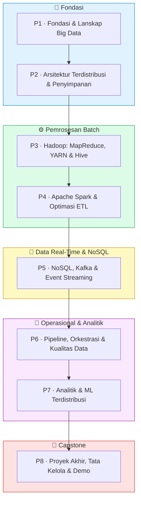

# 🗄️ Big Data (IFR229)

Selamat datang di portal pembelajaran mata kuliah **Big Data (`IFR229`)** untuk **Kelas RPL (Rekognisi Pembelajaran Lampau)**, Program Studi S-1 Informatika, Fakultas Sains dan Teknologi, Universitas Ubudiyah Indonesia.

Mata kuliah ini membekali mahasiswa dengan kemampuan **memahami, merancang, dan mengevaluasi sistem pengolah data berskala besar**. Penekanan diberikan pada **pemahaman konsep dan penalaran arsitektur**: mengapa suatu pendekatan dipilih, trade-off apa yang muncul, dan bagaimana keputusan teknis memengaruhi biaya, keandalan, serta nilai bisnis. Praktik laboratorium diposisikan sebagai **verifikasi dan pengayaan**, bukan satu-satunya bukti kompetensi.

> **"Big data is not just about volume — it is about building systems that turn raw events into reliable decisions."**

::: tip 🎙️ Slide Presentasi Interaktif
Setiap pertemuan dilengkapi **slide presentasi HTML interaktif** dengan navigasi keyboard, timer, transkrip, dan narasi audio. Buka **[Daftar Slide Big Data](/presentasi/)** untuk mengakses kedelapan deck.
:::

::: info 📘 Buku Teori RPL
Bacaan utama kelas RPL tersedia di **[Buku Teori Big Data untuk Kelas RPL](/big-data/TEORI-RPL)** — delapan bab teori dengan analogi, studi kasus kerja, dan pertanyaan refleksi. Modul pertemuan melengkapi buku ini dengan contoh teknis.
:::

---

## 🏛️ Identitas Mata Kuliah

| Komponen | Keterangan |
| :--- | :--- |
| **Kode Mata Kuliah** | `IFR229` |
| **Nama Mata Kuliah** | Big Data |
| **Bobot SKS** | **3 SKS** (2 SKS Teori / 1 SKS Praktikum) |
| **Semester / Tahun Akademik** | VI (Enam) / **2026 Ganjil** |
| **Kelas** | **RPL (Rekognisi Pembelajaran Lampau)** |
| **Rumpun Mata Kuliah** | Sains Data & Sistem Terdistribusi |
| **Dosen Pengampu** | **Mahendar Dwi Payana, S.ST., M.T.** |
| **Prasyarat** | Basis Data, Algoritma & Pemrograman, Pemrograman Berorientasi Objek |
| **Sifat** | Wajib Program Studi |
| **Jumlah Pertemuan** | **8 pertemuan** (masing-masing 2×50' teori + 1×170' praktikum) |

---

## 🎓 Pendekatan Pembelajaran Kelas RPL

**RPL (Rekognisi Pembelajaran Lampau)** adalah jalur kuliah yang **mengakui pengalaman kerja, pelatihan nonformal/informal, atau pendidikan formal sebelumnya** sebagai Satuan Kredit Semester (SKS). Peserta RPL umumnya telah memiliki pengalaman nyata di industri, sehingga kelas dirancang **theory-first**: konsep dipelajari lebih dulu, lalu dihubungkan dengan praktik dan pengalaman kerja.

| Prinsip | Penerapan di Mata Kuliah Ini |
| :--- | :--- |
| **Pengalaman sebagai sumber belajar** | Kasus diambil dari pekerjaan, proyek, atau sistem yang pernah Anda tangani |
| **Teori sebagai kerangka** | Setiap praktik didahului penjelasan *mengapa*, bukan hanya *bagaimana* |
| **Praktik sebagai verifikasi** | Lab membantu membuktikan pemahaman; bukan syarat tunggal kelulusan |
| **Refleksi terstruktur** | Anda memetakan pengalaman kerja ke CPMK dan menjelaskan keputusan teknis |
| **Fleksibel & kontekstual** | Tugas dapat disesuaikan dengan domain kerja (retail, keuangan, telekomunikasi, pemerintahan, dll.) |
| **Etika & integritas** | Pengalaman dan karya sendiri menjadi dasar penilaian; AI hanya alat bantu |

> **Cara belajar yang dianjurkan:** baca **Buku Teori RPL** terlebih dahulu → hubungkan dengan pengalaman kerja → baru jalankan praktik untuk menguji pemahaman. Praktik tidak harus sempurna; yang utama adalah Anda mampu **menjelaskan alasan dan trade-off** di baliknya.

---

## 🎯 Capaian Pembelajaran

### Capaian Pembelajaran Lulusan (CPL)

- **CPL01 (Pengetahuan):** Menguasai konsep sistem terdistribusi, penyimpanan data skala besar, model pemrosesan batch/streaming, dan arsitektur data modern.
- **CPL03 (Problem Solving):** Mampu menganalisis kebutuhan data, memilih arsitektur, serta merancang solusi untuk volume, kecepatan, dan variasi data yang tinggi.
- **CPL04 (Solusi Rekayasa Komputasi):** Mampu membangun pipeline data, aplikasi analitik, dan integrasi layanan data yang andal, teruji, dan dapat di-deploy.
- **CPL05 (Inovasi & Kecerdasan Artifisial):** Mampu menerapkan analitik dan machine learning terdistribusi untuk menghasilkan wawasan dan layanan cerdas.
- **CPL08 (Etika & Sikap):** Menerapkan tata kelola data, keamanan, privasi (UU PDP), integritas akademik, dan pertimbangan biaya dalam rekayasa sistem data.

### Capaian Pembelajaran Mata Kuliah (CPMK)

| Kode | Rumusan CPMK | CPL |
| :--- | :--- | :--- |
| **CPMK 1** | Menjelaskan karakteristik big data, evolusi arsitektur data, serta peran rekayasa perangkat lunak dalam sistem data modern. | CPL01 |
| **CPMK 2** | Merancang penyimpanan dan pemrosesan batch terdistribusi menggunakan HDFS, MapReduce, Hive, dan Apache Spark. | CPL01, CPL03, CPL04 |
| **CPMK 3** | Membangun integrasi data NoSQL dan streaming event dengan MongoDB, Cassandra, dan Apache Kafka. | CPL03, CPL04 |
| **CPMK 4** | Mengotomasi pipeline data, menjamin kualitas data, serta menerapkan analitik dan machine learning terdistribusi. | CPL04, CPL05 |
| **CPMK 5** | Menerapkan tata kelola, keamanan, privasi, dan optimasi biaya pada proyek sistem big data. | CPL08 |

---

## 🗺️ Peta Materi 8 Pertemuan



| Pertemuan | Topik | Fokus Praktikum |
| :---: | :--- | :--- |
| **1** | Fondasi & Lanskap Big Data | Menyiapkan environment, eksplorasi dataset, estimasi kapasitas |
| **2** | Arsitektur Terdistribusi & Penyimpanan | HDFS/MinIO, format Parquet, layout partisi |
| **3** | Hadoop: MapReduce, YARN & Hive | Word count, analitik log dengan Hive SQL |
| **4** | Apache Spark & Optimasi ETL | Pipeline PySpark, broadcast join, tuning shuffle |
| **5** | NoSQL, Kafka & Event Streaming | CRUD MongoDB, producer–consumer Kafka |
| **6** | Pipeline, Orkestrasi & Kualitas Data | DAG Airflow, uji kualitas, idempotensi |
| **7** | Analitik & ML Terdistribusi | Pipeline MLlib, evaluasi model, batch scoring |
| **8** | Proyek Akhir, Tata Kelola & Demo | Demo end-to-end, audit keamanan & biaya |

---

## 🧪 Lingkungan Praktikum

| Komponen | Versi / Rekomendasi | Keterangan |
| :--- | :--- | :--- |
| **Python** | 3.11+ | Bahasa utama praktikum (PySpark, Kafka client) |
| **Java** | JDK 17 | Dibutuhkan Spark 3.5+ |
| **Apache Spark** | 3.5.x | Mode `local[*]` untuk latihan, cluster untuk demo |
| **Apache Hadoop** | 3.3.x | HDFS, YARN, MapReduce, Hive |
| **Apache Kafka** | 3.7+ (KRaft) | Streaming event tanpa ZooKeeper |
| **MongoDB** | 7.x | Basis data dokumen |
| **Apache Airflow** | 2.9+ | Orkestrasi pipeline |
| **Docker Desktop** | Terbaru | Menjalankan layanan laboratorium |
| **Git + GitHub** | Terbaru | Version control & CI |

```bash
# Instalasi pustaka Python utama
python -m venv .venv
source .venv/bin/activate          # Windows: .venv\Scripts\activate
pip install pyspark==3.5.* kafka-python pymongo pandas pyarrow pytest
```

::: tip Alternatif Tanpa Cluster
Jika laptop tidak sanggup menjalankan banyak container, gunakan **mode lokal** PySpark (`master("local[*]")`) dan **Redpanda/Kafka** satu node. Seluruh tugas wajib tetap dapat dijalankan dengan satu perintah (`make run` atau `docker compose up`).
:::

---

## 📊 Komponen Penilaian

| Komponen | Bobot | Keterangan |
| :--- | :---: | :--- |
| Partisipasi, diskusi & refleksi pengalaman | **15%** | Kehadiran, kualitas argumentasi, refleksi pengalaman kerja |
| Tugas konseptual & studi kasus (T1–T5) | **30%** | 5 tugas, masing-masing 6%; menekankan analisis dan justifikasi |
| Ujian Tengah Semester (UTS) | **25%** | Studi kasus teori + rancangan, take-home setelah Pertemuan 4 |
| Proyek Akhir (UAS) | **30%** | Rancangan/aplikasi terbatas + presentasi + laporan + tata kelola |
| **Total** | **100%** | |

> Penekanan penilaian: **pemahaman konsep dan penalaran (60%)**, **penerapan/praktik (40%)**. Praktik tidak harus menggunakan cluster besar; studi kasus dan justifikasi desain sama pentingnya.

Rincian rubrik, jadwal, dan kebijakan akademik tersedia pada halaman **[RPS OBE](/big-data/RPS)**.

---

## 📚 Referensi Utama

1. **Martin Kleppmann** (2017). *Designing Data-Intensive Applications*. O'Reilly Media.
2. **Tom White** (2015). *Hadoop: The Definitive Guide* (4th ed.). O'Reilly Media.
3. **Bill Chambers & Matei Zaharia** (2018). *Spark: The Definitive Guide*. O'Reilly Media.
4. **Neha Narkhede, Gwen Shapira & Todd Palino** (2021). *Kafka: The Definitive Guide* (2nd ed.). O'Reilly Media.
5. **Joe Reis & Matt Housley** (2022). *Fundamentals of Data Engineering*. O'Reilly Media.
6. **Zhamak Dehghani** (2022). *Data Mesh*. O'Reilly Media.
7. **Jure Leskovec, Anand Rajaraman & Jeffrey Ullman** (2020). *Mining of Massive Datasets* (3rd ed.). Cambridge University Press.
8. Dokumentasi resmi: [Spark](https://spark.apache.org/docs/latest/), [Kafka](https://kafka.apache.org/documentation/), [Hadoop](https://hadoop.apache.org/docs/stable/), [Airflow](https://airflow.apache.org/docs/), [MongoDB](https://www.mongodb.com/docs/).

---

## 🧭 Cara Menggunakan Modul

1. **Baca Buku Teori RPL lebih dulu** — pahami *mengapa* dan *trade-off*-nya sebelum menyentuh alat.
2. **Hubungkan dengan pengalaman kerja** — gunakan sistem, laporan, atau masalah nyata yang pernah Anda tangani sebagai contoh.
3. **Baca modul pertemuan** — modul memperjelas teori dengan contoh dan istilah teknis.
4. **Jalankan praktik sebagai verifikasi** — lab bersifat pengayaan; tidak harus sempurna, tetapi harus dapat Anda jelaskan.
5. **Tulis refleksi singkat** — apa yang berubah dari cara Anda memahami masalah setelah mempelajari topik ini.
6. **Gunakan checklist** di akhir setiap modul untuk menilai kesiapan Anda.

::: warning Integritas Akademik & Penggunaan AI
Kode dan laporan harus Anda pahami dan dapat pertanggungjawabkan. Penggunaan asisten AI diperbolehkan sebagai alat bantu belajar, tetapi wajib dicantumkan pada bagian *Acknowledgements* dan tidak boleh menggantikan pemahaman konsep. Plagiarisme kode maupun laporan dikenakan sanksi sesuai kebijakan akademik.
:::
