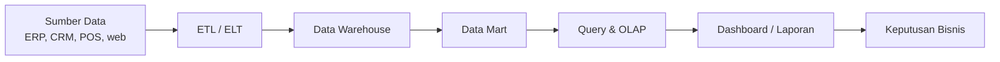
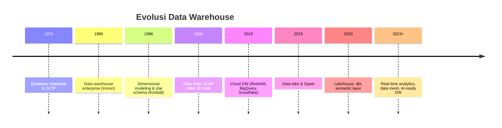

# Pertemuan 1: Data Warehouse & Business Intelligence

::: tip 🎙️ Slide Presentasi Interaktif
Buka **[slide presentasi Pertemuan 1](/presentasi/pertemuan-1-datawarehouse)** — dilengkapi navigasi keyboard, timer, transkrip, dan narasi audio.
Untuk presentasi layar penuh, buka **[HTML interaktif](/Perkuliahan/presentasi/pertemuan-1-pengantar-data-warehouse.html)** di tab baru.
:::

::: tip CAPAIAN PEMBELAJARAN (SUB-CPMK 1)
- **CPMK Terkait:** CPMK 1
- **CPL Terkait:** CPL01, CPL03
- **Indikator:** Mahasiswa mampu menjelaskan karakteristik data warehouse, membedakan beban OLTP dan OLAP, memetakan komponen Business Intelligence, serta memilih jenis platform data yang sesuai dengan kebutuhan bisnis.
:::

---

## 1. Mengapa Data Warehouse?

Setiap aplikasi operasional — kasir, e-commerce, banking, akademik — menghasilkan data. Namun data yang baik untuk **menjalankan** bisnis belum tentu baik untuk **menganalisis** bisnis.

| Pertanyaan Operasional (OLTP) | Pertanyaan Analitis (OLAP) |
| :--- | :--- |
| "Tampilkan pesanan nomor 12345" | "Berapa pendapatan per kategori per bulan selama 3 tahun?" |
| "Simpan transaksi ini sekarang" | "Kategori mana yang tumbuh paling cepat?" |
| "Update stok produk A" | "Bagaimana pola pembelian pelanggan segmen B?" |
| Fokus: satu baris, cepat, transaksi | Fokus: jutaan baris, agregasi, tren |

Menjalankan query analitik berat langsung di database operasional dapat:
- memperlambat aplikasi kasir,
- mengunci tabel,
- menghasilkan angka tidak konsisten karena perbedaan definisi,
- menghapus histori karena data lama diarsipkan.

**Data warehouse** memisahkan beban analitik dari beban transaksional.

---

## 2. Definisi Data Warehouse

> **"A data warehouse is a subject-oriented, integrated, time-variant, and nonvolatile collection of data in support of management's decision-making process."**  
> — **W. H. Inmon**

### Empat Karakteristik Inmon

| Karakteristik | Arti | Contoh |
| :--- | :--- | :--- |
| **Subject-oriented** | Diorganisasi berdasarkan subjek bisnis, bukan aplikasi | Penjualan, pelanggan, produk — bukan "tabel aplikasi kasir" |
| **Integrated** | Menyatukan data dari banyak sumber dengan definisi konsisten | Kode produk dari ERP dan e-commerce diselaraskan |
| **Time-variant** | Menyimpan histori dan konteks waktu | Data penjualan per hari/bulan/tahun, bukan hanya kondisi terkini |
| **Nonvolatile** | Data tidak di-update sembarangan; dimuat dan dibaca | Setelah dimuat, transaksi historis tidak berubah (koreksi lewat proses terkontrol) |

### Business Intelligence (BI)

BI adalah **payung** proses dan teknologi untuk mengubah data menjadi keputusan:



Data warehouse adalah **fondasi**; BI adalah **cara memanfaatkannya**.

---

## 3. OLTP vs OLAP

| Aspek | OLTP | OLAP |
| :--- | :--- | :--- |
| **Tujuan** | Menjalankan operasi harian | Mendukung analisis & keputusan |
| **Operasi dominan** | INSERT, UPDATE, DELETE | SELECT agregasi, scan besar |
| **Jumlah baris per query** | Sedikit (1–100) | Jutaan |
| **Skema** | Ternormalisasi (3NF) | Dimensional (star/snowflake) |
| **Histori** | Sering hanya data aktif | Panjang, time-variant |
| **Prioritas** | Konsistensi transaksi, latensi rendah | Throughput scan, fleksibilitas analisis |
| **Contoh** | Kasir, booking, transfer | Dashboard penjualan, analisis churn |

### Mengapa Skema Berbeda?

- **OLTP** ingin menghindari duplikasi dan anomali update → normalisasi.
- **OLAP** ingin query sederhana dan cepat → denormalisasi terkontrol, join lebih sedikit, agregasi siap pakai.

> **Analogi:** OLTP seperti buku kas harian; OLAP seperti laporan bulanan yang sudah dikelompokkan dan dihitung.

---

## 4. Data Warehouse, Data Mart, ODS, Data Lake

| Platform | Cakupan | Karakteristik | Cocok Untuk |
| :--- | :--- | :--- | :--- |
| **ODS** (Operational Data Store) | Operasional terintegrasi | Data near-real-time, sedikit histori | Operasi lintas sistem, customer service |
| **Data Warehouse** | Enterprise | Terintegrasi, histori panjang, subject-oriented | Analitik korporat, BI |
| **Data Mart** | Satu departemen/domain | Lebih kecil, fokus | Marketing, keuangan, penjualan |
| **Data Lake** | Semua data mentah | Schema-on-read, murah, fleksibel | Data science, eksplorasi, arsip |
| **Lakehouse** | Lake + tabel ACID | Fleksibel + tata kelola | Analitik modern skala besar |

### Data Mart: Dependent vs Independent

- **Dependent data mart:** bersumber dari enterprise data warehouse → konsisten.
- **Independent data mart:** dibangun langsung dari sumber → cepat, tetapi berisiko silo dan definisi ganda.

> **Aturan praktis:** mulai dari satu data mart yang jelas (mis. penjualan), tetapi rancang dimensi bersama (*conformed dimension*) agar bisa berkembang.

---

## 5. Evolusi Platform Data



Tren penting:

1. **Pemisahan storage & compute** — skalakan keduanya secara independen.
2. **ELT menggantikan ETL** — transformasi dilakukan di warehouse dengan SQL.
3. **Analytics engineering** — dbt, testing, version control, dokumentasi.
4. **Semantic layer** — definisi metrik terpusat agar dashboard konsisten.

---

## 6. Use Case & KPI

| Domain | Pertanyaan Bisnis | KPI |
| :--- | :--- | :--- |
| Retail | Produk/kategori mana yang menguntungkan? | Revenue, margin, units sold |
| E-commerce | Di tahap mana funnel bocor? | Conversion rate, cart abandonment |
| Perbankan | Segmen mana yang berisiko churn? | Churn rate, CLV, NPL |
| Pendidikan | Bagaimana performa akademik per prodi? | IPK rata-rata, kelulusan, retensi |
| Logistik | Rute mana yang paling efisien? | On-time delivery, cost per shipment |
| Kesehatan | Bagaimana utilisasi layanan? | Length of stay, readmission rate |

**KPI yang baik** harus: spesifik, terukur, memiliki definisi tunggal, dan dapat ditelusuri ke data sumber.

---

## 7. Praktikum: Menyiapkan Environment & Melihat Perbedaan OLTP/OLAP

### 7.1 Menjalankan PostgreSQL

```bash
docker run -d --name dw-postgres \
  -e POSTGRES_PASSWORD=dw123 \
  -e POSTGRES_DB=retail_dw \
  -p 5432:5432 \
  -v "$PWD/pgdata:/var/lib/postgresql/data" \
  postgres:16
```

Masuk ke database:

```bash
docker exec -it dw-postgres psql -U postgres -d retail_dw
```

### 7.2 Membuat Tabel Sumber (OLTP Sederhana)

```sql
CREATE SCHEMA IF NOT EXISTS oltp;
CREATE SCHEMA IF NOT EXISTS dw;

CREATE TABLE oltp.orders (
    order_id      BIGSERIAL PRIMARY KEY,
    order_ts      TIMESTAMP NOT NULL,
    customer_id   INTEGER NOT NULL,
    product_id    INTEGER NOT NULL,
    category      TEXT NOT NULL,
    quantity      INTEGER NOT NULL CHECK (quantity > 0),
    unit_price    NUMERIC(12,2) NOT NULL CHECK (unit_price >= 0),
    status        TEXT NOT NULL DEFAULT 'paid'
);

CREATE INDEX idx_orders_customer ON oltp.orders (customer_id);
CREATE INDEX idx_orders_ts ON oltp.orders (order_ts);
```

### 7.3 Mengisi Data Sintetis

```sql
INSERT INTO oltp.orders
    (order_ts, customer_id, product_id, category, quantity, unit_price, status)
SELECT
    TIMESTAMP '2024-01-01'
      + (random() * 900)::INT * INTERVAL '1 day'
      + (random() * 86400)::INT * INTERVAL '1 second',
    (random() * 5000)::INT + 1,
    (random() * 500)::INT + 1,
    (ARRAY['Elektronik','Fashion','Rumah Tangga','Kesehatan','Olahraga'])
      [1 + floor(random() * 5)::INT],
    (random() * 5)::INT + 1,
    ROUND((random() * 900000 + 10000)::NUMERIC, 2),
    CASE WHEN random() < 0.95 THEN 'paid' ELSE 'cancelled' END
FROM generate_series(1, 300000);
```

### 7.4 Query OLTP

```sql
-- Cepat: mengambil satu pesanan berdasarkan primary key
EXPLAIN ANALYZE
SELECT *
FROM oltp.orders
WHERE order_id = 12345;
```

### 7.5 Query OLAP

```sql
-- Berat: agregasi seluruh data per bulan dan kategori
EXPLAIN ANALYZE
SELECT
    date_trunc('month', order_ts) AS bulan,
    category,
    SUM(quantity * unit_price)    AS revenue,
    COUNT(*)                      AS orders
FROM oltp.orders
WHERE status = 'paid'
GROUP BY 1, 2
ORDER BY 1, 3 DESC;
```

### 7.6 Diskusi

1. Berapa waktu eksekusi query OLTP vs OLAP?
2. Mengapa query OLAP memindai hampir seluruh tabel?
3. Apa yang terjadi pada aplikasi kasir jika query OLAP dijalankan 20 kali bersamaan?
4. Indeks apa yang bisa membantu? Apakah cukup untuk semua pola query?

---

## 8. Tugas 1 — Analisis Kebutuhan & Profil Data (6%)

Pilih satu organisasi fiktif/nyata (retail, klinik, kampus, logistik). Susun dokumen 3–5 halaman:

1. **Latar belakang & masalah bisnis** yang ingin diselesaikan.
2. **Daftar 5 pertanyaan bisnis** dan KPI-nya.
3. **Profil data sumber:** tabel, kolom, volume, frekuensi update, sensitivitas.
4. **Pemetaan OLTP vs OLAP:** query operasional vs query analitik.
5. **Pilihan platform:** DW, data mart, atau lakehouse — beserta alasan.
6. **Risiko awal:** kualitas data, definisi ganda, privasi, biaya.

**Penilaian:** kejelasan masalah (30%), ketepatan pemetaan OLTP/OLAP (30%), kualitas analisis platform (25%), dokumentasi (15%).

---

## 9. Checklist

- [ ] Saya dapat menjelaskan empat karakteristik data warehouse Inmon.
- [ ] Saya dapat membedakan OLTP dan OLAP dengan contoh konkret.
- [ ] Saya dapat menjelaskan mengapa DW dipisahkan dari database operasional.
- [ ] Saya dapat membedakan DW, data mart, ODS, data lake, dan lakehouse.
- [ ] Saya dapat memetakan pertanyaan bisnis menjadi KPI.
- [ ] Environment PostgreSQL saya berjalan dan data sintetis berhasil dimuat.

---

## 📚 Bacaan Lanjutan

- Kimball, R., & Ross, M. (2013). *The Data Warehouse Toolkit*, Bab 1–2.
- Inmon, W. H. (2005). *Building the Data Warehouse*, Bab 1–2.
- Golfarelli, M., & Rizzi, S. (2018). *Data Warehouse Design*, Bab 1.
- Reis, J., & Housley, M. (2022). *Fundamentals of Data Engineering*, Bab 1–3.
