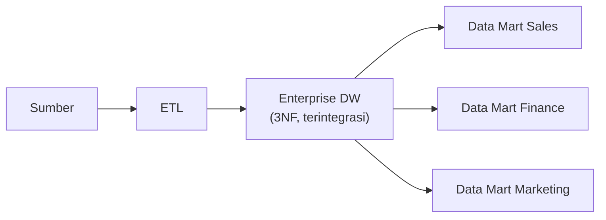
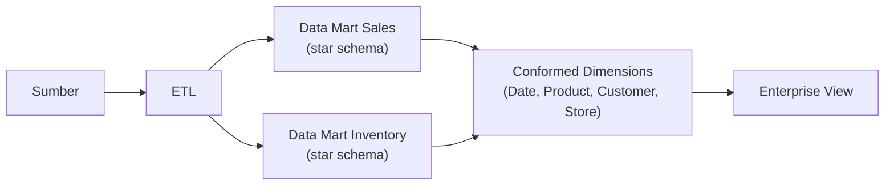
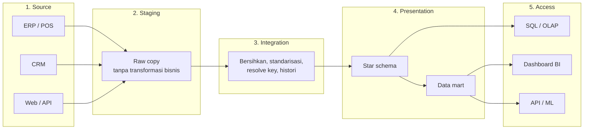
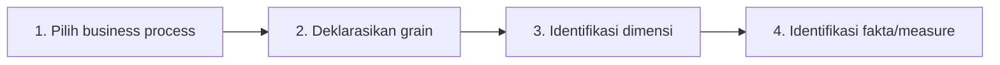

# Pertemuan 2: Arsitektur & Pemodelan Konseptual

::: info 🎓 Bacaan Teori Wajib (Kelas RPL)
Baca **[Buku Teori Data Warehouse — Pertemuan 2](/datawarehouse/TEORI-RPL#p2)** sebelum praktik. Latihan teknis di modul ini adalah **pengayaan/verifikasi**; fokus utama adalah pemahaman konsep dan kemampuan menjelaskan trade-off.
:::

::: tip 🎙️ Slide Presentasi Interaktif
Buka **[slide presentasi Pertemuan 2](/presentasi/pertemuan-2-datawarehouse)** — dilengkapi navigasi keyboard, timer, transkrip, dan narasi audio.
Untuk presentasi layar penuh, buka **[HTML interaktif](/Perkuliahan/presentasi/pertemuan-2-arsitektur-pemodelan.html)** di tab baru.
:::

::: tip CAPAIAN PEMBELAJARAN (SUB-CPMK 2)
- **CPMK Terkait:** CPMK 1, CPMK 2
- **CPL Terkait:** CPL01, CPL03
- **Indikator:** Mahasiswa mampu membandingkan arsitektur Inmon dan Kimball, menyusun bus matrix, menerjemahkan pertanyaan bisnis menjadi deklarasi grain, serta mengidentifikasi fakta dan dimensi.
:::

---

## 1. Dua Mazhab Arsitektur

### 1.1 Inmon: Top-Down

W. H. Inmon memulai dari **enterprise data warehouse** terpusat, lalu menurunkan data mart.



| Kelebihan | Kekurangan |
| :--- | :--- |
| Konsistensi enterprise, single source of truth | Investasi awal besar, waktu lama |
| Mengurangi silo dan definisi ganda | Sulit menunjukkan nilai cepat |
| Cocok untuk organisasi besar & regulasi ketat | Perubahan lambat |

### 1.2 Kimball: Bottom-Up

Ralph Kimball memulai dari **data mart dimensional** yang fokus, lalu menyatukan melalui **conformed dimension** dan **bus matrix**.



| Kelebihan | Kekurangan |
| :--- | :--- |
| Nilai cepat, mudah dipahami pengguna | Risiko silo jika dimensi tidak dikelola |
| Query sederhana (star schema) | Butuh disiplin conformed dimension |
| Fleksibel dan iteratif | Duplikasi data antar mart |

### 1.3 Mana yang Dipilih?

| Situasi | Rekomendasi |
| :--- | :--- |
| Organisasi besar, regulasi ketat, butuh konsistensi penuh | Inmon atau hybrid |
| Tim kecil, butuh hasil cepat, analitik per domain | Kimball |
| Data science & data mentah besar | Lakehouse + dimensional mart |
| Banyak sumber, definisi metrik kacau | Mulai dari bus matrix & semantic layer |

> **Kenyataan lapangan:** sebagian besar implementasi modern adalah **hybrid** — staging/integration layer terpusat, presentation layer dimensional.

---

## 2. Lapisan Arsitektur Data Warehouse



| Lapisan | Tujuan | Ciri |
| :--- | :--- | :--- |
| **Source** | Sistem operasional | Skema OLTP, kotor, berubah |
| **Staging** | Penampung sementara | Mirip sumber, cepat dimuat, boleh duplikat |
| **Integration** | Standarisasi & histori | Aturan bisnis, dedup, SCD, surrogate key |
| **Presentation** | Konsumsi analitik | Star/snowflake, agregat, mudah dipahami |
| **Access** | Layanan pengguna | BI, SQL, API, ML |

### ETL vs ELT

| Aspek | ETL | ELT |
| :--- | :--- | :--- |
| Transformasi | Sebelum masuk DW | Di dalam DW/lakehouse |
| Cocok | DW on-premise, data sensitif | Cloud DW dengan compute elastis |
| Alat | Informatica, SSIS, Spark | dbt, SQL, Spark |
| Kelebihan | Kontrol ketat | Memanfaatkan kekuatan SQL & skalabilitas |

---

## 3. Bus Matrix

**Bus matrix** adalah alat perencanaan yang memetakan **business process** (baris) terhadap **conformed dimension** (kolom). Setiap tanda ✔ berarti proses tersebut menggunakan dimensi itu.

### Contoh Retail

| Business Process | Date | Product | Customer | Store | Promotion | Employee |
| :--- | :---: | :---: | :---: | :---: | :---: | :---: |
| **Sales** | ✔ | ✔ | ✔ | ✔ | ✔ | ✔ |
| **Returns** | ✔ | ✔ | ✔ | ✔ | | ✔ |
| **Inventory Snapshot** | ✔ | ✔ | | ✔ | | |
| **Shipment** | ✔ | ✔ | ✔ | ✔ | | |
| **Campaign Response** | ✔ | ✔ | ✔ | | ✔ | |

### Mengapa Bus Matrix Penting?

1. **Mencegah silo:** dimensi yang sama (mis. `dim_product`) dipakai konsisten di semua mart.
2. **Prioritisasi:** proses mana yang dibangun lebih dulu.
3. **Roadmap:** terlihat proses yang belum tercakup.
4. **Komunikasi:** mudah dipahami stakeholder non-teknis.

> Jika dua data mart mendefinisikan "produk" secara berbeda, laporan akan bertentangan. **Conformed dimension** mencegahnya.

---

## 4. Empat Langkah Kimball



### Langkah 1 — Pilih Business Process

Business process adalah **aktivitas bisnis** yang menghasilkan peristiwa terukur, bukan departemen.

| Contoh Business Process | Bukan Business Process |
| :--- | :--- |
| Penjualan ritel | "Departemen Penjualan" |
| Pengiriman pesanan | "Aplikasi logistik" |
| Pendaftaran mahasiswa | "Sistem akademik" |
| Kunjungan pasien | "Rumah sakit" |

### Langkah 2 — Deklarasikan Grain

**Grain** adalah makna satu baris fact table. Harus dinyatakan dalam bahasa bisnis, bukan teknis.

| Grain yang Baik | Grain yang Buruk |
| :--- | :--- |
| "Satu baris per item pesanan per hari" | "Data penjualan" |
| "Satu baris per produk per toko per akhir hari" | "Snapshot stok" |
| "Satu baris per pengiriman per paket" | "Logistik" |

> **Aturan:** grain harus **paling atomik** yang dibutuhkan bisnis. Lebih mudah agregasi dari detail daripada memecah agregat.

### Langkah 3 — Identifikasi Dimensi

Dimensi menjawab **siapa, apa, di mana, kapan, bagaimana**. Untuk penjualan ritel:

- `dim_date` — kapan
- `dim_product` — apa
- `dim_customer` — siapa
- `dim_store` — di mana
- `dim_promotion` — bagaimana
- `dim_employee` — siapa yang melayani

### Langkah 4 — Identifikasi Fakta

Fakta adalah **measure numerik** yang dapat diagregasi: quantity, revenue, cost, discount, margin, tax.

| Tipe Measure | Dapat Dijumlahkan? | Contoh |
| :--- | :--- | :--- |
| **Additive** | Ya, semua dimensi | Revenue, quantity |
| **Semi-additive** | Ya, kecuali waktu | Saldo stok, saldo rekening |
| **Non-additive** | Tidak | Rasio, persentase, harga satuan |

---

## 5. Requirement Gathering

### 5.1 Dari Pertanyaan Bisnis ke KPI

| Pertanyaan Stakeholder | KPI | Grain yang Mungkin |
| :--- | :--- | :--- |
| "Kategori apa yang paling untung?" | Margin per kategori | Item penjualan |
| "Toko mana yang underperform?" | Revenue vs target | Harian per toko |
| "Apakah promosi meningkatkan penjualan?" | Lift, ROI promosi | Item penjualan per promosi |
| "Berapa stok tersisa tiap akhir hari?" | Inventory on hand | Produk per toko per hari |

### 5.2 Pertanyaan yang Wajib Diajukan

1. Keputusan apa yang akan diambil dari laporan ini?
2. Seberapa detail? (harian? per transaksi? per produk?)
3. Berapa lama histori yang dibutuhkan?
4. Siapa penggunanya dan seberapa sering?
5. Apa definisi resmi setiap KPI?
6. Bagaimana data sumber diidentifikasi dan di-update?
7. Apakah ada data sensitif/PII?

### 5.3 Definisi Metrik

| Metrik | Definisi | Sumber |
| :--- | :--- | :--- |
| **Gross Revenue** | `SUM(quantity * unit_price)` sebelum diskon | Order line |
| **Net Revenue** | Gross revenue − diskon − retur | Order line + return |
| **Margin** | Net revenue − COGS | Order line + product cost |
| **Conversion Rate** | Order paid / sesi unik | Web event + order |
| **Active Customer** | Pelanggan dengan ≥1 transaksi dalam 30 hari | Order |

Definisi harus **tertulis, berversi, dan disepakati**.

---

## 6. Data Mart & Conformed Dimension

### 6.1 Dependent vs Independent

| Tipe | Sumber | Konsistensi | Kecepatan |
| :--- | :--- | :---: | :---: |
| Dependent | Enterprise DW | Tinggi | Sedang |
| Independent | Langsung dari sumber | Rendah (risiko silo) | Cepat |

### 6.2 Conformed Dimension

Dimensi yang **sama** (nama, atribut, nilai key, definisi) digunakan di beberapa fact table.

Contoh `dim_product` harus sama untuk:

- fact penjualan,
- fact retur,
- fact inventory,
- fact pengiriman.

Jika `dim_product` di mart sales berbeda dengan mart inventory, analisis lintas proses akan gagal.

---

## 7. Praktik Terbimbing (Pengayaan): Bus Matrix & Grain Statement

### 7.1 Membuat Staging Schema

```sql
CREATE SCHEMA IF NOT EXISTS staging;

CREATE TABLE staging.raw_orders (
    order_id      TEXT,
    order_ts      TEXT,
    customer_code TEXT,
    product_code  TEXT,
    store_code    TEXT,
    quantity      TEXT,
    unit_price    TEXT,
    discount      TEXT,
    status        TEXT,
    loaded_at     TIMESTAMP DEFAULT now()
);

CREATE TABLE staging.raw_products (
    product_code TEXT,
    product_name TEXT,
    category     TEXT,
    subcategory  TEXT,
    cost         TEXT
);

CREATE TABLE staging.raw_customers (
    customer_code TEXT,
    customer_name TEXT,
    city          TEXT,
    segment       TEXT,
    email         TEXT
);
```

### 7.2 Profiling Data Sumber

```sql
-- Volume & rentang waktu
SELECT COUNT(*) AS rows, MIN(order_ts), MAX(order_ts)
FROM staging.raw_orders;

-- Kualitas: duplikat, null, status tidak valid
SELECT
    COUNT(*) AS total,
    COUNT(DISTINCT order_id) AS unique_orders,
    COUNT(*) - COUNT(DISTINCT order_id) AS duplicates,
    SUM(CASE WHEN customer_code IS NULL THEN 1 ELSE 0 END) AS null_customer,
    SUM(CASE WHEN status NOT IN ('paid','cancelled','refund') THEN 1 ELSE 0 END) AS invalid_status
FROM staging.raw_orders;
```

### 7.3 Menyusun Bus Matrix

Buat tabel (Markdown/Spreadsheet) dengan:

- **Baris:** minimal 4 business process.
- **Kolom:** minimal 6 dimensi.
- **Isi:** ✔ jika proses memakai dimensi.

### 7.4 Menulis Grain Statement

Untuk setiap business process, tulis satu kalimat grain, lalu daftar fakta dan dimensinya.

Contoh:

```text
Business process : Sales
Grain            : Satu baris per item pesanan per hari transaksi.
Dimensions       : Date, Product, Customer, Store, Promotion, Employee
Facts            : quantity, gross_revenue, discount, net_revenue, cost, margin
```

---

## 8. Tugas 2 — Bus Matrix & Grain (6%)

Pilih satu studi kasus (retail, klinik, kampus, logistik, atau perbankan). Serahkan:

1. **Bus matrix** minimal 4 proses × 6 dimensi.
2. **Grain statement** untuk setiap proses.
3. **Daftar fakta & dimensi** per proses.
4. **5 pertanyaan bisnis** dan KPI-nya.
5. **Definisi metrik** utama (minimal 3) beserta rumus.
6. **Justifikasi** pilihan arsitektur (Inmon/Kimball/hybrid).

**Penilaian:** kelengkapan & konsistensi bus matrix (35%), ketepatan grain (30%), kualitas requirement & KPI (25%), dokumentasi (10%).

---

## 9. Checklist

- [ ] Saya dapat menjelaskan perbedaan Inmon dan Kimball.
- [ ] Saya dapat menggambarkan lima lapisan arsitektur DW.
- [ ] Saya dapat membuat bus matrix untuk satu domain.
- [ ] Saya dapat menulis grain statement yang spesifik.
- [ ] Saya dapat membedakan fakta additive, semi-additive, non-additive.
- [ ] Saya dapat menjelaskan pentingnya conformed dimension.

---

## 📚 Bacaan Lanjutan

- Kimball, R., & Ross, M. (2013). *The Data Warehouse Toolkit*, Bab 2–3.
- Inmon, W. H. (2005). *Building the Data Warehouse*, Bab 3–4.
- Golfarelli, M., & Rizzi, S. (2018). *Data Warehouse Design*, Bab 3–4.
- Kimball Group — *The Bus Matrix* (artikel online).
