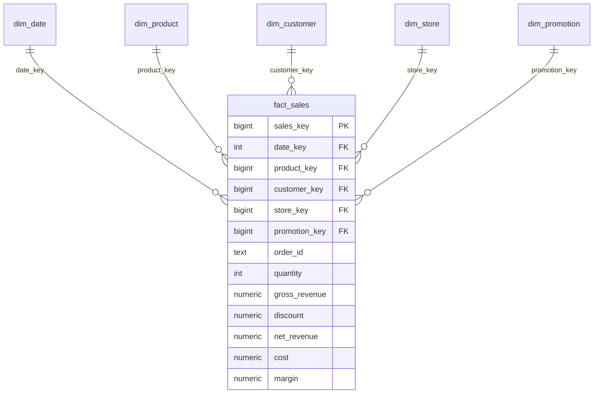

# Pertemuan 3: Fact, Dimension & Star Schema

::: info 🎓 Bacaan Teori Wajib (Kelas RPL)
Baca **[Buku Teori Data Warehouse — Pertemuan 3](/datawarehouse/TEORI-RPL#p3)** sebelum praktik. Latihan teknis di modul ini adalah **pengayaan/verifikasi**; fokus utama adalah pemahaman konsep dan kemampuan menjelaskan trade-off.
:::

::: tip 🎙️ Slide Presentasi Interaktif
Buka **[slide presentasi Pertemuan 3](/presentasi/pertemuan-3-datawarehouse)** — dilengkapi navigasi keyboard, timer, transkrip, dan narasi audio.
Untuk presentasi layar penuh, buka **[HTML interaktif](/Perkuliahan/presentasi/pertemuan-3-fact-dimension-star.html)** di tab baru.
:::

::: tip CAPAIAN PEMBELAJARAN (SUB-CPMK 3)
- **CPMK Terkait:** CPMK 2
- **CPL Terkait:** CPL01, CPL03, CPL04
- **Indikator:** Mahasiswa mampu merancang fact table dan dimension table, memilih surrogate key, membedakan tipe fakta, serta mengimplementasikan star schema yang valid di PostgreSQL.
:::

---

## 1. Anatomi Star Schema

**Star schema** terdiri dari satu **fact table** di tengah dan beberapa **dimension table** di sekelilingnya. Bentuknya seperti bintang karena fact hanya terhubung langsung ke dimensi — tanpa join antar-dimensi.



| Komponen | Isi | Contoh |
| :--- | :--- | :--- |
| **Fact table** | Foreign key + measure | `fact_sales` |
| **Dimension table** | Konteks deskriptif | `dim_product`, `dim_date` |
| **Grain** | Makna satu baris fact | Satu item pesanan |
| **Measure** | Angka yang dianalisis | quantity, revenue, margin |

---

## 2. Fact Table

### 2.1 Karakteristik

- Berisi **foreign key** ke dimensi + **measure** numerik.
- Jumlah baris sangat besar (jutaan–miliar).
- Jarang di-update; umumnya append-only.
- Lebar (kolom) relatif sedikit dibanding dimension.

### 2.2 Tipe Fact Table

| Tipe | Isi | Contoh | Catatan |
| :--- | :--- | :--- | :--- |
| **Transaction** | Satu baris per peristiwa | Item penjualan | Paling umum, grain atomik |
| **Periodic snapshot** | Kondisi pada interval tetap | Stok akhir hari | Semi-additive |
| **Accumulating snapshot** | Satu baris per proses dengan beberapa milestone | Order → bayar → kirim → selesai | Memiliki beberapa tanggal |
| **Factless fact** | Tanpa measure | Kehadiran, partisipasi promo | Mencatat peristiwa/relasi |

### 2.3 Contoh Accumulating Snapshot

```sql
CREATE TABLE dw.fact_order_fulfillment (
    order_key          BIGSERIAL PRIMARY KEY,
    order_id           TEXT UNIQUE NOT NULL,
    order_date_key     INT REFERENCES dw.dim_date(date_key),
    paid_date_key      INT REFERENCES dw.dim_date(date_key),
    shipped_date_key   INT REFERENCES dw.dim_date(date_key),
    delivered_date_key INT REFERENCES dw.dim_date(date_key),
    customer_key       BIGINT REFERENCES dw.dim_customer(customer_key),
    order_amount       NUMERIC(14,2),
    days_to_pay        INT,
    days_to_ship       INT,
    days_to_deliver    INT
);
```

Satu baris di-update seiring milestone terjadi. Berguna untuk analisis siklus proses.

---

## 3. Dimension Table

### 3.1 Karakteristik

- Menyimpan **konteks**: siapa, apa, di mana, kapan, bagaimana.
- Memiliki **surrogate key** (integer) sebagai primary key.
- Memiliki **natural key** dari sumber (kode produk, email, NIK).
- Lebih lebar, banyak atribut deskriptif.
- Menjadi tempat **SCD** (perubahan historis).

### 3.2 Surrogate Key vs Natural Key

| Aspek | Surrogate Key | Natural Key |
| :--- | :--- | :--- |
| Bentuk | Integer berurutan | Kode bisnis (text) |
| Stabilitas | Tidak berubah | Bisa berubah |
| Kinerja join | Cepat (integer) | Lebih lambat (text) |
| Sejarah SCD | Mendukung banyak versi | Tidak cocok |
| Kebocoran makna | Tidak | Ya (kode bisa berubah) |

> **Gunakan surrogate key** di fact table. Simpan natural key di dimension untuk traceability.

### 3.3 Atribut Dimensi yang Baik

- Deskriptif dan dapat difilter (category, city, segment).
- Hierarki (category → subcategory → product).
- Flag/band (price_band, age_group).
- Tanggal berlaku (SCD).

---

## 4. Additivity Measure

| Tipe | Dapat dijumlahkan | Contoh | Perlakuan |
| :--- | :--- | :--- | :--- |
| **Additive** | Semua dimensi | Revenue, quantity | `SUM()` aman |
| **Semi-additive** | Semua kecuali waktu | Saldo stok, saldo bank | Gunakan rata-rata/akhir periode |
| **Non-additive** | Tidak | Rasio, persentase, harga | Hitung dari pembilang/penyebut |

### Contoh Kesalahan Umum

```sql
-- ❌ Salah: menjumlahkan persentase margin antar produk
SELECT SUM(margin_pct) FROM fact_sales;

-- ✅ Benar: hitung dari agregat
SELECT SUM(margin) / NULLIF(SUM(net_revenue), 0) AS margin_pct
FROM fact_sales;
```

---

## 5. Dimensi Khusus

### 5.1 Degenerate Dimension

Atribut dimensi yang tidak punya tabel sendiri, biasanya nomor dokumen:

- `order_id`, `invoice_no`, `ticket_no`.

Disimpan langsung di fact table untuk menjaga grain dan audit.

### 5.2 Junk Dimension

Kombinasi flag/atribut kecil ber-kardinalitas rendah yang tidak layak menjadi dimensi sendiri:

- `is_gift`, `is_promo`, `channel`, `payment_type`.

Dibuat satu tabel `dim_junk` berisi kombinasi unik.

### 5.3 Role-Playing Dimension

Dimensi yang sama berperan beberapa kali:

- `dim_date` sebagai `order_date`, `ship_date`, `delivery_date`.
- `dim_employee` sebagai `sales_rep`, `manager`.

Implementasi: beberapa foreign key di fact yang menunjuk ke tabel dimensi yang sama, dengan alias/view.

```sql
SELECT
    o.full_date AS order_date,
    s.full_date AS ship_date,
    f.order_amount
FROM dw.fact_order_fulfillment f
JOIN dw.dim_date o ON o.date_key = f.order_date_key
JOIN dw.dim_date s ON s.date_key = f.shipped_date_key;
```

### 5.4 Bridge Table

Untuk relasi many-to-many, misalnya satu produk memiliki banyak supplier:

```sql
CREATE TABLE dw.bridge_product_supplier (
    product_key  BIGINT REFERENCES dw.dim_product(product_key),
    supplier_key BIGINT REFERENCES dw.dim_supplier(supplier_key),
    weight       NUMERIC(5,4) DEFAULT 1.0,
    PRIMARY KEY (product_key, supplier_key)
);
```

Kolom `weight` memungkinkan alokasi biaya proporsional.

---

## 6. DDL Star Schema Retail

```sql
CREATE SCHEMA IF NOT EXISTS dw;

-- Dimensi tanggal
CREATE TABLE dw.dim_date (
    date_key     INTEGER PRIMARY KEY,
    full_date    DATE NOT NULL UNIQUE,
    year         INTEGER NOT NULL,
    quarter      INTEGER NOT NULL,
    month        INTEGER NOT NULL,
    month_name   TEXT NOT NULL,
    day          INTEGER NOT NULL,
    day_of_week  INTEGER NOT NULL,
    day_name     TEXT NOT NULL,
    is_weekend   BOOLEAN NOT NULL
);

-- Dimensi produk
CREATE TABLE dw.dim_product (
    product_key   BIGSERIAL PRIMARY KEY,
    product_code  TEXT NOT NULL UNIQUE,
    product_name  TEXT NOT NULL,
    category      TEXT NOT NULL,
    subcategory   TEXT,
    cost          NUMERIC(12,2) NOT NULL DEFAULT 0
);

-- Dimensi pelanggan
CREATE TABLE dw.dim_customer (
    customer_key  BIGSERIAL PRIMARY KEY,
    customer_code TEXT NOT NULL UNIQUE,
    customer_name TEXT NOT NULL,
    city          TEXT,
    segment       TEXT,
    email         TEXT
);

-- Dimensi toko
CREATE TABLE dw.dim_store (
    store_key  BIGSERIAL PRIMARY KEY,
    store_code TEXT NOT NULL UNIQUE,
    store_name TEXT NOT NULL,
    city       TEXT,
    region     TEXT
);

-- Dimensi promosi
CREATE TABLE dw.dim_promotion (
    promotion_key  BIGSERIAL PRIMARY KEY,
    promotion_code TEXT NOT NULL UNIQUE,
    promotion_name TEXT NOT NULL,
    promo_type     TEXT,
    start_date     DATE,
    end_date       DATE
);

-- Fact penjualan
CREATE TABLE dw.fact_sales (
    sales_key      BIGSERIAL PRIMARY KEY,
    date_key       INTEGER NOT NULL REFERENCES dw.dim_date(date_key),
    product_key    BIGINT  NOT NULL REFERENCES dw.dim_product(product_key),
    customer_key   BIGINT  NOT NULL REFERENCES dw.dim_customer(customer_key),
    store_key      BIGINT  NOT NULL REFERENCES dw.dim_store(store_key),
    promotion_key  BIGINT  REFERENCES dw.dim_promotion(promotion_key),
    order_id       TEXT NOT NULL,
    line_no        INTEGER NOT NULL,
    quantity       INTEGER NOT NULL CHECK (quantity > 0),
    gross_revenue  NUMERIC(14,2) NOT NULL,
    discount       NUMERIC(14,2) NOT NULL DEFAULT 0,
    net_revenue    NUMERIC(14,2) NOT NULL,
    cost           NUMERIC(14,2) NOT NULL DEFAULT 0,
    margin         NUMERIC(14,2) GENERATED ALWAYS AS (net_revenue - cost) STORED,
    UNIQUE (order_id, line_no)
);

CREATE INDEX idx_fact_sales_date ON dw.fact_sales(date_key);
CREATE INDEX idx_fact_sales_product ON dw.fact_sales(product_key);
```

---

## 7. Mengisi Dimensi & Fakta

### 7.1 Dimensi Tanggal

```sql
INSERT INTO dw.dim_date
SELECT
    TO_CHAR(d, 'YYYYMMDD')::INT,
    d,
    EXTRACT(YEAR FROM d)::INT,
    EXTRACT(QUARTER FROM d)::INT,
    EXTRACT(MONTH FROM d)::INT,
    TO_CHAR(d, 'Month'),
    EXTRACT(DAY FROM d)::INT,
    EXTRACT(ISODOW FROM d)::INT,
    TO_CHAR(d, 'Day'),
    EXTRACT(ISODOW FROM d) IN (6, 7)
FROM generate_series(DATE '2024-01-01', DATE '2026-12-31', INTERVAL '1 day') AS d;
```

### 7.2 Dimensi Produk & Pelanggan

```sql
INSERT INTO dw.dim_product (product_code, product_name, category, subcategory, cost)
SELECT DISTINCT
    product_code,
    product_name,
    category,
    subcategory,
    cost::NUMERIC
FROM staging.raw_products;

INSERT INTO dw.dim_customer (customer_code, customer_name, city, segment, email)
SELECT DISTINCT
    customer_code,
    customer_name,
    city,
    segment,
    email
FROM staging.raw_customers;
```

### 7.3 Fact Penjualan

```sql
INSERT INTO dw.fact_sales (
    date_key, product_key, customer_key, store_key,
    order_id, line_no, quantity,
    gross_revenue, discount, net_revenue, cost
)
SELECT
    TO_CHAR(o.order_ts::TIMESTAMP, 'YYYYMMDD')::INT,
    p.product_key,
    c.customer_key,
    s.store_key,
    o.order_id,
    ROW_NUMBER() OVER (PARTITION BY o.order_id ORDER BY o.product_code)::INT,
    o.quantity::INT,
    o.quantity::NUMERIC * o.unit_price::NUMERIC,
    COALESCE(o.discount::NUMERIC, 0),
    o.quantity::NUMERIC * o.unit_price::NUMERIC - COALESCE(o.discount::NUMERIC, 0),
    o.quantity::NUMERIC * p.cost
FROM staging.raw_orders o
JOIN dw.dim_product p ON p.product_code = o.product_code
JOIN dw.dim_customer c ON c.customer_code = o.customer_code
JOIN dw.dim_store s ON s.store_code = o.store_code
WHERE o.status = 'paid';
```

> **Perhatikan:** lookup surrogate key dilakukan saat load. Jangan menyimpan `product_code` di fact table.

---

## 8. Query Validasi

```sql
-- Total revenue per kategori
SELECT p.category,
       SUM(f.net_revenue) AS revenue,
       SUM(f.quantity)    AS units
FROM dw.fact_sales f
JOIN dw.dim_product p ON p.product_key = f.product_key
GROUP BY p.category
ORDER BY revenue DESC;

-- Tren bulanan
SELECT d.year, d.month, SUM(f.net_revenue) AS revenue
FROM dw.fact_sales f
JOIN dw.dim_date d ON d.date_key = f.date_key
GROUP BY d.year, d.month
ORDER BY d.year, d.month;

-- Margin per kategori (non-additive ditangani benar)
SELECT p.category,
       SUM(f.net_revenue) AS revenue,
       SUM(f.margin)      AS margin,
       ROUND(SUM(f.margin) / NULLIF(SUM(f.net_revenue), 0) * 100, 2) AS margin_pct
FROM dw.fact_sales f
JOIN dw.dim_product p ON p.product_key = f.product_key
GROUP BY p.category
ORDER BY margin_pct DESC;
```

---

## 9. Tugas 3 — Star Schema Retail (6%)

Bangun star schema untuk studi kasus Anda:

1. **Minimal 1 fact table** dan **4 dimension table**.
2. **Deklarasi grain** di README.
3. **DDL lengkap** dengan primary key, foreign key, dan index.
4. **Data sampel** minimal 10.000 baris fact.
5. **5 query validasi** (agregasi, tren, top-N, margin, filter).
6. **Data dictionary** singkat: kolom, tipe, deskripsi.
7. **Diagram star schema** (Mermaid/PNG).

**Penilaian:** kebenaran model & grain (35%), kualitas DDL (25%), validitas data/query (25%), dokumentasi (15%).

---

## 10. Checklist

- [ ] Saya dapat menjelaskan perbedaan fact dan dimension.
- [ ] Saya dapat memilih grain yang atomik dan bermakna.
- [ ] Saya dapat membedakan transaction, snapshot, accumulating, factless fact.
- [ ] Saya dapat memilih surrogate key dan menjelaskan alasannya.
- [ ] Saya dapat menangani additive, semi-additive, non-additive measure.
- [ ] Saya dapat membuat star schema yang berjalan di PostgreSQL.

---

## 📚 Bacaan Lanjutan

- Kimball, R., & Ross, M. (2013). *The Data Warehouse Toolkit*, Bab 1–4.
- Adamson, C. (2010). *Star Schema: The Complete Reference*, Bab 2–5.
- Golfarelli, M., & Rizzi, S. (2018). *Data Warehouse Design*, Bab 5–6.
