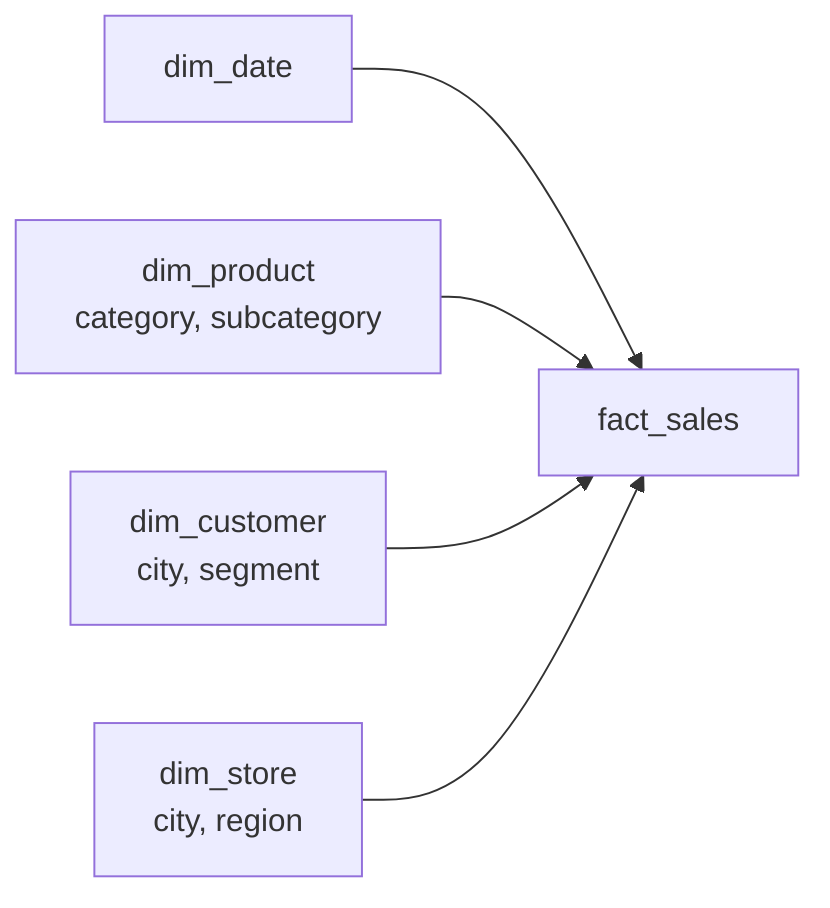
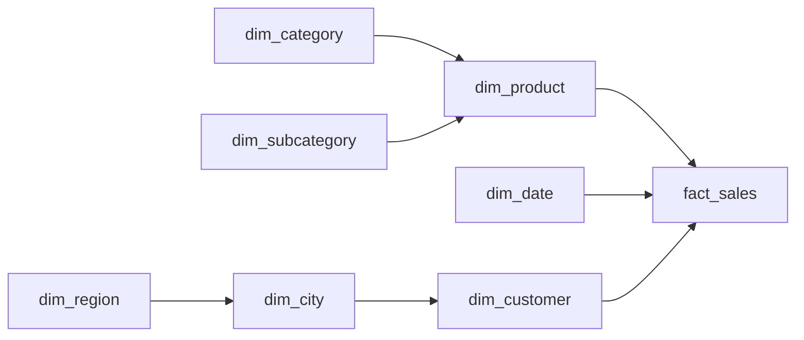
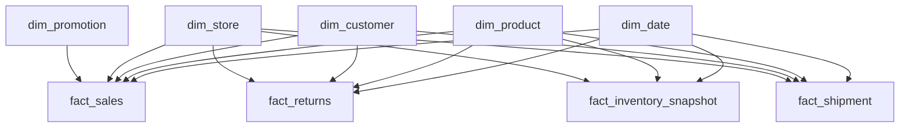

# Pertemuan 4: Snowflake, Galaxy & Slowly Changing Dimensions

::: tip 🎙️ Slide Presentasi Interaktif
Buka **[slide presentasi Pertemuan 4](/presentasi/pertemuan-4-datawarehouse)** — dilengkapi navigasi keyboard, timer, transkrip, dan narasi audio.
Untuk presentasi layar penuh, buka **[HTML interaktif](/Perkuliahan/presentasi/pertemuan-4-snowflake-scd.html)** di tab baru.
:::

::: tip CAPAIAN PEMBELAJARAN (SUB-CPMK 4)
- **CPMK Terkait:** CPMK 2
- **CPL Terkait:** CPL01, CPL03, CPL04
- **Indikator:** Mahasiswa mampu memilih star vs snowflake, merancang galaxy schema dengan conformed dimension, serta mengimplementasikan SCD Tipe 2 untuk menjaga histori dimensi.
:::

---

## 1. Star vs Snowflake

### 1.1 Star Schema

Semua dimensi **denormalisasi** langsung terhubung ke fact.



### 1.2 Snowflake Schema

Dimensi **dinormalisasi** menjadi beberapa tabel bertingkat.



| Aspek | Star | Snowflake |
| :--- | :--- | :--- |
| **Jumlah join** | Sedikit | Lebih banyak |
| **Query simplicity** | Tinggi | Sedang |
| **Redundansi** | Ada (disengaja) | Minimal |
| **Storage** | Lebih besar | Lebih kecil |
| **Kinerja baca** | Umumnya lebih cepat | Tergantung optimizer |
| **Perubahan atribut** | Lebih mudah | Perlu update beberapa tabel |
| **BI usability** | Sangat baik | Lebih rumit |

> **Rekomendasi praktis:** mulai dengan **star schema**. Gunakan snowflake hanya jika dimensi sangat besar, hierarki sering berubah, atau ada kebutuhan normalisasi yang kuat.

### 1.3 Contoh Snowflake Product

```sql
CREATE TABLE dw.dim_category (
    category_key BIGSERIAL PRIMARY KEY,
    category_name TEXT UNIQUE NOT NULL
);

CREATE TABLE dw.dim_subcategory (
    subcategory_key BIGSERIAL PRIMARY KEY,
    category_key BIGINT REFERENCES dw.dim_category(category_key),
    subcategory_name TEXT NOT NULL,
    UNIQUE (category_key, subcategory_name)
);

CREATE TABLE dw.dim_product_snow (
    product_key BIGSERIAL PRIMARY KEY,
    product_code TEXT UNIQUE NOT NULL,
    product_name TEXT NOT NULL,
    subcategory_key BIGINT REFERENCES dw.dim_subcategory(subcategory_key),
    cost NUMERIC(12,2)
);
```

Query harus join tiga tabel untuk mendapatkan kategori. Bandingkan dengan star yang cukup satu join.

---

## 2. Galaxy Schema (Fact Constellation)

**Galaxy schema** memiliki **beberapa fact table** yang berbagi **conformed dimension**.



### Mengapa Conformed Dimension Penting?

- `dim_product` yang sama di `fact_sales` dan `fact_returns` memungkinkan analisis **return rate per produk**.
- `dim_date` yang sama memungkinkan **drill-across** antar proses.
- Definisi kategori, segmen, dan wilayah konsisten di seluruh laporan.

### Drill-Across

```sql
-- Return rate per kategori: gabungkan dua fact melalui dimensi yang sama
WITH sales AS (
    SELECT p.category, SUM(f.net_revenue) AS revenue
    FROM dw.fact_sales f
    JOIN dw.dim_product p ON p.product_key = f.product_key
    GROUP BY p.category
),
returns AS (
    SELECT p.category, SUM(r.refund_amount) AS refund
    FROM dw.fact_returns r
    JOIN dw.dim_product p ON p.product_key = r.product_key
    GROUP BY p.category
)
SELECT s.category,
       s.revenue,
       COALESCE(r.refund, 0) AS refund,
       ROUND(COALESCE(r.refund, 0) / NULLIF(s.revenue, 0) * 100, 2) AS return_pct
FROM sales s
LEFT JOIN returns r USING (category)
ORDER BY return_pct DESC;
```

---

## 3. Slowly Changing Dimensions (SCD)

Dimensi **berubah perlahan** seiring waktu: pelanggan pindah kota, produk ganti kategori, karyawan pindah departemen. Pertanyaannya: **apakah histori perlu dipertahankan?**

### 3.1 Tipe SCD

| Tipe | Strategi | Histori | Contoh |
| :---: | :--- | :---: | :--- |
| **0** | Pertahankan nilai asli | Tidak | Tanggal lahir, NIK |
| **1** | Timpa nilai lama | Tidak | Koreksi ejaan nama |
| **2** | Tambah baris baru + masa berlaku | **Ya** | Perpindahan kota pelanggan |
| **3** | Tambah kolom `previous_value` | Terbatas | Satu perubahan terakhir |
| **4** | Pisahkan tabel histori | Ya | Dimensi besar, histori jarang diakses |
| **5** | Tipe 4 + mini dimension | Ya | Kombinasi |
| **6** | Hybrid 1+2+3 | Ya | Butuh current + previous + histori |

### 3.2 Kapan Memilih Tipe 2?

Gunakan Tipe 2 jika pertanyaan bisnis membutuhkan **kondisi pada saat transaksi terjadi**:

- "Berapa penjualan ke pelanggan yang saat itu berdomisili di Banda Aceh?"
- "Apakah produk yang termasuk kategori lama masih menguntungkan?"
- "Berapa lama pelanggan berada di segmen Silver sebelum naik ke Gold?"

Jika hanya butuh kondisi terkini, Tipe 1 cukup.

---

## 4. Implementasi SCD Tipe 2

### 4.1 Skema

```sql
CREATE TABLE dw.dim_customer_scd (
    customer_key  BIGSERIAL PRIMARY KEY,
    customer_code TEXT NOT NULL,
    customer_name TEXT NOT NULL,
    city          TEXT,
    segment       TEXT,
    valid_from    TIMESTAMP NOT NULL,
    valid_to      TIMESTAMP,
    is_current    BOOLEAN NOT NULL DEFAULT TRUE,
    version       INTEGER NOT NULL DEFAULT 1,
    source        TEXT,
    UNIQUE (customer_code, version)
);

-- Hanya satu versi current per customer
CREATE UNIQUE INDEX uq_customer_current
    ON dw.dim_customer_scd (customer_code)
    WHERE is_current;

-- Mempercepat query point-in-time
CREATE INDEX idx_customer_validity
    ON dw.dim_customer_scd (customer_code, valid_from, valid_to);
```

### 4.2 Data Awal

```sql
INSERT INTO dw.dim_customer_scd
    (customer_code, customer_name, city, segment, valid_from, valid_to, is_current, version, source)
VALUES
    ('C001', 'Siti Aminah', 'Banda Aceh', 'Silver', TIMESTAMP '2024-01-01 00:00:00', NULL, TRUE, 1, 'crm');
```

### 4.3 Proses Perubahan (Tipe 2)

Ketika pelanggan pindah ke `Medan` dan naik ke `Gold`:

```sql
BEGIN;

-- 1. Tutup versi lama
UPDATE dw.dim_customer_scd
SET valid_to = TIMESTAMP '2025-06-01 00:00:00',
    is_current = FALSE
WHERE customer_code = 'C001'
  AND is_current = TRUE;

-- 2. Buat versi baru
INSERT INTO dw.dim_customer_scd
    (customer_code, customer_name, city, segment, valid_from, valid_to, is_current, version, source)
SELECT
    customer_code, customer_name, 'Medan', 'Gold',
    TIMESTAMP '2025-06-01 00:00:00', NULL, TRUE,
    version + 1, 'crm'
FROM dw.dim_customer_scd
WHERE customer_code = 'C001'
ORDER BY version DESC
LIMIT 1;

COMMIT;
```

### 4.4 Query Versi Current

```sql
SELECT *
FROM dw.dim_customer_scd
WHERE customer_code = 'C001'
  AND is_current = TRUE;
```

Atau buat view:

```sql
CREATE VIEW dw.dim_customer_current AS
SELECT *
FROM dw.dim_customer_scd
WHERE is_current = TRUE;
```

### 4.5 Query Point-in-Time

Untuk transaksi tanggal 1 Maret 2025, gunakan versi yang berlaku saat itu:

```sql
SELECT f.order_id, f.net_revenue, c.city, c.segment
FROM dw.fact_sales f
JOIN dw.dim_customer_scd c
  ON c.customer_key = f.customer_key
WHERE c.customer_code = 'C001'
  AND TIMESTAMP '2025-03-01 12:00:00' >= c.valid_from
  AND (TIMESTAMP '2025-03-01 12:00:00' < c.valid_to OR c.valid_to IS NULL);
```

> **Penting:** fact table harus menyimpan **surrogate key versi yang tepat saat transaksi**, bukan hanya `customer_code`. Jika tidak, analisis historis akan memakai atribut yang salah.

### 4.6 Query Perubahan

```sql
-- Riwayat perubahan pelanggan
SELECT customer_code, city, segment, valid_from, valid_to, is_current, version
FROM dw.dim_customer_scd
WHERE customer_code = 'C001'
ORDER BY version;
```

---

## 5. Late-Arriving Dimension

Data fakta bisa tiba sebelum dimensinya dikenal (mis. transaksi dari cabang baru yang belum ada di `dim_store`).

### Strategi

| Strategi | Cara | Kelebihan | Kekurangan |
| :--- | :--- | :--- | :--- |
| **Inferred member** | Buat baris dimensi sementara (`is_inferred = TRUE`) | Fact langsung dapat dimuat | Atribut belum lengkap |
| **Hold fact** | Tunda fact sampai dimensi tiba | Data bersih | Pipeline tertahan |
| **Late update** | Muat fact dengan key sementara, update saat dimensi tiba | Fleksibel | Butuh proses koreksi |

```sql
ALTER TABLE dw.dim_store
ADD COLUMN is_inferred BOOLEAN NOT NULL DEFAULT FALSE;
```

Saat dimensi asli tiba, update atribut dan set `is_inferred = FALSE` tanpa mengubah surrogate key agar fact tetap valid.

---

## 6. Praktikum: SCD2 End-to-End

### 6.1 Skenario

Pelanggan `C001`:

| Tanggal | Kota | Segmen | Aksi |
| :--- | :--- | :--- | :--- |
| 2024-01-01 | Banda Aceh | Silver | Insert awal |
| 2024-09-01 | Banda Aceh | Gold | Naik segmen |
| 2025-06-01 | Medan | Gold | Pindah kota |
| 2026-01-01 | Medan | Platinum | Naik segmen |

### 6.2 Langkah

1. Jalankan DDL SCD2.
2. Insert versi awal.
3. Simulasikan tiga perubahan menggunakan transaksi.
4. Verifikasi hanya satu `is_current = TRUE`.
5. Jalankan query point-in-time untuk tiga tanggal berbeda.
6. Bandingkan hasil dengan `dim_customer_current`.

### 6.3 Uji Integritas

```sql
-- Pastikan tidak ada versi yang tumpang tindih
SELECT a.customer_code, a.version, b.version
FROM dw.dim_customer_scd a
JOIN dw.dim_customer_scd b
  ON a.customer_code = b.customer_code
 AND a.version < b.version
 AND a.valid_to > b.valid_from;

-- Pastikan hanya satu current
SELECT customer_code, COUNT(*) AS current_versions
FROM dw.dim_customer_scd
WHERE is_current
GROUP BY customer_code
HAVING COUNT(*) > 1;
```

Kedua query harus mengembalikan **nol baris**.

---

## 7. Tugas 4 — SCD2 + Galaxy (6%)

1. Pilih satu dimensi yang realistis berubah (pelanggan, produk, karyawan).
2. Implementasikan **SCD Tipe 2** dengan `valid_from`, `valid_to`, `is_current`, `version`.
3. Buat **minimal 3 perubahan** dan buktikan histori tersimpan.
4. Tulis **query point-in-time** untuk 3 tanggal.
5. Buat **fact table kedua** yang berbagi minimal 3 conformed dimension (galaxy).
6. Tulis **query drill-across** yang menggabungkan kedua fact.
7. Sertakan uji integritas (tidak ada tumpang tindih, satu current).

**Penilaian:** implementasi SCD2 (35%), kebenaran query historis (25%), kualitas galaxy/drill-across (20%), pengujian & dokumentasi (20%).

---

## 8. Checklist

- [ ] Saya dapat menjelaskan trade-off star vs snowflake.
- [ ] Saya dapat menggambar galaxy schema dengan conformed dimension.
- [ ] Saya dapat memilih tipe SCD sesuai kebutuhan histori.
- [ ] Saya dapat mengimplementasikan SCD2 dengan benar.
- [ ] Saya dapat menulis query point-in-time.
- [ ] Saya dapat menangani late-arriving dimension.

---

## 📚 Bacaan Lanjutan

- Kimball, R., & Ross, M. (2013). *The Data Warehouse Toolkit*, Bab 5–6.
- Adamson, C. (2010). *Star Schema: The Complete Reference*, Bab 6–8.
- Golfarelli, M., & Rizzi, S. (2018). *Data Warehouse Design*, Bab 7.
