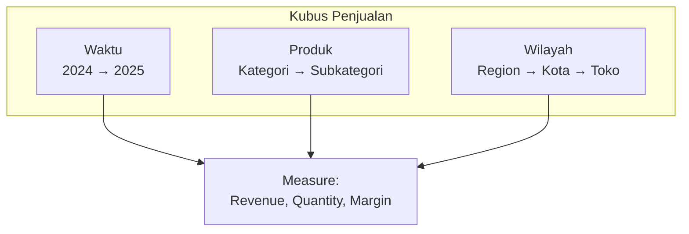

# Pertemuan 6: OLAP & SQL Analytics

::: tip 🎙️ Slide Presentasi Interaktif
Buka **[slide presentasi Pertemuan 6](/presentasi/pertemuan-6-datawarehouse)** — dilengkapi navigasi keyboard, timer, transkrip, dan narasi audio.
Untuk presentasi layar penuh, buka **[HTML interaktif](/Perkuliahan/presentasi/pertemuan-6-olap-sql-analytics.html)** di tab baru.
:::

::: tip CAPAIAN PEMBELAJARAN (SUB-CPMK 6)
- **CPMK Terkait:** CPMK 4
- **CPL Terkait:** CPL04, CPL05
- **Indikator:** Mahasiswa mampu menjelaskan operasi OLAP dan menulis query analitik lanjutan (roll-up, drill-down, window function, perbandingan periode) untuk menjawab pertanyaan bisnis.
:::

---

## 1. Konsep OLAP

**OLAP (Online Analytical Processing)** adalah cara memandang data sebagai **kubus** yang dapat dipotong, diiris, dan diagregasi dari berbagai sudut.

| Elemen | Arti | Contoh |
| :--- | :--- | :--- |
| **Dimension** | Sumbu analisis | Waktu, produk, kota, segmen |
| **Measure** | Angka yang diukur | Revenue, quantity, margin |
| **Cube** | Ruang multidimensi | Revenue per bulan × kategori × kota |
| **Hierarchy** | Tingkatan dalam dimensi | Tahun → Kuartal → Bulan → Hari |



---

## 2. Operasi OLAP

| Operasi | Arti | Contoh |
| :--- | :--- | :--- |
| **Roll-up** | Naik ke level agregasi lebih tinggi | Bulan → Kuartal → Tahun |
| **Drill-down** | Turun ke level lebih detail | Tahun → Bulan → Hari |
| **Slice** | Pilih satu nilai dimensi | Hanya tahun 2025 |
| **Dice** | Pilih rentang/subset beberapa dimensi | 2025 + kategori Elektronik + kota Medan |
| **Pivot** | Tukar dimensi baris/kolom | Bulan jadi kolom |
| **Drill-across** | Gabungkan beberapa fact | Sales vs Returns |
| **Drill-through** | Lihat baris detail dari agregat | Klik angka → transaksi asal |

### Ilustrasi

```text
Roll-up   : Revenue per bulan  →  Revenue per kuartal
Drill-down: Revenue per tahun  →  Revenue per bulan  →  per hari
Slice     : Semua data, hanya category = 'Elektronik'
Dice      : category = 'Elektronik' AND city = 'Medan' AND year = 2025
Pivot     : baris = category, kolom = month
```

---

## 3. SQL untuk OLAP

### 3.1 GROUP BY Dasar

```sql
SELECT
    d.year,
    d.month,
    p.category,
    SUM(f.net_revenue) AS revenue
FROM dw.fact_sales f
JOIN dw.dim_date d    ON d.date_key = f.date_key
JOIN dw.dim_product p ON p.product_key = f.product_key
GROUP BY d.year, d.month, p.category
ORDER BY d.year, d.month, revenue DESC;
```

### 3.2 ROLLUP

Menghasilkan subtotal dan grand total:

```sql
SELECT
    d.year,
    d.month,
    SUM(f.net_revenue) AS revenue
FROM dw.fact_sales f
JOIN dw.dim_date d ON d.date_key = f.date_key
GROUP BY ROLLUP (d.year, d.month)
ORDER BY d.year NULLS LAST, d.month NULLS LAST;
```

| year | month | revenue |
| :---: | :---: | ---: |
| 2024 | 1 | 120.000.000 |
| 2024 | 2 | 135.000.000 |
| 2024 | NULL | **255.000.000** ← subtotal tahun |
| NULL | NULL | **...** ← grand total |

### 3.3 CUBE

CUBE menghasilkan semua kombinasi:

```sql
SELECT
    p.category,
    s.region,
    SUM(f.net_revenue) AS revenue
FROM dw.fact_sales f
JOIN dw.dim_product p ON p.product_key = f.product_key
JOIN dw.dim_store s   ON s.store_key = f.store_key
GROUP BY CUBE (p.category, s.region)
ORDER BY p.category NULLS LAST, s.region NULLS LAST;
```

### 3.4 GROUPING SETS

Pilih kombinasi spesifik agar lebih efisien:

```sql
SELECT
    d.year,
    p.category,
    SUM(f.net_revenue) AS revenue
FROM dw.fact_sales f
JOIN dw.dim_date d    ON d.date_key = f.date_key
JOIN dw.dim_product p ON p.product_key = f.product_key
GROUP BY GROUPING SETS (
    (d.year, p.category),
    (d.year),
    (p.category),
    ()
)
ORDER BY d.year NULLS LAST, p.category NULLS LAST;
```

### 3.5 Pivot dengan FILTER

```sql
SELECT
    p.category,
    SUM(f.net_revenue) FILTER (WHERE d.month = 1)  AS jan,
    SUM(f.net_revenue) FILTER (WHERE d.month = 2)  AS feb,
    SUM(f.net_revenue) FILTER (WHERE d.month = 3)  AS mar,
    SUM(f.net_revenue) AS total_q1
FROM dw.fact_sales f
JOIN dw.dim_date d    ON d.date_key = f.date_key
JOIN dw.dim_product p ON p.product_key = f.product_key
WHERE d.year = 2025 AND d.quarter = 1
GROUP BY p.category
ORDER BY total_q1 DESC;
```

---

## 4. Window Functions

Window function menghitung tanpa menggabungkan baris — setiap baris tetap ada.

### 4.1 Running Total (YTD)

```sql
WITH monthly AS (
    SELECT d.year, d.month, SUM(f.net_revenue) AS revenue
    FROM dw.fact_sales f
    JOIN dw.dim_date d ON d.date_key = f.date_key
    GROUP BY d.year, d.month
)
SELECT
    year,
    month,
    revenue,
    SUM(revenue) OVER (
        PARTITION BY year
        ORDER BY month
        ROWS BETWEEN UNBOUNDED PRECEDING AND CURRENT ROW
    ) AS ytd_revenue
FROM monthly
ORDER BY year, month;
```

### 4.2 Moving Average 3 Bulan

```sql
WITH monthly AS (
    SELECT d.year, d.month, SUM(f.net_revenue) AS revenue
    FROM dw.fact_sales f
    JOIN dw.dim_date d ON d.date_key = f.date_key
    GROUP BY d.year, d.month
)
SELECT
    year,
    month,
    revenue,
    ROUND(AVG(revenue) OVER (
        ORDER BY year, month
        ROWS BETWEEN 2 PRECEDING AND CURRENT ROW
    ), 2) AS ma_3m
FROM monthly
ORDER BY year, month;
```

### 4.3 Year-over-Year (YoY)

```sql
WITH monthly AS (
    SELECT d.year, d.month, SUM(f.net_revenue) AS revenue
    FROM dw.fact_sales f
    JOIN dw.dim_date d ON d.date_key = f.date_key
    GROUP BY d.year, d.month
)
SELECT
    year,
    month,
    revenue,
    LAG(revenue, 12) OVER (ORDER BY year, month) AS revenue_last_year,
    ROUND(
        (revenue - LAG(revenue, 12) OVER (ORDER BY year, month))
        / NULLIF(LAG(revenue, 12) OVER (ORDER BY year, month), 0) * 100,
        2
    ) AS yoy_pct
FROM monthly
ORDER BY year, month;
```

### 4.4 Share of Total

```sql
SELECT
    p.category,
    SUM(f.net_revenue) AS revenue,
    ROUND(
        SUM(f.net_revenue)
        / SUM(SUM(f.net_revenue)) OVER () * 100,
        2
    ) AS share_pct
FROM dw.fact_sales f
JOIN dw.dim_product p ON p.product_key = f.product_key
GROUP BY p.category
ORDER BY revenue DESC;
```

### 4.5 Top-N per Kategori

```sql
WITH product_revenue AS (
    SELECT
        p.category,
        p.product_name,
        SUM(f.net_revenue) AS revenue
    FROM dw.fact_sales f
    JOIN dw.dim_product p ON p.product_key = f.product_key
    GROUP BY p.category, p.product_name
),
ranked AS (
    SELECT *,
           ROW_NUMBER() OVER (
               PARTITION BY category
               ORDER BY revenue DESC
           ) AS rn
    FROM product_revenue
)
SELECT category, product_name, revenue, rn
FROM ranked
WHERE rn <= 3
ORDER BY category, rn;
```

---

## 5. Pola Query BI yang Sering Dipakai

| Pertanyaan | Teknik |
| :--- | :--- |
| Tren bulanan | `GROUP BY year, month` |
| Pertumbuhan YoY | `LAG(..., 12)` |
| Kontribusi kategori | `SUM() / SUM(SUM()) OVER ()` |
| Top produk per kategori | `ROW_NUMBER() OVER (PARTITION BY ...)` |
| Rata-rata bergerak | `AVG() OVER (ROWS BETWEEN ...)` |
| Perbandingan target vs aktual | Join ke tabel target |
| Customer baru vs returning | `MIN(order_date)` per customer |
| Repeat purchase rate | Count customer dengan ≥2 order |

---

## 6. Materialized View untuk Agregat

Query dashboard sering mengulang agregasi yang sama. Materialized view menyimpan hasilnya:

```sql
CREATE MATERIALIZED VIEW dw.mv_sales_monthly AS
SELECT
    d.year,
    d.month,
    p.category,
    SUM(f.net_revenue) AS revenue,
    SUM(f.quantity)    AS units,
    SUM(f.margin)      AS margin
FROM dw.fact_sales f
JOIN dw.dim_date d    ON d.date_key = f.date_key
JOIN dw.dim_product p ON p.product_key = f.product_key
GROUP BY d.year, d.month, p.category;

CREATE UNIQUE INDEX ON dw.mv_sales_monthly (year, month, category);

-- Refresh berkala
REFRESH MATERIALIZED VIEW CONCURRENTLY dw.mv_sales_monthly;
```

> **Trade-off:** pembacaan jauh lebih cepat, tetapi data bisa tertinggal sampai refresh berikutnya. Dokumentasikan SLA kesegaran data.

---

## 7. Praktikum: Delapan Query OLAP

Gunakan star schema dari Pertemuan 3/4. Jalankan dan simpan hasilnya:

1. **Revenue per kategori per bulan** (tren).
2. **Roll-up**: revenue per kuartal dan total tahunan.
3. **Drill-down**: dari tahun → bulan → hari untuk satu kategori.
4. **Slice/dice**: revenue kategori Elektronik di Medan tahun 2025.
5. **Pivot**: kategori × bulan untuk Q1 2025.
6. **YoY** pertumbuhan revenue bulanan.
7. **Top 3 produk** per kategori berdasarkan revenue.
8. **Share of total** tiap kategori.

Untuk setiap query, tulis:

- pertanyaan bisnis yang dijawab,
- query SQL,
- interpretasi 2–3 kalimat,
- insight/aksi yang disarankan.

---

## 8. Milestone Proyek 1

Pada pertemuan ini, setiap kelompok menyerahkan:

1. **Star schema** yang sudah berisi data.
2. **8 query OLAP** dengan insight.
3. **Dokumentasi KPI** (definisi, rumus, sumber).
4. **Draft dashboard/visualisasi** (boleh Metabase/Superset/Spreadsheet).
5. **README** cara menjalankan.

**Review:** 10 menit per kelompok, fokus pada kebenaran query dan relevansi insight.

---

## 9. Checklist

- [ ] Saya dapat menjelaskan roll-up, drill-down, slice, dice, pivot.
- [ ] Saya dapat menulis ROLLUP, CUBE, GROUPING SETS.
- [ ] Saya dapat menggunakan window function untuk YTD, moving average, YoY.
- [ ] Saya dapat menghitung share of total dan top-N per kategori.
- [ ] Saya dapat memilih kapan memakai materialized view.
- [ ] Saya dapat menerjemahkan hasil query menjadi insight bisnis.

---

## 📚 Bacaan Lanjutan

- Kimball, R., & Ross, M. (2013). *The Data Warehouse Toolkit*, Bab 2 & 8.
- PostgreSQL Documentation — *Window Functions*, *GROUPING SETS*, *Materialized Views*.
- Golfarelli, M., & Rizzi, S. (2018). *Data Warehouse Design*, Bab 8.
