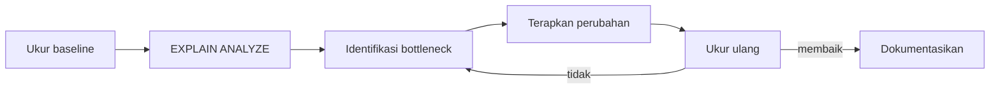

# Pertemuan 7: Implementasi & Optimasi Data Warehouse

::: info 🎓 Bacaan Teori Wajib (Kelas RPL)
Baca **[Buku Teori Data Warehouse — Pertemuan 7](/datawarehouse/TEORI-RPL#p7)** sebelum praktik. Latihan teknis di modul ini adalah **pengayaan/verifikasi**; fokus utama adalah pemahaman konsep dan kemampuan menjelaskan trade-off.
:::

::: tip 🎙️ Slide Presentasi Interaktif
Buka **[slide presentasi Pertemuan 7](/presentasi/pertemuan-7-datawarehouse)** — dilengkapi navigasi keyboard, timer, transkrip, dan narasi audio.
Untuk presentasi layar penuh, buka **[HTML interaktif](/Perkuliahan/presentasi/pertemuan-7-implementasi-optimasi.html)** di tab baru.
:::

::: tip CAPAIAN PEMBELAJARAN (SUB-CPMK 7)
- **CPMK Terkait:** CPMK 4
- **CPL Terkait:** CPL04, CPL05
- **Indikator:** Mahasiswa mampu mendiagnosis query lambat, menerapkan index/partisi/materialized view, membangun model dbt yang teruji, serta menjelaskan optimasi pada cloud data warehouse.
:::

---

## 1. Physical Design

Model logis yang baik belum tentu cepat. **Physical design** menentukan bagaimana data disimpan dan diakses.

| Teknik | Tujuan | Kapan Dipakai |
| :--- | :--- | :--- |
| **Index** | Mempercepat filter/join | Kolom sering difilter, foreign key |
| **Partition** | Memangkas data yang dibaca | Fact besar berdasarkan tanggal |
| **Materialized view** | Menyimpan agregat | Query dashboard berulang |
| **Clustering/sort key** | Mengelompokkan data sejenis | Cloud DW, filter kolom tertentu |
| **Columnar storage** | Membaca kolom yang dipakai saja | Analitik, tabel lebar |
| **Compression** | Mengurangi I/O | Semua tabel analitik |

> **Prinsip:** optimasi harus **diukur**. Jangan menambah index “karena biasa begitu” tanpa `EXPLAIN ANALYZE` sebelum/sesudah.

---

## 2. PostgreSQL: Membaca Query Plan

```sql
EXPLAIN (ANALYZE, BUFFERS)
SELECT p.category, SUM(f.net_revenue)
FROM dw.fact_sales f
JOIN dw.dim_product p ON p.product_key = f.product_key
JOIN dw.dim_date d    ON d.date_key = f.date_key
WHERE d.year = 2025
GROUP BY p.category;
```

### Yang Dicari

| Simbol/Node | Arti | Tindakan |
| :--- | :--- | :--- |
| `Seq Scan` pada tabel besar | Memindai seluruh tabel | Tambah index/partisi/filter |
| `Nested Loop` dengan baris besar | Join mahal | Cek index join key |
| `Hash Join` + `Seq Scan` | Join tanpa index | Pertimbangkan index |
| `Sort` besar | Urutan mahal | Index berurutan/clustering |
| `Buffers: read` tinggi | Banyak I/O | Cache/kompresi/partisi |
| Estimasi vs actual jauh | Statistik usang | `ANALYZE` tabel |

```sql
ANALYZE dw.fact_sales;
```

---

## 3. Index

### 3.1 Index Dasar

```sql
-- Filter tanggal
CREATE INDEX idx_fact_sales_date
    ON dw.fact_sales (date_key);

-- Join produk
CREATE INDEX idx_fact_sales_product
    ON dw.fact_sales (product_key);

-- Composite untuk query umum
CREATE INDEX idx_fact_sales_date_product
    ON dw.fact_sales (date_key, product_key);
```

### 3.2 Covering Index

Jika query hanya butuh kolom tertentu, index dapat memuat kolom tambahan:

```sql
CREATE INDEX idx_fact_sales_cover
    ON dw.fact_sales (date_key, product_key)
    INCLUDE (net_revenue, quantity);
```

### 3.3 Partial Index

```sql
-- Hanya pesanan yang valid
CREATE INDEX idx_fact_sales_paid
    ON dw.fact_sales (date_key)
    WHERE net_revenue > 0;
```

### 3.4 BRIN untuk Data Besar Berurutan

```sql
CREATE INDEX idx_fact_sales_date_brin
    ON dw.fact_sales USING BRIN (date_key);
```

BRIN sangat kecil dan cocok untuk fact append-only yang tanggalnya berurutan.

### 3.5 Kapan Index Tidak Membantu?

- Tabel kecil (seq scan lebih murah).
- Query mengambil sebagian besar baris.
- Kolom dengan kardinalitas sangat rendah (mis. boolean).
- Terlalu banyak index → memperlambat INSERT/UPDATE.

---

## 4. Partisi

Untuk fact miliaran baris, partisi berdasarkan tanggal memungkinkan **partition pruning**: query hanya membaca partisi yang relevan.

```sql
CREATE TABLE dw.fact_sales_part (
    sales_key   BIGSERIAL,
    date_key    INTEGER NOT NULL,
    product_key BIGINT  NOT NULL,
    customer_key BIGINT NOT NULL,
    quantity    INTEGER NOT NULL,
    net_revenue NUMERIC(14,2) NOT NULL,
    PRIMARY KEY (sales_key, date_key)
) PARTITION BY RANGE (date_key);

CREATE TABLE dw.fact_sales_2024
    PARTITION OF dw.fact_sales_part
    FOR VALUES FROM (20240101) TO (20250101);

CREATE TABLE dw.fact_sales_2025
    PARTITION OF dw.fact_sales_part
    FOR VALUES FROM (20250101) TO (20260101);
```

> **Catatan:** unique constraint pada tabel terpartisi harus menyertakan partition key. Karena itu `PRIMARY KEY (sales_key, date_key)`.

### Partition Pruning

```sql
EXPLAIN
SELECT SUM(net_revenue)
FROM dw.fact_sales_part
WHERE date_key BETWEEN 20250101 AND 20251231;
```

Plan hanya boleh menyebut partisi 2025.

---

## 5. Materialized View

```sql
CREATE MATERIALIZED VIEW dw.mv_sales_daily AS
SELECT
    date_key,
    product_key,
    SUM(net_revenue) AS revenue,
    SUM(quantity)    AS units
FROM dw.fact_sales
GROUP BY date_key, product_key;

CREATE UNIQUE INDEX ON dw.mv_sales_daily (date_key, product_key);
```

Refresh:

```sql
REFRESH MATERIALIZED VIEW CONCURRENTLY dw.mv_sales_daily;
```

`CONCURRENTLY` membutuhkan unique index dan memungkinkan pembacaan saat refresh.

### Trade-off

| Kelebihan | Kekurangan |
| :--- | :--- |
| Query dashboard sangat cepat | Data tertinggal sampai refresh |
| Mengurangi beban fact table | Menambah storage |
| Mudah dipakai BI | Perlu jadwal & monitoring refresh |

---

## 6. Cloud Data Warehouse

| Platform | Karakteristik | Optimasi Kunci |
| :--- | :--- | :--- |
| **BigQuery** | Serverless, columnar, pisah storage/compute | Partition, cluster, hindari `SELECT *` |
| **Snowflake** | Multi-cluster, micro-partition | Clustering key, warehouse sizing, cache |
| **Redshift** | MPP, columnar | Dist/sort key, vacuum/analyze, WLM |
| **PostgreSQL** | Row-store (columnar via extension) | Index, partisi, MV |
| **DuckDB** | In-process columnar | Parquet, predicate pushdown |

### Prinsip yang Sama di Semua Platform

1. **Column pruning** — pilih kolom yang dibutuhkan.
2. **Partition/cluster pruning** — filter pada kolom partisi.
3. **Predicate pushdown** — filter sedini mungkin.
4. **Hindari data spill** — cukupkan memori/partisi.
5. **Ukur bytes scanned** — biaya cloud sering berbasis data yang dipindai.

```sql
-- ❌ Memindai semua kolom
SELECT * FROM fact_sales WHERE date_key = 20250101;

-- ✅ Hanya kolom yang dibutuhkan
SELECT product_key, SUM(net_revenue)
FROM fact_sales
WHERE date_key = 20250101
GROUP BY product_key;
```

---

## 7. dbt: Transformasi sebagai Kode

dbt mengelola transformasi SQL dengan **model**, **test**, **documentation**, dan **lineage**.

### 7.1 Struktur Proyek

```text
dw_project/
├── dbt_project.yml
├── models/
│   ├── staging/
│   │   ├── stg_orders.sql
│   │   └── schema.yml
│   └── marts/
│       ├── dim_product.sql
│       ├── fct_sales.sql
│       └── schema.yml
└── tests/
```

### 7.2 Model Staging

```sql
-- models/staging/stg_orders.sql
SELECT
    order_id,
    order_ts::TIMESTAMP AS order_ts,
    customer_code,
    product_code,
    store_code,
    quantity::INT AS quantity,
    unit_price::NUMERIC(12,2) AS unit_price,
    COALESCE(discount::NUMERIC, 0) AS discount,
    status
FROM {{ source('raw', 'orders') }}
WHERE status = 'paid'
```

### 7.3 Model Fact Incremental

```sql
-- models/marts/fct_sales.sql
{{ config(
    materialized='incremental',
    unique_key=['order_id', 'line_no']
) }}

SELECT
    TO_CHAR(o.order_ts, 'YYYYMMDD')::INT AS date_key,
    p.product_key,
    c.customer_key,
    s.store_key,
    o.order_id,
    ROW_NUMBER() OVER (PARTITION BY o.order_id ORDER BY o.product_code)::INT AS line_no,
    o.quantity,
    o.quantity * o.unit_price AS gross_revenue,
    o.discount,
    o.quantity * o.unit_price - o.discount AS net_revenue,
    o.quantity * p.cost AS cost
FROM {{ ref('stg_orders') }} o
JOIN {{ ref('dim_product') }} p  ON p.product_code = o.product_code
JOIN {{ ref('dim_customer') }} c ON c.customer_code = o.customer_code
JOIN {{ ref('dim_store') }} s    ON s.store_code = o.store_code


WHERE TO_CHAR(o.order_ts, 'YYYYMMDD')::INT
      > (SELECT COALESCE(MAX(date_key), 0) FROM {{ this }})

```

### 7.4 Test dbt

```yaml
# models/marts/schema.yml
version: 2

models:
  - name: fct_sales
    columns:
      - name: order_id
        tests:
          - not_null
      - name: net_revenue
        tests:
          - not_null
          - dbt_utils.expression_is_true:
              expression: ">= 0"
```

```bash
dbt run
dbt test
dbt docs generate
dbt docs serve
```

### 7.5 Manfaat dbt

- Transformasi **berversi** di Git.
- **Test** otomatis untuk kualitas data.
- **Lineage** dan dokumentasi otomatis.
- **Incremental model** tanpa menulis logika manual.
- Kolaborasi tim lebih mudah.

---

## 8. Alur Tuning



### Checklist Diagnosis

| Gejala | Kemungkinan Penyebab | Tindakan |
| :--- | :--- | :--- |
| Seq scan tabel besar | Tidak ada index/filter | Index, partisi, filter |
| Sort besar | Urutan tanpa index | Index berurutan, limit |
| Hash join besar | Join tanpa index | Index join key, broadcast |
| Buffer read tinggi | Data tidak cache | Kurangi kolom, partisi |
| Estimasi meleset | Statistik usang | `ANALYZE` |
| Query dashboard lambat | Agregasi berulang | Materialized view |
| Biaya cloud tinggi | Scan berlebih | Partition/cluster pruning |

---

## 9. Praktik Terbimbing (Pengayaan): Optimasi Terukur

### 9.1 Baseline

```sql
\timing on

SELECT p.category, d.month, SUM(f.net_revenue)
FROM dw.fact_sales f
JOIN dw.dim_product p ON p.product_key = f.product_key
JOIN dw.dim_date d ON d.date_key = f.date_key
WHERE d.year = 2025
GROUP BY p.category, d.month;
```

Catat waktu dan `EXPLAIN (ANALYZE, BUFFERS)`.

### 9.2 Eksperimen

| Eksperimen | Perubahan | Metrik |
| :--- | :--- | :--- |
| E1 | Tambah index `(date_key)` | Waktu, buffers |
| E2 | Tambah composite index `(date_key, product_key)` | Waktu, buffers |
| E3 | Partisi fact per tahun | Partisi yang dipindai |
| E4 | Materialized view agregat | Waktu query dashboard |
| E5 | Hapus kolom tidak perlu | Buffers |

### 9.3 Laporkan

Tabel:

| Eksperimen | Waktu (ms) | Buffers read | Catatan |
| :--- | ---: | ---: | :--- |
| Baseline | ... | ... | ... |
| E1 | ... | ... | ... |
| E2 | ... | ... | ... |

Sertakan **kesimpulan**: perubahan mana yang paling berdampak dan mengapa.

---

## 10. Milestone Proyek 2

Serahkan:

1. **Query plan sebelum/sesudah** untuk minimal 2 query.
2. **Index/partisi/materialized view** yang diterapkan.
3. **Model dbt** (minimal 3 model: staging, dimension, fact) + test.
4. **Dokumentasi performa**: baseline, metrik, kesimpulan.
5. **README** cara menjalankan `dbt run` dan `dbt test`.

---

## 11. Checklist

- [ ] Saya dapat membaca `EXPLAIN ANALYZE`.
- [ ] Saya dapat memilih index yang tepat.
- [ ] Saya dapat mempartisi fact table dan membuktikan pruning.
- [ ] Saya dapat membuat dan me-refresh materialized view.
- [ ] Saya dapat membangun model dbt + test.
- [ ] Saya dapat mengukur dampak optimasi secara kuantitatif.

---

## 📚 Bacaan Lanjutan

- PostgreSQL Documentation — *Performance Tips*, *Partitioning*, *Indexes*.
- dbt Documentation — *Models*, *Tests*, *Incremental Models*.
- Kimball, R., & Ross, M. (2013). *The Data Warehouse Toolkit*, Bab 18–19.
- BigQuery/Snowflake/Redshift — *Performance Optimization Guides*.
