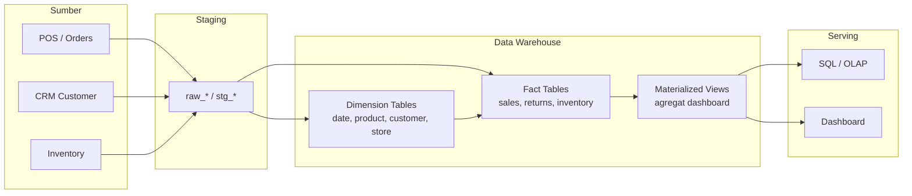
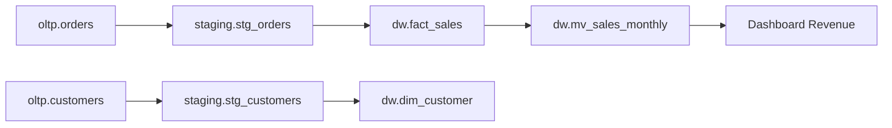

# Pertemuan 8: Proyek Akhir, Tata Kelola & UAS

::: info 🎓 Bacaan Teori Wajib (Kelas RPL)
Baca **[Buku Teori Data Warehouse — Pertemuan 8](/datawarehouse/TEORI-RPL#p8)** sebelum praktik. Latihan teknis di modul ini adalah **pengayaan/verifikasi**; fokus utama adalah pemahaman konsep dan kemampuan menjelaskan trade-off.
:::

::: tip 🎙️ Slide Presentasi Interaktif
Buka **[slide presentasi Pertemuan 8](/presentasi/pertemuan-8-datawarehouse)** — dilengkapi navigasi keyboard, timer, transkrip, dan narasi audio.
Untuk presentasi layar penuh, buka **[HTML interaktif](/Perkuliahan/presentasi/pertemuan-8-dw-capstone.html)** di tab baru.
:::

::: tip CAPAIAN PEMBELAJARAN (SUB-CPMK 8)
- **CPMK Terkait:** CPMK 5
- **CPL Terkait:** CPL04, CPL05, CPL08
- **Indikator:** Mahasiswa mampu menyajikan data warehouse end-to-end yang berjalan, mendokumentasikan tata kelola dan lineage, menerapkan keamanan serta privasi data, dan mengevaluasi biaya operasional.
:::

---

## 1. Capstone: Dari Kebutuhan Bisnis ke Dashboard

Proyek akhir mengintegrasikan seluruh kompetensi Pertemuan 1–7 menjadi **satu data warehouse yang dapat dijalankan ulang**.



---

## 2. Ruang Lingkup Proyek

Pilih **satu** studi kasus dengan data yang dapat diperoleh/dibangkitkan:

| Kasus | Pertanyaan Bisnis | Fact Utama |
| :--- | :--- | :--- |
| **Retail sales** | Produk/kategori/toko mana yang menguntungkan? | `fact_sales` |
| **E-commerce funnel** | Di tahap mana pengguna berhenti? | `fact_funnel` |
| **Inventory** | Kapan stok menipis/berlebih? | `fact_inventory_snapshot` |
| **Perbankan** | Segmen mana yang berisiko? | `fact_transactions` |
| **Klinik** | Bagaimana utilisasi layanan? | `fact_visits` |
| **Kampus** | Bagaimana performa akademik? | `fact_enrollment` |

**Batasan minimum:**

- 1 fact table + minimal 4 dimension table.
- Minimal 1 SCD Tipe 2.
- ETL incremental + minimal 5 quality checks.
- 8 query OLAP + dashboard/visualisasi.
- Optimasi terbukti (index/partisi/materialized view).
- Tata kelola & keamanan terdokumentasi.

---

## 3. Deliverables

| # | Artefak | Isi Minimum |
| :---: | :--- | :--- |
| 1 | **Repositori Git** | DDL, ETL, dbt, query, README, `.env.example` |
| 2 | **Dokumen requirement** | Stakeholder, pertanyaan bisnis, KPI, definisi metrik |
| 3 | **Bus matrix & grain** | Proses bisnis × dimensi, grain statement |
| 4 | **Model dimensional** | Diagram star/snowflake, data dictionary |
| 5 | **ETL** | Incremental, idempoten, reject table, log |
| 6 | **Quality checks** | ≥5 uji + rekonsiliasi |
| 7 | **OLAP & serving** | 8 query + dashboard/visualisasi |
| 8 | **Optimasi** | Bukti before/after (index/partisi/MV) |
| 9 | **Governance pack** | Ownership, lineage, retensi, akses, PII |
| 10 | **Laporan & demo** | 8–12 halaman + demo 10 menit |

### Struktur Repositori

```text
dw-project/
├── README.md
├── docs/
│   ├── requirements.md
│   ├── bus-matrix.md
│   ├── data-dictionary.md
│   ├── governance.md
│   └── performance.md
├── sql/
│   ├── 01_schema.sql
│   ├── 02_dimensions.sql
│   ├── 03_facts.sql
│   └── 04_quality.sql
├── etl/
│   ├── extract.py
│   ├── load.py
│   └── quality.py
├── dbt_project/
├── dashboards/
├── docker-compose.yml
└── Makefile
```

### Prinsip “One Command”

Dosen harus dapat menjalankan proyek dari kondisi bersih:

```bash
git clone <repo>
cd dw-project
cp .env.example .env
docker compose up -d
make seed
make etl
make quality
make test
```

Jika ada langkah manual, tulis di README dan tunjukkan saat demo.

---

## 4. Tata Kelola Data

### 4.1 Komponen

| Komponen | Pertanyaan | Artefak |
| :--- | :--- | :--- |
| **Metadata** | Apa arti tabel/kolom ini? | Data dictionary |
| **Lineage** | Dari mana angka ini berasal? | Diagram alur sumber → fact |
| **Ownership** | Siapa penanggung jawab? | Data owner per domain |
| **Kualitas** | Seberapa andal data ini? | Quality report & SLA |
| **Retensi** | Berapa lama disimpan? | Kebijakan retensi |
| **Akses** | Siapa boleh melihat? | RBAC/row-level security |
| **Definisi metrik** | Apa rumus resmi KPI? | Metric dictionary |

### 4.2 Data Dictionary

| Kolom | Tipe | Deskripsi | PII | Sumber |
| :--- | :--- | :--- | :---: | :--- |
| `customer_code` | TEXT | Kode pelanggan unik | Ya | CRM |
| `customer_name` | TEXT | Nama lengkap | Ya | CRM |
| `city` | TEXT | Kota domisili | Tidak | CRM |
| `segment` | TEXT | Segmen pelanggan | Tidak | CRM |
| `net_revenue` | NUMERIC | Revenue setelah diskon | Tidak | Order line |

### 4.3 Metric Dictionary

| Metrik | Definisi | Rumus | Sumber |
| :--- | :--- | :--- | :--- |
| **Net Revenue** | Pendapatan setelah diskon | `SUM(quantity*price - discount)` | `fact_sales` |
| **Gross Margin** | Laba kotor | `SUM(net_revenue - cost)` | `fact_sales` |
| **Margin %** | Persentase margin | `margin / net_revenue * 100` | Turunan |
| **Active Customer** | Pelanggan aktif 30 hari | `COUNT(DISTINCT customer_key)` | `fact_sales` |

### 4.4 Lineage



Lineage memungkinkan **impact analysis**: jika definisi `net_revenue` berubah, dashboard mana yang terpengaruh?

---

## 5. Keamanan & Privasi

### 5.1 Kontrol Keamanan

| Area | Kontrol |
| :--- | :--- |
| **Autentikasi** | SSO/MFA, akun terpisah untuk ETL |
| **Otorisasi** | Least privilege, role analyst/engineer/admin |
| **Enkripsi** | TLS in transit, AES-256 at rest |
| **Masking** | Email/nomor telepon disamarkan untuk analis |
| **Audit** | Log query & akses tabel sensitif |
| **Backup** | Backup terjadwal + uji restore |

```sql
-- Contoh role dan akses minimum
CREATE ROLE dw_analyst NOLOGIN;
GRANT USAGE ON SCHEMA dw TO dw_analyst;
GRANT SELECT ON dw.fact_sales, dw.dim_product, dw.dim_date TO dw_analyst;
-- Tidak memberikan akses ke dim_customer (mengandung PII)
```

### 5.2 UU PDP No. 27 Tahun 2022

| Prinsip | Implementasi |
| :--- | :--- |
| **Minimisasi** | Hanya menyimpan kolom yang diperlukan |
| **Tujuan terbatas** | Dokumentasikan penggunaan data |
| **Retensi terbatas** | Hapus otomatis setelah masa retensi |
| **Hak subjek data** | Prosedur akses/koreksi/penghapusan |
| **Notifikasi kebocoran** | Maksimal 3×24 jam |
| **Keamanan** | Enkripsi, akses minimum, audit |

### 5.3 PII di Data Warehouse

- **Identifikasi** kolom PII di data dictionary.
- **Pseudonimisasi** untuk analitik (hash/token).
- **Masking** di view untuk analis.
- **Batasi** akses ke tabel dimensi pelanggan.
- **Jangan** menyalin PII ke lingkungan development tanpa masking.

```sql
CREATE VIEW dw.v_customer_masked AS
SELECT
    customer_key,
    customer_code,
    LEFT(customer_name, 1) || '***' AS customer_name,
    city,
    segment,
    REGEXP_REPLACE(email, '(^.{2}).*(@.*$)', '\1***\2') AS email
FROM dw.dim_customer;
```

---

## 6. Optimasi Biaya

### 6.1 Sumber Biaya

| Komponen | Pemicu | Strategi |
| :--- | :--- | :--- |
| **Storage** | GB/bulan | Kompresi, arsip, retensi |
| **Compute** | Jam warehouse/credits | Auto-suspend, right-sizing |
| **Query scan** | TB dipindai | Partition/cluster pruning, MV |
| **Egress** | Data keluar | Lokalisasi, cache |
| **Orkestrasi** | Jumlah run | Jadwal efisien, incremental |

### 6.2 Contoh Perhitungan

> Asumsi ilustratif: storage 500 GB @ $0.02/GB, warehouse 2 credits × 8 jam/hari × 30 hari @ $2/credit, scan 10 TB/bulan @ $5/TB.

```text
Storage : 500 x $0.02                    = $10
Compute : 2 x 8 x 30 x $2                = $960
Scan    : 10 x $5                        = $50
------------------------------------------------
Total kasar                               ≈ $1.020/bulan
```

**Penghematan:**

- Auto-suspend saat idle (12 jam/hari) → compute turun ±50%.
- Materialized view untuk dashboard → scan turun 70–90%.
- Partition/cluster pruning → scan turun 50–80%.
- Kompresi & retensi → storage turun 30–60%.
- Query incremental, bukan full refresh.

> **Metrik berguna:** biaya per 1.000 query, biaya per dashboard refresh, bytes scanned per query, storage per tabel.

---

## 7. Anti-Pattern

| Anti-pattern | Akibat | Perbaikan |
| :--- | :--- | :--- |
| **Skema OLTP untuk DW** | Query lambat, join rumit | Star schema |
| **Grain tidak jelas** | Duplikasi/agregasi salah | Deklarasi grain |
| **Natural key di fact** | Join lambat, histori rusak | Surrogate key |
| **Tidak ada SCD** | Histori hilang | SCD Tipe 2 |
| **ETL tidak idempoten** | Duplikasi saat retry | Upsert/overwrite |
| **Tanpa quality check** | Dashboard salah | Quality gate |
| **SELECT \*** | Scan & biaya besar | Pilih kolom |
| **Index berlebihan** | Load lambat | Index sesuai query |
| **Tanpa dokumentasi** | Sulit dirawat | Data dictionary & lineage |
| **PII tersebar** | Risiko kepatuhan | Masking & akses minimum |

---

## 8. Rubrik Proyek Akhir (100)

| Aspek | Bobot | Level Sangat Baik (90–100) | Level Cukup (70–79) | Level Kurang (< 60) |
| :--- | :---: | :--- | :--- | :--- |
| **Requirement & KPI** | 15 | Pertanyaan bisnis jelas, KPI terdefinisi, stakeholder jelas | KPI ada, definisi kabur | Tidak jelas |
| **Model dimensional** | 20 | Grain tepat, star/snowflake konsisten, SCD2 benar | Model jalan, SCD minim | Tidak konsisten |
| **ETL & kualitas** | 20 | Incremental, idempoten, ≥5 checks, rekonsiliasi | ETL jalan, test minim | Sering gagal |
| **OLAP & serving** | 15 | 8 query benar, insight kuat, dashboard berfungsi | Query dasar | Tidak berjalan |
| **Optimasi & biaya** | 10 | Before/after terukur, keputusan beralasan | Optimasi tanpa bukti | Tidak ada |
| **Tata kelola & keamanan** | 10 | Metadata, lineage, akses, PII lengkap | Sebagian | Diabaikan |
| **Demo & dokumentasi** | 10 | One command, runbook, demo lancar | README dasar | Tidak dapat dijalankan |

### Pertanyaan Pertahanan

1. Mengapa memilih grain tersebut?
2. Mengapa memakai star/snowflake?
3. Bagaimana SCD2 menangani perubahan dan late-arriving data?
4. Apa yang terjadi jika ETL dijalankan dua kali?
5. Bagaimana Anda membuktikan data di DW benar?
6. Query mana yang paling mahal, dan bagaimana Anda mengoptimalkannya?
7. Di mana PII disimpan dan bagaimana dilindungi?
8. Berapa biaya per bulan, dan bagaimana menguranginya?
9. Apa yang akan berubah jika data naik 10×?
10. Bagian mana yang paling rapuh, dan apa mitigasinya?

---

## 9. Demo & Laporan

### Struktur Demo (10 Menit)

| Menit | Konten |
| :---: | :--- |
| 0–2 | Masalah bisnis, stakeholder, KPI |
| 2–4 | Arsitektur, bus matrix, model dimensional |
| 4–7 | Demo: ETL → quality check → query OLAP → dashboard |
| 7–8 | Simulasi kegagalan/quality gate |
| 8–9 | Optimasi & biaya |
| 9–10 | Tata kelola, keamanan, pelajaran |

### Struktur Laporan (8–12 Halaman)

1. Ringkasan eksekutif
2. Requirement & KPI
3. Arsitektur & bus matrix
4. Model dimensional & data dictionary
5. ETL & kualitas data
6. Query OLAP & insight
7. Optimasi performa
8. Tata kelola, keamanan, privasi
9. Analisis biaya
10. Kendala, pelajaran, pengembangan lanjutan
11. Referensi & lampiran

---

## 10. Checklist Akhir

- [ ] Proyek dapat dijalankan dari kondisi bersih.
- [ ] Grain dan model dimensional konsisten.
- [ ] SCD2 menyimpan histori dan query point-in-time benar.
- [ ] ETL idempoten + minimal 5 quality checks.
- [ ] 8 query OLAP + dashboard/visualisasi berfungsi.
- [ ] Optimasi terbukti dengan before/after.
- [ ] Metadata, lineage, ownership terdokumentasi.
- [ ] PII diidentifikasi, dimasking, dan akses dibatasi.
- [ ] Estimasi biaya dan strategi penghematan ada.
- [ ] Semua anggota dapat menjelaskan keputusan teknis.

---

## 11. Penutup

Data warehouse bukan sekadar kumpulan tabel. Ia adalah **produk data** yang menghubungkan sistem operasional dengan keputusan bisnis. Prinsip yang perlu dibawa:

1. **Mulai dari pertanyaan bisnis**, bukan dari tabel.
2. **Grain adalah fondasi** — salah grain, semua turunannya salah.
3. **Konsistensi mengalahkan kecepatan sesaat** — conformed dimension menjaga kebenaran.
4. **Kualitas data harus diuji**, bukan diasumsikan.
5. **Optimasi harus diukur**, bukan ditebak.
6. **Privasi adalah tanggung jawab**, bukan beban kepatuhan.
7. **Dokumentasi adalah bagian dari sistem.**

---

## 📚 Bacaan Lanjutan

- Kimball, R., & Ross, M. (2013). *The Data Warehouse Toolkit*, Bab 17–20.
- Inmon, W. H. (2005). *Building the Data Warehouse*, Bab 10–12.
- Reis, J., & Housley, M. (2022). *Fundamentals of Data Engineering*, Bab 10–11.
- Undang-Undang Republik Indonesia Nomor 27 Tahun 2022 tentang Pelindungan Data Pribadi.
