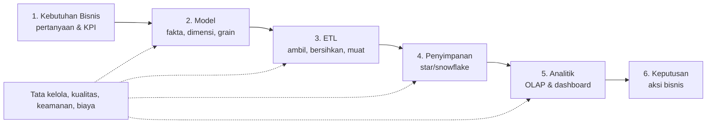

# 📘 Buku Teori Data Warehouse untuk Kelas RPL

**Mata Kuliah:** Data Warehouse (`IFR237`) · 3 SKS · Semester IV  
**Kelas:** RPL (Rekognisi Pembelajaran Lampau)  
**Dosen:** Mahendar Dwi Payana, S.ST., M.T.

---

## Mengapa Buku Teori Ini Ada?

Kelas RPL mengakui **pengalaman kerja, pelatihan nonformal/informal, dan pendidikan formal sebelumnya** sebagai SKS. Peserta RPL sering sudah pernah membuat laporan, dashboard, atau rekap data — tetapi mungkin belum pernah membedah **mengapa** rancangan datanya bekerja atau gagal.

Buku ini menempatkan **teori dan penalaran desain** di depan:

- **Tanpa SQL terlebih dahulu** — fokus pada konsep, analogi, dan trade-off.
- **Studi kasus** yang dekat dengan pekerjaan sehari-hari.
- **Pertanyaan refleksi** untuk menghubungkan teori dengan pengalaman.
- **Praktik sebagai verifikasi**, bukan satu-satunya bukti kompetensi.

> **Cara membaca:** baca bab sebelum pertemuan, tandai bagian yang mirip dengan pengalaman Anda, lalu gunakan modul pertemuan untuk melihat contoh implementasi.

---

## Peta Besar Data Warehouse

Data warehouse bukan tujuan. Ia adalah **jembatan** antara data operasional dan keputusan.

---

## Pertemuan 1 — Fondasi: Mengapa Data Warehouse Ada? {#p1}

### Pertanyaan Pemandu

- Mengapa laporan analitik tidak cukup dijalankan di database operasional?
- Apa perbedaan data, informasi, dan keputusan?
- Kapan data warehouse tidak diperlukan?

### Analogi: Buku Kas dan Laporan Tahunan

- **Database operasional (OLTP)** seperti buku kas harian: setiap transaksi dicatat cepat dan rinci.
- **Data warehouse (OLAP)** seperti laporan tahunan: data sudah dikelompokkan, histori panjang, dan siap dibaca manajer.
- Anda tidak akan meminta manajer membaca ribuan halaman buku kas untuk mengambil keputusan. Anda menyiapkan **ringkasan yang benar**.

### Empat Karakteristik Data Warehouse (Inmon)

| Karakteristik | Arti Sederhana | Contoh |
| :--- | :--- | :--- |
| **Subject-oriented** | Diorganisasi per subjek bisnis | Penjualan, pelanggan, produk |
| **Integrated** | Definisi disatukan | Kode produk dari dua sistem diselaraskan |
| **Time-variant** | Menyimpan histori | Data 5 tahun, bukan hanya hari ini |
| **Nonvolatile** | Tidak diubah sembarangan | Data dimuat, dibaca, diaudit |

### Konsep Inti

**OLTP** menjawab *"apa yang baru terjadi?"* — cepat, satu baris, transaksi.  
**OLAP** menjawab *"apa pola yang terjadi?"* — agregasi, banyak baris, tren.

Memisahkan keduanya mencegah:
- aplikasi kasir melambat saat laporan bulanan dibuat,
- angka berbeda karena definisi tidak seragam,
- histori hilang saat data lama diarsipkan.

**Business Intelligence (BI)** adalah cara memanfaatkan data warehouse: query, dashboard, analisis, dan keputusan.

### Kesalahpahaman Umum

1. **"Data warehouse harus besar."** Tidak. Yang penting adalah tujuan dan kualitas, bukan ukuran.
2. **"Data warehouse menggantikan database."** Tidak. Keduanya punya peran berbeda.
3. **"Semua perusahaan perlu data warehouse."** Jika kebutuhan analitik masih sederhana, RDBMS yang baik sudah cukup.

### Studi Kasus Kerja

Seorang analis diminta membuat laporan penjualan per cabang. Ia mengambil data langsung dari database kasir dan menjalankan query berat pada jam sibuk. Aplikasi kasir melambat, dan laporan tetap salah karena setiap cabang memakai kode kategori berbeda. Solusinya bukan query yang lebih cepat, tetapi **memisahkan analitik** dan **menyatukan definisi**.

### Refleksi

1. Laporan apa yang paling sering diminta di tempat kerja Anda?
2. Apakah laporan itu diambil langsung dari database operasional?
3. Definisi metrik apa yang sering berbeda antarunit?

### Istilah Kunci

`OLTP` · `OLAP` · `data warehouse` · `data mart` · `Business Intelligence` · `KPI`

---

## Pertemuan 2 — Arsitektur dan Pemodelan Konseptual {#p2}

### Pertanyaan Pemandu

- Mulai dari enterprise atau dari data mart?
- Bagaimana memastikan definisi "produk" sama di semua laporan?
- Apa itu grain, dan mengapa ia menentukan segalanya?

### Analogi: Membangun Kota

- **Inmon (top-down)** seperti membangun jalan utama dan jaringan kota terlebih dahulu, lalu kawasan.
- **Kimball (bottom-up)** seperti membangun satu kawasan fungsional lebih dulu, lalu menghubungkannya dengan jalan yang sama.
- **Bus matrix** adalah peta jalan: memastikan kawasan-kawasan terhubung, bukan menjadi kota terpisah.

### Konsep Inti

| Konsep | Arti | Mengapa Penting |
| :--- | :--- | :--- |
| **Staging** | Salinan mentah data sumber | Memuat cepat, tidak mengganggu sumber |
| **Integration** | Pembersihan & standarisasi | Definisi konsisten |
| **Presentation** | Star/snowflake siap BI | Mudah dipahami pengguna |
| **Bus matrix** | Proses bisnis × dimensi | Mencegah silo |
| **Conformed dimension** | Dimensi yang sama di banyak mart | Memungkinkan drill-across |
| **Grain** | Makna satu baris fakta | Menentukan agregasi yang benar |

**Empat langkah Kimball:** pilih proses bisnis → deklarasikan grain → identifikasi dimensi → identifikasi fakta.

### Kesalahpahaman Umum

1. **"Grain bisa diperbaiki nanti."** Perubahan grain berarti membangun ulang fact dan seluruh laporan.
2. **"Dimensi boleh berbeda antar mart."** Jika `dim_product` berbeda, angka lintas laporan tidak akan cocok.
3. **"Requirement cukup didengar sekali."** Kebutuhan berubah; definisi metrik harus dipelihara.

### Studi Kasus Kerja

Dua departemen membuat dashboard penjualan. Departemen A menghitung "pelanggan aktif" sebagai pelanggan yang bertransaksi bulan ini; departemen B menghitung yang pernah login. Kedua dashboard benar menurut definisinya, tetapi bertentangan di rapat. Solusinya adalah **metric dictionary** dan **conformed dimension**, bukan debat data.

### Refleksi

1. Pernahkah dua laporan di tempat kerja Anda menunjukkan angka berbeda?
2. Apa penyebabnya: sumber, definisi, atau waktu pengambilan?
3. Siapa yang seharusnya memiliki definisi metrik?

### Istilah Kunci

`Inmon` · `Kimball` · `bus matrix` · `grain` · `conformed dimension` · `staging`

---

## Pertemuan 3 — Fact, Dimension, dan Star Schema {#p3}

### Pertanyaan Pemandu

- Apa yang disimpan fact, dan apa yang disimpan dimension?
- Mengapa fact memakai surrogate key?
- Kapan angka tidak boleh dijumlahkan?

### Analogi: Struk Belanja

- **Fact** = baris item di struk: jumlah, harga, diskon.
- **Dimension** = informasi di sekitar struk: tanggal, toko, produk, pelanggan.
- **Star schema** = struk yang langsung menunjuk ke kartu produk, kartu pelanggan, dan kalender.

Tanpa dimension, angka di struk tidak punya konteks. Tanpa fact, dimension hanya daftar referensi tanpa peristiwa.

### Konsep Inti

| Konsep | Arti | Catatan |
| :--- | :--- | :--- |
| **Fact table** | Foreign key + measure | Besar, append-only |
| **Dimension table** | Konteks deskriptif | Lebih lebar, banyak atribut |
| **Surrogate key** | ID internal integer | Stabil, cepat, mendukung SCD |
| **Natural key** | Kode bisnis | Disimpan untuk traceability |
| **Additive** | Bisa dijumlahkan semua dimensi | Revenue, quantity |
| **Semi-additive** | Tidak bisa dijumlahkan lintas waktu | Saldo stok |
| **Non-additive** | Tidak bisa dijumlahkan | Rasio, persentase |

**Tipe fact:** transaction, periodic snapshot, accumulating snapshot, factless fact.

**Dimensi khusus:** degenerate dimension (nomor dokumen), junk dimension (kombinasi flag), role-playing dimension (tanggal pesanan vs tanggal kirim), bridge table (many-to-many).

### Kesalahpahaman Umum

1. **"Semakin banyak tabel semakin baik."** Star schema justru menyederhanakan.
2. **"Semua angka bisa di-SUM."** Persentase dan rasio tidak additive.
3. **"Surrogate key hanya nomor urut."** Ia melindungi fact dari perubahan kode bisnis dan mendukung histori.

### Studi Kasus Kerja

Sebuah laporan menghitung margin dengan menjumlahkan persentase margin per produk. Hasilnya 340%, jelas salah. Perbaikan: hitung total margin dibagi total revenue. Masalahnya bukan SQL, tetapi **pemahaman additivity**.

### Refleksi

1. Laporan di tempat kerja Anda mana yang menjumlahkan persentase?
2. Apakah laporan itu masih masuk akal?
3. Informasi apa yang biasanya hilang dari laporan Anda karena tidak ada dimensi yang tepat?

### Istilah Kunci

`fact` · `dimension` · `surrogate key` · `star schema` · `additivity` · `degenerate dimension`

---

## Pertemuan 4 — Snowflake, Galaxy, dan Perubahan Dimensi {#p4}

### Pertanyaan Pemandu

- Kapan dimensi perlu dinormalisasi?
- Bagaimana menjaga histori ketika pelanggan pindah kota?
- Apa yang terjadi jika fact tiba sebelum dimensinya?

### Analogi: Arsip Kepegawaian

Seorang karyawan pindah departemen. Ada dua pilihan:

- **Tipe 1** = ubah kartu kepegawaian, histori lama hilang.
- **Tipe 2** = simpan kartu lama dengan masa berlaku, buat kartu baru. Histori tetap ada.
- **Tipe 3** = tambahkan kolom "departemen sebelumnya" di kartu yang sama.

Pilihan bergantung pada pertanyaan: *"Berapa penjualan saat karyawan itu masih di departemen A?"* Jika pertanyaan ini penting, Tipe 2 diperlukan.

### Konsep Inti

| Tipe SCD | Strategi | Histori |
| :---: | :--- | :---: |
| 0 | Pertahankan nilai asli | Tidak |
| 1 | Timpa nilai | Tidak |
| 2 | Tambah baris + masa berlaku | Ya |
| 3 | Tambah kolom previous | Terbatas |
| 4 | Tabel histori terpisah | Ya |
| 6 | Hybrid | Ya |

**Star vs snowflake:** star lebih sederhana dan cepat untuk BI; snowflake lebih hemat ruang dan cocok untuk hierarki besar. **Galaxy** = beberapa fact berbagi dimensi yang sama.

**Point-in-time** berarti melihat atribut dimensi **saat transaksi terjadi**, bukan saat ini.

### Kesalahpahaman Umum

1. **"SCD2 selalu lebih baik."** Jika histori tidak dibutuhkan, SCD1 lebih sederhana.
2. **"Fact cukup menyimpan kode pelanggan."** Tanpa surrogate key versi, histori tidak bisa dilacak.
3. **"Late-arriving data bisa diabaikan."** Fact yang menunjuk dimensi hilang akan merusak laporan.

### Studi Kasus Kerja

Seorang pelanggan pindah kota pada Juni. Laporan penjualan Januari–Mei seharusnya memakai kota lama, tetapi dashboard memakai kota baru karena dimensi ditimpa. Akibatnya, analisis per wilayah salah. Solusi: SCD2 dan fact menyimpan key versi yang tepat.

### Refleksi

1. Atribut apa di tempat kerja Anda yang berubah dan historinya penting?
2. Apakah laporan Anda menampilkan kondisi "saat ini" atau "saat transaksi"?
3. Siapa yang memutuskan tipe SCD yang dipakai?

### Istilah Kunci

`SCD` · `snowflake` · `galaxy` · `point-in-time` · `late-arriving dimension` · `bridge table`

---

## Pertemuan 5 — ETL dan Kualitas Data {#p5}

### Pertanyaan Pemandu

- Mengapa ETL yang berjalan belum tentu benar?
- Bagaimana menangani data yang datang terlambat?
- Apa bukti bahwa data warehouse dapat dipercaya?

### Analogi: Jalur Produksi Makanan

- **Extract** = menerima bahan dari pemasok.
- **Transform** = mencuci, memotong, memasak.
- **Load** = mengemas ke rak.
- **Quality check** = memastikan tidak ada bahan busuk yang lolos.

Jika quality check dilewati, pelanggan menerima produk cacat. Dalam data, pelanggan adalah manajer yang mengambil keputusan.

### Konsep Inti

| Konsep | Arti | Praktik |
| :--- | :--- | :--- |
| **Full extract** | Ambil semua data | Sederhana, berat |
| **Incremental** | Ambil perubahan | Efisien, butuh watermark |
| **CDC** | Baca log perubahan | Near-real-time |
| **Idempotence** | Dijalankan ulang, hasil sama | Upsert/overwrite |
| **Reconciliation** | Cocokkan sumber & warehouse | Bukti kebenaran |
| **Reject table** | Simpan baris gagal | Audit & perbaikan |
| **Quality gate** | Blokir data buruk | Lindungi dashboard |

**Dimensi kualitas:** completeness, uniqueness, validity, consistency, timeliness, accuracy, volume.

### Kesalahpahaman Umum

1. **"ETL sukses berarti data benar."** Job bisa sukses dengan data kosong atau ganda.
2. **"Duplikat bisa dibersihkan nanti."** Lebih baik dicegah dengan kunci unik dan upsert.
3. **"Kualitas data adalah tanggung jawab tim data saja."** Kualitas dimulai dari sumber dan kontrak data.

### Studi Kasus Kerja

Sebuah pipeline berhasil memuat 0 baris karena filter tanggal salah. Dashboard menampilkan kosong, tetapi tidak ada alert. Setelah ditambahkan **volume check** dan **freshness check**, kegagalan terdeteksi dalam 15 menit.

### Refleksi

1. Pernahkah laporan Anda kosong atau aneh tanpa penjelasan?
2. Apakah ada uji kualitas sebelum data dipublikasikan?
3. Jika ETL dijalankan dua kali, apakah data bisa ganda?

### Istilah Kunci

`ETL/ELT` · `CDC` · `watermark` · `idempotence` · `reconciliation` · `quality gate`

---

## Pertemuan 6 — OLAP dan Analitik SQL {#p6}

### Pertanyaan Pemandu

- Apa arti melihat data sebagai kubus?
- Kapan roll-up, drill-down, slice, dan dice digunakan?
- Mengapa beberapa angka tidak boleh dijumlahkan?

### Analogi: Lemari Multidimensi

Bayangkan lemari dengan tiga laci: **waktu**, **produk**, dan **wilayah**.

- **Roll-up** = melihat dari jauh: semua bulan menjadi satu tahun.
- **Drill-down** = membuka laci lebih detail: tahun → bulan → hari.
- **Slice** = hanya melihat satu laci: tahun 2025.
- **Dice** = memilih beberapa laci sekaligus: 2025 + Elektronik + Medan.
- **Pivot** = menukar posisi laci: bulan menjadi kolom.

### Konsep Inti

| Operasi | Arti | SQL |
| :--- | :--- | :--- |
| **Roll-up** | Agregasi ke level lebih tinggi | `ROLLUP` |
| **Cube** | Semua kombinasi | `CUBE` |
| **Grouping sets** | Kombinasi terpilih | `GROUPING SETS` |
| **Window** | Hitung tanpa menggabungkan baris | `OVER()` |
| **YTD** | Total berjalan tahun ini | `SUM() OVER` |
| **YoY** | Perbandingan tahun lalu | `LAG(...,12)` |
| **Share** | Kontribusi terhadap total | `SUM()/SUM(SUM()) OVER()` |

**Insight** bukan sekadar angka. Insight menjawab: *apa yang terjadi, mengapa, dan apa yang sebaiknya dilakukan?*

### Kesalahpahaman Umum

1. **"Dashboard banyak grafik berarti analitik baik."** Tanpa pertanyaan dan definisi, grafik hanya dekorasi.
2. **"Persentase bisa dirata-ratakan sembarangan."** Rata-rata persentase bukan persentase keseluruhan.
3. **"Top-N global cukup."** Sering kali yang dibutuhkan adalah top-N **per kategori**.

### Studi Kasus Kerja

Seorang manajer melihat revenue naik 20% dan menyimpulkan promosi berhasil. Setelah di-drill-down, kenaikan hanya terjadi di satu kota dan di luar periode promosi. Tanpa analisis dimensi, kesimpulan bisa salah.

### Refleksi

1. Pertanyaan bisnis apa yang paling sering muncul di tempat kerja Anda?
2. Apakah jawabannya membutuhkan tren, perbandingan, atau kontribusi?
3. Pernahkah Anda melihat grafik yang menyesatkan? Mengapa?

### Istilah Kunci

`OLAP` · `roll-up` · `drill-down` · `slice` · `dice` · `window function` · `materialized view`

---

## Pertemuan 7 — Implementasi dan Optimasi {#p7}

### Pertanyaan Pemandu

- Mengapa query yang sama bisa cepat di satu lingkungan dan lambat di lingkungan lain?
- Kapan index membantu, dan kapan justru merugikan?
- Mengapa biaya cloud bisa naik tanpa data bertambah?

### Analogi: Perpustakaan dan Indeks Buku

- **Index** = katalog kartu yang mempercepat pencarian.
- **Partition** = rak berdasarkan tahun, agar tidak mencari di seluruh perpustakaan.
- **Materialized view** = ringkasan yang sudah disiapkan di meja depan.
- **Terlalu banyak index** = katalog yang harus diperbarui setiap kali buku baru datang; memperlambat penambahan buku.

### Konsep Inti

| Teknik | Tujuan | Kapan |
| :--- | :--- | :--- |
| **Index** | Mempercepat filter/join | Kolom sering dicari |
| **Partition** | Memangkas data dibaca | Fact besar per tanggal |
| **Materialized view** | Simpan agregat | Dashboard berulang |
| **Clustering/sort** | Kelompokkan data | Cloud DW |
| **Columnar** | Baca kolom yang dipakai | Analitik tabel lebar |
| **EXPLAIN** | Melihat rencana query | Sebelum optimasi |

**Alur tuning:** ukur → diagnosis → perbaiki → ukur ulang → dokumentasikan. Tanpa baseline, optimasi hanya opini.

### Kesalahpahaman Umum

1. **"Tambah index selalu mempercepat."** Index memperlambat INSERT/UPDATE dan memakan storage.
2. **"Cluster lebih besar selalu lebih cepat."** Bottleneck bisa ada di query, model, atau skew.
3. **"Biaya cloud hanya storage."** Compute dan data scan sering lebih mahal.

### Studi Kasus Kerja

Sebuah dashboard memindai 2 TB setiap refresh. Setelah membuat materialized view dan cluster key, scan turun menjadi 40 GB. Biaya turun 90%, dan dashboard lebih cepat. Perubahan terbesar bukan pada hardware, tetapi pada **mengurangi data yang dibaca**.

### Refleksi

1. Query apa di tempat kerja Anda yang paling lambat?
2. Apakah penyebabnya volume, join, atau pemindaian kolom?
3. Jika biaya cloud naik, bagaimana Anda mengetahuinya?

### Istilah Kunci

`index` · `partition` · `materialized view` · `EXPLAIN` · `columnar` · `cost per query`

---

## Pertemuan 8 — Tata Kelola, Keamanan, dan Keberlanjutan {#p8}

### Pertanyaan Pemandu

- Siapa pemilik data dan siapa yang boleh mengaksesnya?
- Bagaimana membuktikan angka di dashboard berasal dari sumber yang benar?
- Apa yang membuat data warehouse bertahan lama?

### Analogi: Perpustakaan Nasional

- **Katalog** = metadata & data dictionary.
- **Kartu peminjaman** = lineage & audit.
- **Ruang arsip terbatas** = data sensitif.
- **Aturan pemusnahan** = retensi.
- **Anggaran tahunan** = biaya operasional.

Perpustakaan besar tidak dikelola dengan ingatan satu orang. Ada aturan, pemilik, dan catatan.

### Konsep Inti

| Komponen | Arti | Artefak |
| :--- | :--- | :--- |
| **Metadata** | Deskripsi data | Data dictionary |
| **Lineage** | Asal-usul data | Diagram sumber → dashboard |
| **Ownership** | Penanggung jawab | Data owner |
| **Kualitas** | Tingkat keandalan | Quality report & SLA |
| **Keamanan** | Perlindungan akses | RBAC, enkripsi, audit |
| **Privasi** | Perlindungan data pribadi | Masking, pseudonimisasi |
| **Biaya** | Efisiensi operasional | Cost per query, per refresh |

### Kesalahpahaman Umum

1. **"Data warehouse selesai setelah dashboard jadi."** Ia perlu dirawat: kualitas, akses, biaya, perubahan kebutuhan.
2. **"Menghapus nama = anonim."** Quasi-identifier tetap bisa mengidentifikasi.
3. **"Dokumentasi bisa menyusul."** Tanpa dokumentasi, sistem akan ditinggalkan saat pembuatnya pindah.

### Studi Kasus Kerja

Sebuah dashboard digunakan selama dua tahun. Ketika analis yang membuatnya resign, tidak ada yang tahu definisi "active customer" dan dari mana angkanya berasal. Tim menghabiskan berminggu-minggu untuk merekonstruksi. Solusi: **metric dictionary** dan **lineage**.

### Refleksi

1. Jika Anda cuti panjang, apakah orang lain bisa memahami dashboard Anda?
2. Data pribadi apa yang ada di laporan Anda, dan siapa yang boleh melihatnya?
3. Apa satu kebijakan tata kelola yang paling mendesak di tempat kerja Anda?

### Istilah Kunci

`governance` · `metadata` · `lineage` · `PII` · `RBAC` · `retention`

---

## Penutup: Tujuh Prinsip Desain

1. **Mulai dari pertanyaan bisnis**, bukan tabel.
2. **Grain adalah fondasi** — salah grain, semua turunannya salah.
3. **Konsistensi mengalahkan kecepatan sesaat.**
4. **Kualitas data harus diuji**, bukan diasumsikan.
5. **Optimasi harus diukur**, bukan ditebak.
6. **Privasi adalah tanggung jawab.**
7. **Dokumentasi adalah bagian dari sistem.**

---

## Glosarium Singkat

| Istilah | Arti |
| :--- | :--- |
| **Grain** | Makna satu baris fact table |
| **Fact** | Peristiwa terukur (penjualan, stok) |
| **Dimension** | Konteks peristiwa (produk, waktu, pelanggan) |
| **Star schema** | Fact dikelilingi dimension |
| **Snowflake** | Dimension yang dinormalisasi |
| **SCD** | Slowly Changing Dimension |
| **Surrogate key** | ID internal pengganti natural key |
| **ETL/ELT** | Proses memindahkan & mentransformasi data |
| **OLAP** | Analisis multidimensi |
| **Lineage** | Riwayat asal-usul data |
