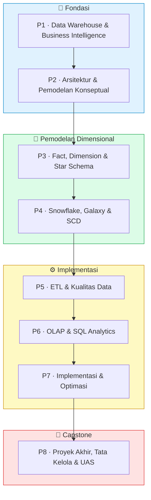

# 🏛️ Data Warehouse (IFR237)

Selamat datang di portal pembelajaran mata kuliah **Data Warehouse (`IFR237`)** untuk **Kelas RPL (Rekognisi Pembelajaran Lampau)**, Program Studi S-1 Informatika, Fakultas Sains dan Teknologi, Universitas Ubudiyah Indonesia.

Mata kuliah ini membekali mahasiswa dengan kemampuan **memahami dan merancang data warehouse** untuk mendukung Business Intelligence. Penekanan diberikan pada **cara berpikir konseptual**: mengapa data dipisahkan, bagaimana kebutuhan bisnis diterjemahkan menjadi model, dan mengapa suatu rancangan lebih tepat daripada alternatifnya. Praktik SQL dan tools diposisikan sebagai **verifikasi dan pengayaan**, bukan satu-satunya bukti kompetensi.

> **"A data warehouse is a subject-oriented, integrated, time-variant, and nonvolatile collection of data in support of management's decision-making process."**  
> — **Bill Inmon**

::: tip 🎙️ Slide Presentasi Interaktif
Setiap pertemuan dilengkapi **slide presentasi HTML interaktif** dengan navigasi keyboard, timer, transkrip, dan narasi audio. Buka **[Daftar Slide Data Warehouse](/presentasi/)** untuk mengakses kedelapan deck.
:::

::: info 📘 Buku Teori RPL
Bacaan utama kelas RPL tersedia di **[Buku Teori Data Warehouse untuk Kelas RPL](/datawarehouse/TEORI-RPL)** — delapan bab teori dengan analogi, studi kasus, dan pertanyaan refleksi.
:::

---

## 🏛️ Identitas Mata Kuliah

| Komponen | Keterangan |
| :--- | :--- |
| **Kode Mata Kuliah** | `IFR237` |
| **Nama Mata Kuliah** | Data Warehouse |
| **Bobot SKS** | **3 SKS** (2 SKS Teori / 1 SKS Praktikum) |
| **Semester / Tahun Akademik** | IV (Empat) / **2026 Ganjil** |
| **Kelas** | **RPL (Rekognisi Pembelajaran Lampau)** |
| **Program Studi** | S-1 Informatika |
| **Rumpun Mata Kuliah** | Basis Data & Sains Data |
| **Dosen Pengampu** | **Mahendar Dwi Payana, S.ST., M.T.** |
| **Prasyarat** | Basis Data (`IFR222`), Algoritma & Pemrograman, Statistika |
| **Sifat** | Wajib Program Studi |
| **Jumlah Pertemuan** | **8 pertemuan** (masing-masing 2×50' teori + 1×170' praktikum) |

---

## 🎓 Pendekatan Pembelajaran Kelas RPL

**RPL (Rekognisi Pembelajaran Lampau)** adalah jalur kuliah yang **mengakui pengalaman kerja, pelatihan nonformal/informal, atau pendidikan formal sebelumnya** sebagai Satuan Kredit Semester (SKS). Karena peserta RPL telah memiliki pengalaman nyata, kelas ini menekankan **pemahaman teori dan penalaran desain** sebelum keterampilan teknis.

| Prinsip | Penerapan di Mata Kuliah Ini |
| :--- | :--- |
| **Pengalaman sebagai sumber belajar** | Laporan, dashboard, atau gudang data yang pernah Anda kelola menjadi studi kasus |
| **Teori sebagai kerangka** | Setiap topik dimulai dari *mengapa* dan *trade-off*, bukan langsung SQL |
| **Praktik sebagai verifikasi** | Latihan SQL/ETL membuktikan pemahaman; bukan syarat tunggal |
| **Refleksi terstruktur** | Anda memetakan pengalaman kerja ke CPMK dan menjelaskan keputusan desain |
| **Fleksibel & kontekstual** | Studi kasus dapat disesuaikan dengan domain kerja Anda |
| **Etika & integritas** | Karya sendiri dan pengalaman nyata menjadi dasar penilaian |

> **Cara belajar yang dianjurkan:** baca **Buku Teori RPL** → hubungkan dengan pengalaman kerja → gunakan modul dan latihan untuk menguji pemahaman. Yang dinilai utama adalah kemampuan **menjelaskan alasan di balik rancangan**, bukan sekadar query yang berjalan.

---

## 🎯 Capaian Pembelajaran

### Capaian Pembelajaran Lulusan (CPL)

- **CPL01 (Pengetahuan):** Menguasai konsep basis data, pemodelan dimensional, arsitektur data warehouse, dan teknologi Business Intelligence.
- **CPL03 (Problem Solving):** Mampu menerjemahkan kebutuhan bisnis menjadi rancangan data warehouse yang tepat dan dapat dipertanggungjawabkan.
- **CPL04 (Solusi Rekayasa Komputasi):** Mampu membangun ETL, skema dimensional, query OLAP, dan optimasi performa pada platform data warehouse.
- **CPL05 (Inovasi & Analitik):** Mampu memanfaatkan data warehouse untuk analitik, pelaporan, dan pengambilan keputusan berbasis data.
- **CPL08 (Etika & Sikap):** Menerapkan tata kelola, kualitas data, keamanan, privasi, dan integritas akademik.

### Capaian Pembelajaran Mata Kuliah (CPMK)

| Kode | Rumusan CPMK | CPL |
| :--- | :--- | :--- |
| **CPMK 1** | Menjelaskan konsep data warehouse, Business Intelligence, OLTP vs OLAP, serta arsitektur dan evolusi platform data. | CPL01 |
| **CPMK 2** | Merancang model dimensional (fact, dimension, grain, star/snowflake) dan menangani perubahan dimensi (SCD). | CPL01, CPL03 |
| **CPMK 3** | Membangun pipeline ETL/ELT yang idempoten, teruji, dan menjaga kualitas data. | CPL03, CPL04 |
| **CPMK 4** | Mengimplementasikan query OLAP, optimasi performa, dan layanan BI pada data warehouse. | CPL04, CPL05 |
| **CPMK 5** | Menerapkan tata kelola, keamanan, privasi, dan menyajikan proyek data warehouse end-to-end. | CPL05, CPL08 |

---

## 🗺️ Peta Materi 8 Pertemuan



| Pertemuan | Topik | Fokus Praktikum |
| :---: | :--- | :--- |
| **1** | Data Warehouse & Business Intelligence | Menyiapkan PostgreSQL, eksplorasi data sumber, OLTP vs OLAP |
| **2** | Arsitektur & Pemodelan Konseptual | Bus matrix, requirement gathering, deklarasi grain |
| **3** | Fact, Dimension & Star Schema | Membuat skema bintang di PostgreSQL |
| **4** | Snowflake, Galaxy & SCD | Implementasi SCD Tipe 2 dan query point-in-time |
| **5** | ETL & Kualitas Data | ETL incremental, deduplikasi, quality checks |
| **6** | OLAP & SQL Analytics | Roll-up, drill-down, window functions, dashboard query |
| **7** | Implementasi & Optimasi | Index, partisi, materialized view, dbt |
| **8** | Proyek Akhir, Tata Kelola & UAS | Demo end-to-end, lineage, keamanan, evaluasi biaya |

---

## 🧪 Lingkungan Praktikum

| Komponen | Versi / Rekomendasi | Keterangan |
| :--- | :--- | :--- |
| **PostgreSQL** | 16+ | Database utama untuk latihan star schema & OLAP |
| **DBeaver / pgAdmin** | Terbaru | Client SQL |
| **Python** | 3.11+ | ETL, generasi data, pengujian |
| **pandas / SQLAlchemy / psycopg** | Terbaru | Ekstraksi & load data |
| **dbt-core + dbt-postgres** | 1.8+ | Transformasi & pengujian model |
| **Docker Desktop** | Terbaru | Menjalankan PostgreSQL & Metabase |
| **Metabase / Superset** | Opsional | Dashboard BI |
| **Git + GitHub** | Terbaru | Version control & kolaborasi |

```bash
# Menjalankan PostgreSQL dengan Docker
docker run -d --name dw-postgres \
  -e POSTGRES_PASSWORD=dw123 \
  -e POSTGRES_DB=retail_dw \
  -p 5432:5432 \
  -v "$PWD/pgdata:/var/lib/postgresql/data" \
  postgres:16

# Instalasi pustaka Python
python -m venv .venv
source .venv/bin/activate
pip install pandas sqlalchemy psycopg[binary] dbt-core dbt-postgres pytest
```

::: tip Alternatif Ringan
Jika laptop tidak sanggup Docker, gunakan **DuckDB** (`pip install duckdb`) dengan file lokal. SQL yang dipelajari hampir seluruhnya kompatibel; sesuaikan tipe data dan fitur partisi.
:::

---

## 📊 Komponen Penilaian

| Komponen | Bobot | Keterangan |
| :--- | :---: | :--- |
| Partisipasi, diskusi & refleksi pengalaman | **15%** | Kehadiran, argumentasi, refleksi pengalaman kerja |
| Tugas konseptual & studi kasus (T1–T5) | **30%** | 5 tugas, masing-masing 6%; fokus analisis & justifikasi |
| Ujian Tengah Semester (UTS) | **25%** | Studi kasus teori + rancangan model, take-home |
| Proyek Akhir (UAS) | **30%** | Rancangan/aplikasi terbatas + presentasi + laporan |
| **Total** | **100%** | |

> Penekanan penilaian: **pemahaman konsep dan penalaran desain (60%)**, **penerapan teknis (40%)**. Query yang berjalan tanpa penjelasan trade-off belum dianggap kompeten.

Rincian jadwal, rubrik, dan kebijakan tersedia pada halaman **[RPS OBE](/datawarehouse/RPS)**.

---

## 📚 Referensi Utama

1. **Ralph Kimball & Margy Ross** (2013). *The Data Warehouse Toolkit: The Definitive Guide to Dimensional Modeling* (3rd ed.). Wiley.
2. **W. H. Inmon** (2005). *Building the Data Warehouse* (4th ed.). Wiley.
3. **Christopher Adamson** (2010). *Star Schema: The Complete Reference*. McGraw-Hill.
4. **Matteo Golfarelli & Stefano Rizzi** (2018). *Data Warehouse Design: Modern Principles and Methodologies* (2nd ed.). McGraw-Hill.
5. **Joe Reis & Matt Housley** (2022). *Fundamentals of Data Engineering*. O'Reilly Media.
6. **Ralph Kimball & Margy Ross** (2013). *The Kimball Group Reader* (2nd ed.). Wiley.
7. Dokumentasi resmi: [PostgreSQL](https://www.postgresql.org/docs/), [dbt](https://docs.getdbt.com/), [DuckDB](https://duckdb.org/docs/), [Metabase](https://www.metabase.com/docs/).

---

## 🧭 Cara Menggunakan Modul

1. **Baca Buku Teori RPL lebih dulu** — pahami *mengapa* data warehouse ada dan *trade-off* desainnya.
2. **Hubungkan dengan pengalaman kerja** — gunakan laporan/dashboard yang pernah Anda buat atau gunakan.
3. **Baca modul pertemuan** — modul memperjelas teori dengan istilah, contoh, dan SQL.
4. **Gunakan latihan sebagai verifikasi** — tidak harus sempurna, tetapi harus dapat Anda jelaskan.
5. **Tulis refleksi singkat** — keputusan desain apa yang akan Anda ubah setelah mempelajari topik ini.
6. **Gunakan checklist** di akhir modul untuk menilai kesiapan Anda.

::: warning Integritas Akademik & Penggunaan AI
Kode dan laporan harus Anda pahami dan dapat dipertanggungjawabkan. Penggunaan asisten AI diperbolehkan sebagai alat bantu belajar, tetapi wajib dicantumkan pada bagian *Acknowledgements*. Plagiarisme kode maupun laporan dikenakan sanksi sesuai kebijakan akademik.
:::
