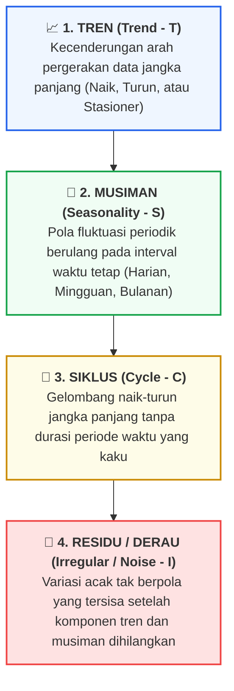
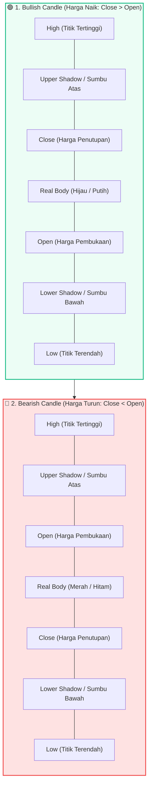

# 📘 Modul 11: Visualisasi Data Deret Waktu (Time Series) & Finansial

::: tip 📈 Versi kanvas interaktif
Materi minggu ini tersedia sebagai **kanvas visual interaktif 8 tahap**: dari sinyal vs derau, 4 komponen deret waktu, model Aditif vs Multiplikatif, resampling, pemulusan SMA 7/30, dekomposisi Statsmodels, hingga anatomi & dashboard Candlestick OHLC.

[**Buka Kanvas Interaktif Minggu 11 →**](/visualisasi-data/canvas-minggu-11)
:::

## 🎯 Capaian Pembelajaran (Sub-CPMK 3)
Setelah mempelajari modul ini, mahasiswa diharapkan mampu:
1. Membedakan 4 komponen fundamental data deret waktu: **Tren (*Trend*)**, **Musiman (*Seasonality*)**, **Siklus (*Cycle*)**, dan **Residu (*Residual/Noise*)** serta memilih model **Aditif** atau **Multiplikatif**.
2. Melakukan manipulasi indeks temporal (`DatetimeIndex`, *resampling* harian/mingguan/bulanan) dan pemulusan data (*Data Smoothing*) menggunakan **SMA** & **EMA** beserta pita volatilitasnya.
3. Merancang **Line Chart Multi-Skala** (termasuk normalisasi indeks/basis 100) dan **Stacked Area Chart** untuk menunjukkan kontribusi komponen sepanjang waktu.
4. Melakukan serta menginterpretasikan dekomposisi deret waktu 4 panel menggunakan **Statsmodels** dan mengidentifikasi periode musiman lewat **Seasonal Subseries** serta **Autocorrelation Function (ACF)**.
5. Membangun visualisasi pasar modal profesional: **Candlestick Chart (OHLC)**, indikator **MA20 / Bollinger Bands**, dan **Volume Subplot** berbasis **Plotly**.

---

## 1. Empat Komponen Fundamental Data Deret Waktu

Data deret waktu (*time series*) adalah urutan pengamatan yang dicatat secara kronologis pada interval waktu yang seragam:



### Model Matematis Dekomposisi: Aditif vs Multiplikatif

| Aspek Pembanding | Model Aditif (*Additive*) | Model Multiplikatif (*Multiplicative*) |
| :--- | :--- | :--- |
| **Persamaan** | `Y(t) = T(t) + S(t) + C(t) + I(t)` | `Y(t) = T(t) × S(t) × C(t) × I(t)` |
| **Lebar Ayunan Musiman** | Relatif konstan meski level tren naik/turun | Melebar/menyempit proporsional mengikuti level tren |
| **Bentuk Pita Visual** | Sejajar (*parallel band*) | Mengembang seperti kipas (*fanning out*) |
| **Contoh Kasus Nyata** | Suhu harian kota sepanjang tahun (°C) | Jumlah penumpang pesawat atau omzet e-commerce tahunan |
| **Parameter Statsmodels** | `model="additive"` | `model="multiplicative"` |

---

## 2. Grafik Tren Multi-Skala, Stacked Area & Pemulusan

### A. Menangani Line Chart Multi-Skala
Ketika membandingkan dua atau lebih deret waktu dengan satuan atau magnitudo jauh berbeda (misalnya **Harga Saham (Rp)** vs **Volume Transaksi (lembar)** atau **Suhu (°C)** vs **Konsumsi Listrik (kWh)**), menaruhnya pada satu sumbu Y mentah akan menggepengkan seri yang nilainya lebih kecil. Tiga pendekatan utamanya:

1. **Indexed Line Chart (Basis = 100):** Mengubah seluruh seri menjadi pertumbuhan relatif terhadap titik awal (`(nilai / nilai_awal) × 100`). Paling jujur untuk membandingkan laju pertumbuhan antar aset atau metrik.
2. **Small Multiples / Subplot Vertikal (`sharex=True`):** Memisahkan tiap seri ke panel sendiri dengan sumbu waktu terkunci (dipakai pada dashboard *Candlestick + Volume*).
3. **Dual-Axis Chart (`twinx()`):** Dua sumbu Y kiri-kanan. Gunakan dengan sangat hati-hati karena manipulasi rentang salah satu sumbu dapat menciptakan ilusi korelasi atau persilangan palsu.

### B. Stacked Area Chart untuk Komposisi Temporal
**Stacked Area Chart** menumpuk beberapa deret waktu di atas satu sama lain untuk memperlihatkan **total agregat** sekaligus **kontribusi masing-masing kategori** dari waktu ke waktu (misalnya trafik situs dari *Organic*, *Social*, dan *Direct*).

::: warning ⚠️ Kapan Tidak Memakai Stacked Area?
* Jangan dipakai jika data mengandung nilai negatif.
* Sulit membaca tren individu pada lapisan tengah/atas karena garis dasarnya ikut bergelombang mengikuti lapisan di bawahnya—letakkan seri yang paling stabil di lapisan paling bawah, atau gunakan **100% Stacked Area** bila fokus utamanya adalah proporsi relatif.
:::

### C. Manipulasi Indeks Temporal (`DatetimeIndex` & `resample()`)
Sebelum memvisualisasikan deret waktu di Pandas, pastikan kolom tanggal bertipe `datetime64` dan dijadikan indeks (`set_index()`).

| Operasi | Tujuan | Contoh Sintaks Pandas |
| :--- | :--- | :--- |
| **Downsampling** | Meringkas data rapat (harian → mingguan/bulanan) agar tren bersih | `df['Suhu'].resample('W').mean()` / `resample('ME').sum()` |
| **OHLC Resampling** | Membentuk batang harga *Open-High-Low-Close* dari data *tick*/harian | `df['Harga'].resample('W').ohlc()` |
| **Upsampling** | Menaikkan frekuensi (bulanan → harian) + mengisi celah | `df.resample('D').ffill()` atau `.interpolate()` |

### D. Pemulusan Data: SMA vs EMA
* **Simple Moving Average (SMA):** Rata-rata bergerak dengan bobot sama rata pada jendela `N` periode terakhir (`rolling(window=N).mean()`). Efektif meredam *noise* untuk melihat tren mulus, tetapi responsnya sedikit tertinggal (*lag*) saat terjadi pembalikan arah mendadak.
* **Exponential Moving Average (EMA):** Rata-rata bergerak dengan bobot eksponensial lebih besar pada pengamatan terbaru (`ewm(span=N, adjust=False).mean()`). Lebih cepat merespons perubahan tren jangka pendek sehingga populer pada analisis finansial dan pemantauan anomali.

---

## 3. Mengidentifikasi Musiman: Seasonal Subseries & ACF

Sebelum memanggil fungsi dekomposisi seperti `seasonal_decompose(..., period=P)`, analis perlu menentukan nilai `period` berdasarkan bukti data, bukan sekadar tebakan:

1. **Seasonal Subseries Plot:** Mengelompokkan data berdasarkan unit siklusnya (misalnya semua data bulan Januari, Februari, ..., Desember) lalu memplot garis rata-rata tiap kelompok. Dari sini langsung terlihat bulan mana yang menjadi puncak musim (*Peak Season*) dan apakah polanya bergeser dari tahun ke tahun.
2. **Autocorrelation Function (ACF):** Mengukur korelasi deret waktu dengan dirinya sendiri pada berbagai pergeseran waktu (*lag* `1, 2, ..., k`). Puncak korelasi berulang pada lag kelipatan tertentu (misalnya `lag = 7` untuk data harian berpola mingguan, atau `lag = 12` untuk data bulanan berpola tahunan) menjadi dasar objektif penentuan `period`.

---

## 4. Anatomi Grafik Candlestick Finansial (OHLC)

Grafik Candlestick meringkas 4 titik harga aset finansial dalam satu batang waktu (*Open, High, Low, Close*):



| Elemen Candlestick | Makna Analitis Pasar |
| :--- | :--- |
| **Real Body** (`\|Close - Open\|`) | Tekanan beli/jual bersih; badan panjang menunjukkan dominasi satu sisi |
| **Upper & Lower Shadow** | Rentang volatilitas *intraday* (`High` ke `Low`); sumbu panjang menandakan penolakan harga |
| **MA20 & Bollinger Bands** | `MA20 ± 2 × STD20` menggambarkan batas normal volatilitas harga |
| **Volume Subplot** | Mengonfirmasi kekuatan pergerakan harga (kenaikan harga + volume tinggi = sinyal lebih kuat) |

---

## 5. Implementasi Kode Hands-on Python

Keempat skrip di bawah ini disusun berurutan dan dapat dijalankan mandiri (cukup jalankan blok impor pada Praktikum 1 terlebih dahulu):

### Praktikum 1: Resampling & Pemulusan Data (SMA, EMA, dan Pita ±1σ)

```python
import pandas as pd
import numpy as np
import matplotlib.pyplot as plt

plt.rcParams['figure.dpi'] = 200

# Generate data sensor IoT harian (365 hari) dengan tren + musiman 30 hari + noise
np.random.seed(42)
tanggal = pd.date_range(start="2024-01-01", periods=365, freq="D")
tren = np.linspace(20, 35, 365)
musiman = 5 * np.sin(2 * np.pi * np.arange(365) / 30)  # Siklus ~30 hari
noise = np.random.normal(0, 2.5, 365)
suhu_harian = tren + musiman + noise

df_sensor = pd.DataFrame({"Tanggal": tanggal, "Suhu": suhu_harian}).set_index("Tanggal")

# Hitung SMA 7, EMA 14, SMA 30, dan Standar Deviasi 30 hari
df_sensor['SMA_7'] = df_sensor['Suhu'].rolling(window=7, center=True).mean()
df_sensor['EMA_14'] = df_sensor['Suhu'].ewm(span=14, adjust=False).mean()
df_sensor['SMA_30'] = df_sensor['Suhu'].rolling(window=30, center=True).mean()
df_sensor['STD_30'] = df_sensor['Suhu'].rolling(window=30, center=True).std()

fig, ax = plt.subplots(figsize=(11, 5))

ax.plot(df_sensor.index, df_sensor['Suhu'], color='#cbd5e1', linewidth=1, alpha=0.7, label='Data Mentah Harian')
ax.plot(df_sensor.index, df_sensor['SMA_7'], color='#38bdf8', linewidth=1.4, label='SMA 7-Hari')
ax.plot(df_sensor.index, df_sensor['EMA_14'], color='#f59e0b', linewidth=1.6, linestyle='--', label='EMA 14-Hari (Responsif)')
ax.plot(df_sensor.index, df_sensor['SMA_30'], color='#0284c7', linewidth=2.5, label='Tren Utama SMA 30-Hari')

# Pita Volatilitas ± 1 Std Deviasi dari SMA 30
ax.fill_between(
    df_sensor.index,
    df_sensor['SMA_30'] - df_sensor['STD_30'],
    df_sensor['SMA_30'] + df_sensor['STD_30'],
    color='#0284c7', alpha=0.15, label='Pita Volatilitas (±1σ)'
)

ax.set_title("Pemulusan Suhu Sensor IoT: SMA vs EMA & Pita Volatilitas", fontsize=12, fontweight='bold', pad=14, loc='left')
ax.set_ylabel("Suhu Ruang (°C)", fontweight='medium')
ax.spines['top'].set_visible(False)
ax.spines['right'].set_visible(False)
ax.legend(frameon=False, loc='upper left', ncol=2)
ax.grid(axis='y', linestyle=':', alpha=0.6)

plt.tight_layout()
plt.show()
```

### Praktikum 2: Dekomposisi 4 Komponen (`Statsmodels`) & Plot Autokorelasi (ACF)

```python
from statsmodels.tsa.seasonal import seasonal_decompose
from statsmodels.graphics.tsaplots import plot_acf

# Resample ke rata-rata mingguan (~52 minggu); periode musiman 30 hari ≈ 4 minggu
df_weekly = df_sensor['Suhu'].resample('W').mean().interpolate()
hasil_dekomposisi = seasonal_decompose(df_weekly, model='additive', period=4)

fig, axes = plt.subplots(4, 1, figsize=(10, 8), sharex=True)

axes[0].plot(hasil_dekomposisi.observed, color='#0f172a', linewidth=1.5)
axes[0].set_ylabel('Observed', fontweight='bold')

axes[1].plot(hasil_dekomposisi.trend, color='#0284c7', linewidth=2)
axes[1].set_ylabel('Trend', fontweight='bold')

axes[2].plot(hasil_dekomposisi.seasonal, color='#10b981', linewidth=1.5)
axes[2].set_ylabel('Seasonal', fontweight='bold')

axes[3].scatter(hasil_dekomposisi.resid.index, hasil_dekomposisi.resid, color='#ef4444', s=18, alpha=0.85)
axes[3].axhline(0, color='gray', linestyle='--', linewidth=1)
axes[3].set_ylabel('Residual', fontweight='bold')

for ax in axes:
    ax.spines['top'].set_visible(False)
    ax.spines['right'].set_visible(False)
    ax.grid(axis='y', linestyle=':', alpha=0.4)

plt.suptitle("Dekomposisi Aditif 4 Panel Deret Waktu Sensor IoT (period=4 minggu)", fontsize=13, fontweight='bold', y=0.98)
plt.tight_layout()
plt.show()

# Cek Autokorelasi (ACF) pada data mingguan untuk memvalidasi pola lag berulang
fig_acf, ax_acf = plt.subplots(figsize=(9, 3.5))
plot_acf(df_weekly.dropna(), lags=20, ax=ax_acf, color='#0284c7')
ax_acf.set_title("Plot Autokorelasi (ACF) Data Mingguan", fontsize=11, fontweight='bold', loc='left')
ax_acf.spines['top'].set_visible(False)
ax_acf.spines['right'].set_visible(False)
plt.tight_layout()
plt.show()
```

### Praktikum 3: Line Chart Multi-Skala (Indexed Base 100) & Stacked Area Chart

```python
# Simulasi trafik bulanan 3 kanal pemasaran selama 12 bulan
bulan = pd.date_range("2024-01-01", periods=12, freq="MS")
df_trafik = pd.DataFrame({
    "Organic": [1200, 1280, 1350, 1420, 1550, 1620, 1710, 1800, 1890, 1980, 2120, 2300],
    "Social":  [400,  460,  510,  490,  620,  680,  710,  790,  830,  910,  1050, 1180],
    "Direct":  [300,  310,  325,  330,  345,  360,  370,  385,  395,  410,  430,  460],
}, index=bulan)

# Normalisasi ke Indeks Basis 100 (bulan pertama = 100) untuk perbandingan multi-skala yang adil
df_indexed = df_trafik.div(df_trafik.iloc[0]) * 100

fig, (ax1, ax2) = plt.subplots(1, 2, figsize=(13, 4.8))

# Panel Kiri: Indexed Line Chart (laju pertumbuhan relatif)
for col, col_hex in zip(["Organic", "Social", "Direct"], ["#0284c7", "#10b981", "#f59e0b"]):
    ax1.plot(df_indexed.index, df_indexed[col], marker='o', markersize=4, linewidth=2, color=col_hex, label=col)
ax1.axhline(100, color='#94a3b8', linestyle='--', linewidth=1)
ax1.set_title("Perbandingan Laju Pertumbuhan (Basis 100 = Jan)", fontsize=11, fontweight='bold', loc='left')
ax1.set_ylabel("Indeks Pertumbuhan")
ax1.legend(frameon=False, loc='upper left')
ax1.spines['top'].set_visible(False)
ax1.spines['right'].set_visible(False)
ax1.grid(axis='y', linestyle=':', alpha=0.5)

# Panel Kanan: Stacked Area Chart (komposisi total trafik)
ax2.stackplot(
    df_trafik.index,
    df_trafik["Direct"], df_trafik["Social"], df_trafik["Organic"],
    labels=["Direct (stabil di bawah)", "Social", "Organic"],
    colors=["#fde68a", "#a7f3d0", "#bae6fd"],
    edgecolor="#334155", linewidth=0.6, alpha=0.9
)
ax2.set_title("Komposisi Total Trafik Bulanan (Stacked Area)", fontsize=11, fontweight='bold', loc='left')
ax2.set_ylabel("Jumlah Kunjungan")
ax2.legend(frameon=False, loc='upper left')
ax2.spines['top'].set_visible(False)
ax2.spines['right'].set_visible(False)
ax2.grid(axis='y', linestyle=':', alpha=0.5)

plt.tight_layout()
plt.show()
```

### Praktikum 4: Candlestick Finansial Interaktif, Bollinger Bands & Volume (Plotly)

```python
import plotly.graph_objects as go
from plotly.subplots import make_subplots

# Simulasi data pasar saham harian (60 hari bursa)
np.random.seed(10)
dates_stock = pd.date_range("2024-01-01", periods=60, freq="B")
base_price = 1000 + np.cumsum(np.random.randn(60) * 10)
open_p = base_price + np.random.uniform(-5, 5, 60)
close_p = open_p + np.random.uniform(-15, 15, 60)
high_p = np.maximum(open_p, close_p) + np.random.uniform(2, 10, 60)
low_p = np.minimum(open_p, close_p) - np.random.uniform(2, 10, 60)
volume = np.random.randint(100000, 800000, size=60)

df_saham = pd.DataFrame({
    'Tanggal': dates_stock, 'Open': open_p, 'High': high_p,
    'Low': low_p, 'Close': close_p, 'Volume': volume
})

# Hitung MA20 dan Bollinger Bands (±2σ)
df_saham['MA20'] = df_saham['Close'].rolling(window=20).mean()
df_saham['STD20'] = df_saham['Close'].rolling(window=20).std()
df_saham['BB_Upper'] = df_saham['MA20'] + 2 * df_saham['STD20']
df_saham['BB_Lower'] = df_saham['MA20'] - 2 * df_saham['STD20']

fig_stock = make_subplots(
    rows=2, cols=1, shared_xaxes=True, vertical_spacing=0.05,
    subplot_titles=("Pergerakan Harga Saham (Candlestick, MA20 & Bollinger ±2σ)", "Volume Transaksi Harian"),
    row_heights=[0.75, 0.25]
)

# Pita Bollinger (Upper & Lower fill)
fig_stock.add_trace(
    go.Scatter(x=df_saham['Tanggal'], y=df_saham['BB_Upper'], line=dict(color='rgba(245,158,11,0.35)', width=1), name="BB Upper (+2σ)"),
    row=1, col=1
)
fig_stock.add_trace(
    go.Scatter(
        x=df_saham['Tanggal'], y=df_saham['BB_Lower'],
        line=dict(color='rgba(245,158,11,0.35)', width=1),
        fill='tonexty', fillcolor='rgba(245,158,11,0.10)',
        name="BB Lower (-2σ)"
    ), row=1, col=1
)

# Candlestick & Garis MA20
fig_stock.add_trace(
    go.Candlestick(
        x=df_saham['Tanggal'],
        open=df_saham['Open'], high=df_saham['High'],
        low=df_saham['Low'], close=df_saham['Close'],
        increasing_line_color='#10b981', decreasing_line_color='#ef4444',
        name="OHLC"
    ), row=1, col=1
)
fig_stock.add_trace(
    go.Scatter(x=df_saham['Tanggal'], y=df_saham['MA20'], name="MA20", line=dict(color="#f59e0b", width=2)),
    row=1, col=1
)

# Bar Volume berwarna senada
colors_volume = ['#10b981' if c >= o else '#ef4444' for o, c in zip(df_saham['Open'], df_saham['Close'])]
fig_stock.add_trace(
    go.Bar(x=df_saham['Tanggal'], y=df_saham['Volume'], marker_color=colors_volume, name="Volume"),
    row=2, col=1
)

fig_stock.update_layout(
    template="plotly_white",
    xaxis_rangeslider_visible=False,
    height=640,
    title="Dashboard Analitik Finansial Candlestick Saham"
)
# Sembunyikan celah akhir pekan (Sabtu–Minggu) pada grafik pasar saham
fig_stock.update_xaxes(rangebreaks=[dict(bounds=["sat", "mon"])])

fig_stock.write_html("candlestick_stock.html")
print("✅ Berkas 'candlestick_stock.html' berhasil disimpan.")
```

---

## 6. Jebakan Umum (*Pitfalls*) Visualisasi Deret Waktu

| Kesalahan Umum | Dampak Visual | Solusi Praktis |
| :--- | :--- | :--- |
| **Dual-Axis dengan rentang sumbu sembarangan** | Menciptakan kesan korelasi atau titik potong palsu | Gunakan *Indexed Chart (Basis 100)* atau *Small Multiples* terpisah |
| **Rasio aspek terlalu pipih/tinggi** | Tren terlihat datar sekali atau terlalu ekstrem (*banking bias*) | Jaga proporsi kemiringan garis rata-rata mendekati ~45° |
| **Celah akhir pekan di grafik saham harian** | Candlestick tampak renggang dan terputus setiap Senin | Aktifkan `rangebreaks=[dict(bounds=["sat", "mon"])]` di Plotly |
| **Memakai model Aditif pada tren yang melebar** | Komponen residual masih menyisakan pola kipas berulang | Beralih ke `model='multiplicative'` atau transformasi `np.log()` |

---

## 7. Rangkuman & Latihan Mandiri

::: tip 💡 Rangkuman Konsep Kunci
1. **Pemisahan Sinyal & Derau (*Signal vs Noise*):** Gunakan *SMA* untuk membaca tren jangka panjang yang halus dan *EMA* untuk merespons pembalikan arah lebih cepat.
2. **Model Dekomposisi & ACF:** Gunakan model *Additive* jika ayunan musiman konstan, *Multiplicative* jika melebar mengikuti tren, serta validasi `period=` menggunakan plot **ACF** sebelum menjalankan `seasonal_decompose`.
3. **Multi-Skala & Komposisi:** Pakai *Indexed Line Chart (Basis 100)* untuk membandingkan laju seri berbeda skala, dan *Stacked Area* untuk menampilkan total agregat beserta kontribusi tiap kategori.
4. **Candlestick OHLC + Volume:** Menyajikan 4 dimensi harga per periode beserta pita volatilitas **Bollinger Bands** dan konfirmasi kekuatan tren dari bar **Volume**.
:::

### 📝 Tugas Praktikum 11 (Mandiri — Tugas 6 RPS)
1. **Dekomposisi & Validasi ACF:** Ambil dataset publik deret waktu bulanan (misalnya *Air Passengers* atau penjualan ritel e-commerce). Lakukan **plot ACF** untuk membuktikan periode musimannya, jalankan `seasonal_decompose` dengan model yang tepat (*Additive* vs *Multiplicative*), dan tentukan bulan *Peak Season*-nya.
2. **Perbandingan Multi-Skala & Stacked Area:** Buat visualisasi 2 panel dari minimal 3 metrik atau kategori deret waktu: satu panel **Indexed Line Chart (Basis 100)** untuk membandingkan laju pertumbuhan, dan satu panel **Stacked Area Chart** untuk menunjukkan kontribusi totalnya.
3. **Dashboard Finansial Lengkap:** Modifikasi skrip Praktikum 4 menggunakan data historis saham riil (misalnya dari `yfinance`) selama minimal 6 bulan, lengkapi dengan **Candlestick OHLC**, **MA20**, **Bollinger Bands (±2σ)**, **Volume**, serta penghapusan celah akhir pekan (`rangebreaks`).
